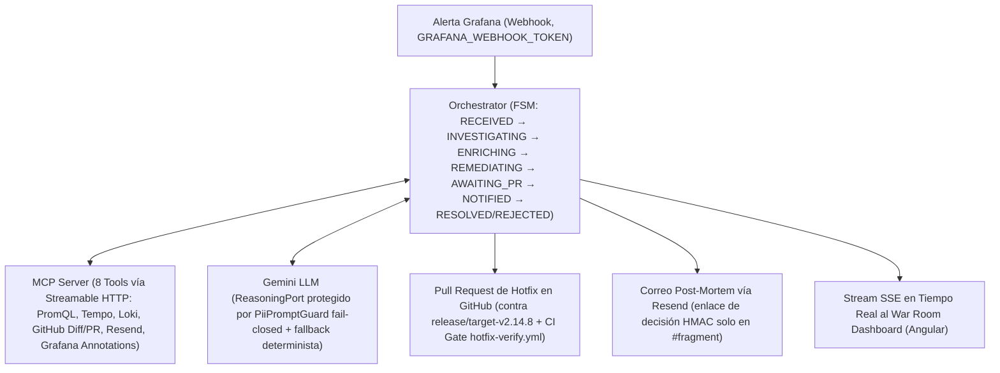

# ⚡ ZeroMTTR — Remediación Autónoma de Incidentes y Gobernanza Humana

> **Read in English:** [README.md](./README.md) | **Leia em Português:** [README.pt-BR.md](./README.pt-BR.md)  
> **Track:** Logística y Automatización (_Automatización de flujos de trabajo operativos e integraciones entre sistemas críticos_)  
> **Organización:** AGJ Works ([https://agjworks.com](https://agjworks.com))  
> **Repositorio:** [https://github.com/AdmilsonGoncalves/zeromttr](https://github.com/AdmilsonGoncalves/zeromttr)  
> **Demo Pública:** [https://zeromttr.agjworks.com](https://zeromttr.agjworks.com)

---

## 1. Visión General y Posicionamiento

En sistemas distribuidos de misión crítica — como liquidación de pagos instantáneos (PIX), logística de despacho, checkout de comercio electrónico o facturación — el tiempo medio entre la alerta y una corrección revisable está dominado por el cambio manual de contexto entre métricas, trazas, logs y diffs en Git.

**ZeroMTTR** es una plataforma autónoma de AIOps y remediación de incidentes que conecta observabilidad, análisis de código y gobernanza humana en un solo flujo:

- **Agnóstico al servicio monitorizado:** funciona con cualquier aplicación que emita telemetría OpenTelemetry y cuente con un repositorio en GitHub (extensible a otros proveedores Git), sin modificar el núcleo de la plataforma.
- **Monitorización activa o pasiva:** se integra con servicios cooperativos mediante un manifiesto de salud o monitoriza servicios externos/legados de forma pasiva vía Prometheus, sin requerir endpoints personalizados en la aplicación objetivo.
- **Configuración en tiempo real con auditoría:** las políticas operativas (ventanas de cooldown, modelos de IA, parámetros del objetivo y nivel de log) se ajustan directamente desde la interfaz, con persistencia local, historial de cambios y control de acceso.

### Comparativa con Soluciones de AIOps / AI-SRE

| Capacidad                          | HolmesGPT / OpenSRE                                   | Datadog Bits AI / Sentry Seer                 | ZeroMTTR                                                                                                                                  |
| :--------------------------------- | :---------------------------------------------------- | :-------------------------------------------- | :---------------------------------------------------------------------------------------------------------------------------------------- |
| **Despliegue y Protocolo**         | Self-hosted (CLI / ChatOps)                           | SaaS propietario en la nube                   | **100% Self-Hosted y Open Source**, exponiendo un contrato abierto **Model Context Protocol (MCP)** sobre HTTP                            |
| **Protección PII en Borde (LGPD)** | Sin pipeline nativo en borde para PII brasileña / PIX | Telemetría procesada en la nube del proveedor | **Doble barrera:** redacción de datos sensibles en el borde antes del almacenamiento + guardia _fail-closed_ antes de enviar al LLM       |
| **Telemetría FinOps de Payload**   | Dumps brutos de contexto                              | Facturación gestionada en el SaaS             | Sumarización determinista y truncamiento de evidencias con seguimiento de payload bruto vs. compactado y estimación de tokens ahorrados   |
| **Gobernanza de Remediación**      | Scripts ad-hoc o sugerencias por ChatOps              | PR / sugerencias propietarias                 | **Pull Request de hotfix** contra la rama de release + **validación automática en CI** + **aprobación humana firmada enviada por correo** |
| **Resiliencia sin LLM**            | Depende del LLM configurado                           | Dependiente del SaaS en la nube               | Diagnóstico con **fallback determinista explícito** cuando el LLM no está disponible o es bloqueado por la guardia de privacidad          |

### Cómo Funciona la Demo Interactiva

Desde el panel **Demostración** en el War Room puedes probar la plataforma en dos modos sobre el servicio de ejemplo **`api-pagamentos-core`** (mientras el panel **Configuración**, siempre visible en el icono de engranaje, permite consultar y ajustar políticas operativas e historial de cambios sin reiniciar la pila):

1. **Modo `Replay` (predeterminado público):**
   - Reproduce en tiempo real la línea temporal de una ejecución real grabada, sin consumir cuotas de APIs externas (Gemini, GitHub o Resend).
2. **Modo `Live` (ejecución real de extremo a extremo, con clave de evaluación o Docker local):**
   1. **Inyección de fallo:** activa una degradación controlada del pool de conexiones en el servicio de ejemplo (`v2.14.7` → `v2.14.8`), simulando agotamiento bajo carga concurrente.
   2. **Tráfico sintético con PII ficticia:** envía solicitudes simuladas de PIX con datos sintéticos (CPF, CNPJ, correo y token) para demostrar el enmascaramiento de privacidad.
   3. **Observabilidad y alerta:** la saturación genera errores y picos de latencia en Prometheus, trazas de error en Tempo y logs enmascarados en el borde antes de llegar a Loki; Grafana detecta la anomalía y alerta al orquestador.
   4. **Diagnóstico y remediación autónoma:** el orquestador correlaciona métricas, trazas, logs y el diff entre versiones mediante el servidor MCP, verifica la ausencia de fugas de PII, sintetiza causa raíz y parche, abre un Pull Request real en GitHub y envía el informe post-mortem por correo con enlace firmado de aprobación.
   5. **Restauración:** limpia el estado de caos y devuelve el servicio de ejemplo a su versión saludable (`v2.14.7`).

> Los detalles de arquitectura, contratos de API, variables de entorno y decisiones técnicas están documentados en [`docs/es-ES/`](./docs/es-ES/00_architecture_master.md).

---

## 2. Arquitectura y Pipeline Autónomo



---

## 3. Transparencia Técnica y Límites del MVP

Para mantener una evaluación honesta y auditable, ZeroMTTR documenta explícitamente los límites del MVP actual:

1. **Modo `Live` vs. Modo `Replay` en la Demo Pública (`https://zeromttr.agjworks.com`):**
   - Los visitantes anónimos en la demo pública experimentan el **Modo `Replay`** por defecto, reproduciendo una instantánea grabada de una ejecución real (`data/last-recorded-incident.json`) para proteger las cuotas externas de LLM, GitHub y correo.
   - Para ejecutar el **Modo `Live`** de extremo a extremo (razonamiento real con Gemini, PR real en GitHub y correo real con Resend), ejecute localmente con `docker compose up -d` usando sus propias claves en `.env`, o desbloquee el Modo Live en la instancia pública con `LIVE_DEMO_KEY` (dedicada a evaluación y rotada inmediatamente tras el período de evaluación).
2. **Frontera de Gobernanza — PR Verificado por CI + Aprobación Humana (Sin Auto-Merge / Auto-Redespliegue):**
   - El ciclo autónomo se detiene intencionadamente al abrir un **Pull Request de hotfix verificado por CI** (`.github/workflows/hotfix-verify.yml`) y registrar una **decisión humana firmada criptográficamente** (`approve` / `reject` mediante enlace HMAC `#fragment` entregado exclusivamente por correo).
   - ZeroMTTR **no** realiza auto-merge en `master` ni redespliega automáticamente contenedores en producción.
3. **Estimación FinOps y Alcance del Enmascaramiento de PII:**
   - **Métrica FinOps:** mide la reducción de payload lograda mediante sumarización y truncamiento de política en MCP (`rawBytesFetched` vs. `compactedBytesSentToLlm`), usando una estimación proporcional conservadora de `Math.round(bytesSaved / 4)` tokens en lugar de un conteo específico de tokenizador de proveedor.
   - **Protección PII:** cubre los **5 tipos oficiales de clave PIX del Banco Central de Brasil (BACEN)** — **CPF** y **CNPJ** (validados con dígitos verificadores Módulo-11 de la Receita Federal), **teléfonos móviles y fijos** (reglas de ANATEL), **direcciones de correo estándar sin comillas** (`[A-Za-z0-9._%+-]+@dominio`, excluyendo formas entrecomilladas como direcciones con espacios) y **claves PIX aleatorias (EVP / UUID v4 RFC 4122 en contexto PIX)** — además de **tokens JWT / `Bearer`**. Los UUID técnicos (como `request_id` / `trace_id`), las partes locales entrecomilladas de correo y los nombres propios no estructurados en texto libre quedan intencionadamente fuera del alcance determinista de regex/validador.

---

## 4. Conexión de un Cliente MCP Externo (`.mcp.json`)

`apps/mcp-server` implementa el estándar **Model Context Protocol (MCP)** sobre Streamable HTTP (`POST /mcp`). Cualquier cliente compatible con MCP (**MCP Inspector**, **Claude Code**, **Claude Desktop**, **Cursor**) puede conectarse directamente. El archivo [`.mcp.json`](./.mcp.json) de la raíz proporciona la configuración base:

```json
{
  "mcpServers": {
    "zeromttr-aiops": {
      "type": "http",
      "url": "http://localhost:8000/mcp",
      "headers": {
        "Authorization": "Bearer ${MCP_AUTH_TOKEN}"
      }
    }
  }
}
```

> **Nota para usuarios de Cursor:** Cursor lee las definiciones MCP de proyecto desde `.cursor/mcp.json` (no autodescubre el `.mcp.json` de la raíz) y usa `${env:MCP_AUTH_TOKEN}` para interpolación de entorno:
>
> ```json
> {
>   "mcpServers": {
>     "zeromttr-aiops": {
>       "url": "http://localhost:8000/mcp",
>       "headers": {
>         "Authorization": "Bearer ${env:MCP_AUTH_TOKEN}"
>       }
>     }
>   }
> }
> ```
>
> Asegúrese de que `MCP_AUTH_TOKEN` esté exportada en el entorno de su proceso cliente MCP — copiar `.env` por sí solo no exporta variables a clientes externos.

### Herramientas MCP Expuestas (8)

| Categoría      | Herramienta                 | Propósito                                                                   |
| :------------- | :-------------------------- | :-------------------------------------------------------------------------- |
| Métricas       | `execute_promql_range`      | Consulta métricas de rango en Prometheus y devuelve estadísticas resumidas  |
| Trazas         | `search_traces_by_traceql`  | Encuentra trazas anómalas en Tempo mediante TraceQL                         |
| Trazas         | `analyze_otel_trace`        | Extrae la ruta crítica y spans con error para un `traceId` dado             |
| Logs           | `query_loki_logs`           | Obtiene logs redactados en borde desde Loki con truncamiento de política    |
| Código         | `inspect_git_deploy_diff`   | Inspecciona el diff real en GitHub entre las etiquetas base y degradada     |
| Remediación    | `create_remediation_pr`     | Crea una rama `hotfix/*` y abre un Pull Request contra la rama de release   |
| Notificación   | `send_post_mortem_resend`   | Envía el correo post-mortem con enlaces de decisión HMAC en `#fragment`     |
| Observabilidad | `annotate_grafana_incident` | Publica anotaciones del ciclo de vida del incidente directamente en Grafana |

Prueba rápida con MCP Inspector (después de iniciar la pila local):

```bash
export MCP_AUTH_TOKEN="$(grep '^MCP_AUTH_TOKEN=' .env | cut -d= -f2-)"
npx @modelcontextprotocol/inspector
# Conectar vía Streamable HTTP a http://localhost:8000/mcp con cabecera:
# Authorization: Bearer <MCP_AUTH_TOKEN>
```

---

## 5. Escenario Determinista de Demo (`v2.14.7` vs. `v2.14.8`)

Para reproducir Pull Requests reales de forma determinista sin romper nunca `master`:

- **Tag `v2.14.7` (en `master`):** Línea base saludable de `apps/target-app-demo` (`api-pagamentos-core`) con configuración de pool de conexiones dimensionada correctamente. `master` permanece siempre en verde.
- **Tag `v2.14.8` (en la rama `release/target-v2.14.8`):** Regresión controlada en `apps/target-app-demo/src/repositories/payment.repository.ts` que introduce agotamiento del pool de conexiones (`KnexTimeoutError`).
- Cuando se dispara un incidente, ZeroMTTR inspecciona el diff real `v2.14.7...v2.14.8`, genera un parche mínimo de remediación, abre un Pull Request apuntando a **`release/target-v2.14.8`** y dispara [`.github/workflows/hotfix-verify.yml`](./.github/workflows/hotfix-verify.yml), que ejecuta la suite de pruebas objetivo y comenta `✅ ZeroMTTR Autonomous CI Gate: PASSED`.

---

## 6. Línea Base Medida (TTD / TTPR y Estabilidad LGTM)

El protocolo de medición y los scripts de verificación están documentados en [07_demo_and_delivery.md](./docs/es-ES/tech/07_demo_and_delivery.md).

Frente a la línea base manual de 7 pasos (1. triaje de alerta → 2. consulta PromQL → 3. inspección de exemplar/traza en Tempo → 4. correlación de logs en Loki → 5. `git diff v2.14.7...v2.14.8` → 6. editar y probar corrección → 7. abrir PR y redactar post-mortem):

| Modo de Ejecución                                                              | TTD (`RECEIVED -> REMEDIATING`) | TTPR (`RECEIVED -> AWAITING_PR`) | Post-Mortem (`RECEIVED -> NOTIFIED`)                         | Reducción FinOps               | Guard PII      |
| :----------------------------------------------------------------------------- | :------------------------------ | :------------------------------- | :----------------------------------------------------------- | :----------------------------- | :------------- |
| **Replay Dorado** (`inc-live-demo-golden-1795134557970-1`)                     | `11.51s` (meta `<= 15s`)        | `14.51s` (meta `<= 30s`)         | `19.51s` (meta `<= 45s`)                                     | `94%` (`11,328` tokens est.)   | `passed: true` |
| **Live LGTM Local** (`inc-d7a8aa3e`, modo fallback sin claves de API externas) | `1.03s` (meta `<= 15s`)         | `1.06s` (meta `<= 30s`)          | `n/a` (detenido en `401` en PR de GitHub sin `GITHUB_TOKEN`) | `66.14%` (`5,014` tokens est.) | `passed: true` |

- **Estabilidad LGTM bajo Carga (`./scripts/load-test-lgtm.sh`):** `1,462` observaciones de histograma en Prometheus en 9 buckets, `zeromttr-otel-collector` estable en `91.77 MiB` (`GOMEMLIMIT=200MiB`), memoria total de los 10 contenedores en `986.8 MiB` (`<= 2,200 MiB`, cero OOMKills).
- **Video Demo en Vivo (3 min):** _Pendiente de grabación final en Modo Live (consulte [07_demo_and_delivery.md](./docs/es-ES/tech/07_demo_and_delivery.md) §1 para el guion exacto de 3 minutos)._

---

## 7. Desarrollo Local y Arranque Rápido

### Prerrequisitos

- Node.js 24 LTS (`.nvmrc`)
- pnpm 10+ (`packageManager`)
- Docker y Docker Compose v2.40+

### Configuración y Verificación

```bash
# 1. Clonar y configurar variables de entorno
cp .env.prod.template .env

# 2. Instalar dependencias con lockfile congelado
pnpm install --frozen-lockfile

# 3. Ejecutar puerta completa de calidad del workspace (Prettier, ESLint, typecheck, tests, build)
pnpm run check:workspace

# 4. Iniciar la pila local completa (LGTM + OTel Collector + apps)
docker compose up -d --build
```

Endpoints locales:

- **War Room Dashboard:** [http://localhost:4200](http://localhost:4200)
- **Grafana:** [http://localhost:3000](http://localhost:3000)
- **Prometheus:** [http://localhost:9090](http://localhost:9090)
- **MCP Server:** `http://localhost:8000/mcp`
- **OTel Collector:** OTLP gRPC `4317` / HTTP `4318`

> **Nota sobre la ejecución de scripts CLI en el host con `.env`:** `.env.prod.template` define `TARGET_APP_URL=http://target-app-demo:3001` para la red interna de Docker. Al ejecutar `./scripts/chaos.sh`, `./scripts/reset.sh`, `./scripts/record-replay.sh` o `./scripts/load-test-lgtm.sh` directamente desde el host, sobrescribe la variable **en línea por comando** (p. ej., `TARGET_APP_URL=http://127.0.0.1:3001 ./scripts/reset.sh`). **No** exportes `TARGET_APP_URL=http://127.0.0.1:3001` globalmente en `~/.zshrc` o `~/.bashrc`, ya que Docker Compose prioriza las variables del shell sobre `.env` y haría que el contenedor `orchestrator` apuntara a su propio loopback.

---

## 8. Documentación

- [Índice de Documentación en Español (`docs/es-ES/README.md`)](./docs/es-ES/README.md)
- [Documento Maestro de Arquitectura (es-ES)](./docs/es-ES/00_architecture_master.md)
- [Diagramas y Flujos del Sistema (es-ES)](./docs/es-ES/01_system_diagrams.md)
- [Registros de Decisión de Arquitectura — ADRs 001–011 (es-ES)](./docs/es-ES/adr/README.md)
- [Especificaciones Técnicas (`docs/es-ES/tech/`)](./docs/es-ES/tech/)
- [English Documentation (`docs/en-US/`)](./docs/en-US/README.md)
- [Documentação em Português (`docs/pt-BR/`)](./docs/pt-BR/00_architecture_master.md)
- [Guía de Contribución](./CONTRIBUTING.md)
- [Política de Seguridad](./SECURITY.md)
- [Guía para Agentes de Codificación](./AGENTS.md)

---

## 9. Licencia

Licencia MIT — Copyright (c) 2026 AGJ Works. Consulte [LICENSE](./LICENSE).
