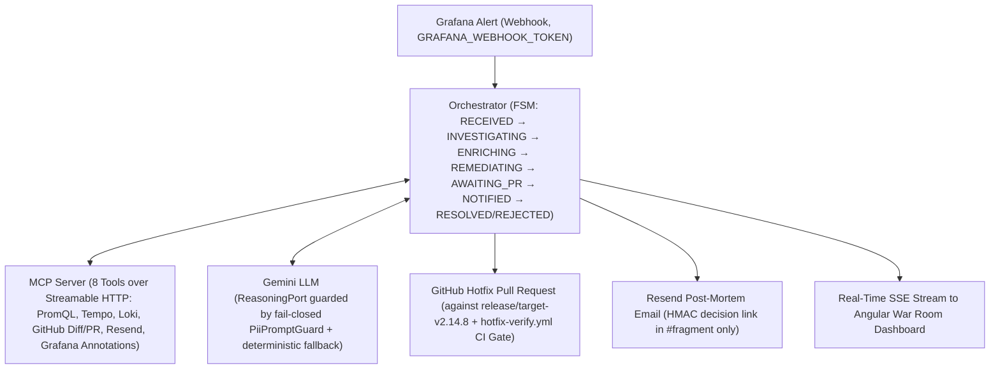

# ⚡ ZeroMTTR — Autonomous AIOps & Incident Remediation

> **Read in Portuguese:** [README.pt-BR.md](./README.pt-BR.md) | **Leer en Español:** [README.es-ES.md](./README.es-ES.md)  
> **Track:** Logistics & Automation (_Operational workflow automation & mission-critical system integrations_)  
> **Organization:** AGJ Works ([https://agjworks.com](https://agjworks.com))  
> **Repository:** [https://github.com/AdmilsonGoncalves/zeromttr](https://github.com/AdmilsonGoncalves/zeromttr)  
> **Public Demo:** [https://zeromttr.agjworks.com](https://zeromttr.agjworks.com)

---

## 1. Overview & Positioning

In mission-critical distributed systems — such as instant payment settlement (PIX), logistics fulfillment, e-commerce checkout, or billing — the mean time from alert to reviewable fix is dominated by manual context switching across siloed metrics, traces, logs, and Git diffs.

**ZeroMTTR** is an autonomous AIOps and incident remediation platform built for the **Logistics & Automation** track (automating operational workflows and integrating mission-critical systems). Its core follows **Clean / Hexagonal Architecture** and is **100% domain-agnostic**: any service emitting OpenTelemetry (OTLP) telemetry and backed by a **GitHub** repository (with other Git hosts like GitLab supported by adding an adapter for `RepoInspectorPort` / `RemediationPort`) can be diagnosed and remediated without changing a single line in `apps/orchestrator` or `apps/mcp-server`. Target status inspection is decoupled behind `TargetStatusPort`: cooperative workloads expose a neutral `GET /ops/status` manifest (`capabilities` + generic `saturation`), while external/legacy workloads can be monitored passively via `TARGET_STATUS_PROVIDER=prometheus` (MCP) with zero target-side endpoints. Operational policies (post-rejection Human Takeover cooldown, repeat suppression, decision TTL, target diff refs, LLM models, and orchestrator log level) are editable at runtime via an audited **Node 24 SQLite** settings store (`GET`/`PATCH /api/settings`) protected by a dedicated `SETTINGS_ADMIN_TOKEN`.

### Comparative Positioning (as of November 2026)

| Capability                     | HolmesGPT / OpenSRE                         | Datadog Bits AI / Sentry Seer       | ZeroMTTR                                                                                                                                                |
| :----------------------------- | :------------------------------------------ | :---------------------------------- | :------------------------------------------------------------------------------------------------------------------------------------------------------ |
| **Deployment & Protocol**      | Self-hosted (CLI / ChatOps)                 | Proprietary cloud SaaS              | **100% Self-Hosted & Open Source** exposing an open **Model Context Protocol (MCP)** Streamable HTTP contract (8 tools + `.mcp.json`)                   |
| **Edge PII Protection (LGPD)** | No native Brazilian PII / PIX edge pipeline | Telemetry processed in vendor cloud | **Dual-barrier:** OTTL `transform` redaction in OTel Collector before Loki persistence + **fail-closed `PiiPromptGuard`** before LLM dispatch           |
| **FinOps Payload Telemetry**   | Raw context dumps                           | Vendor-managed billing              | Deterministic summarization & policy truncation in MCP with per-incident `raw` vs. `compacted` byte tracking and token-savings estimate                 |
| **Remediation Governance**     | Ad-hoc scripts or ChatOps advice            | Vendor-managed PR / suggestions     | **Automated hotfix PR** against the release branch + **CI gate (`hotfix-verify.yml`)** + **human-in-the-loop HMAC approval sent exclusively via email** |
| **Resilience Without LLM**     | Depends on configured LLM                   | Cloud SaaS dependent                | Explicit `ReasoningPort` with **deterministic fallback** (`reasoningSource: 'llm' \| 'fallback'`)                                                       |

### How the Interactive Demo Works

When you open the **Demo** slide-over drawer (`app-demo-settings`) in the War Room and click **"Simulate Incident"** (`POST /api/demo/chaos`), the Orchestrator's modular demo router (`demo.controller.ts`, `demo-session-lifecycle.ts`, `demo-guards.ts`, `demo-handlers.ts`) operates in one of two modes targeting the **`api-pagamentos-core`** workload (`apps/target-app-demo`). Separately, the always-available **Settings** drawer (`app-system-settings`, gear icon) lets operators inspect or update runtime alert cooldowns, target diff settings, LLM models, log levels, and the change audit log (`GET`/`PATCH /api/settings`, `GET /api/settings/audit`) without restarting containers:

1. **Replay Mode (public default):**
   - Streams a real-time SSE timeline of a recorded real execution (`data/last-recorded-incident.json`) via `ReplayRunner`.
   - Consumes zero external API quotas (Gemini, GitHub, Resend).
2. **Live Mode (end-to-end real execution, unlocked with `LIVE_DEMO_KEY` or local Docker):**
   1. **Chaos Injection on `api-pagamentos-core`:** The Orchestrator triggers `chaos.controller.ts`, enabling `chaosManager.setPoolSaturation(true)` (`chaos.manager.ts`). Service status switches from `healthy` (`v2.14.7`) to `degraded` (`v2.14.8`), while `payment.repository.ts` drops the pool cap to `2` connections (`degradedMaxConnections`), injects a `4600 ms` delay, and omits `client.release()`, causing connection exhaustion.
   2. **Synthetic Traffic Burst:** With `CHAOS_AUTO_TRAFFIC_BURST=true`, `startSyntheticTrafficBurst()` fires waves of 6 `POST /payments` requests (at `0s, 3s, 6s, 9s, 12s, 15s`) carrying synthetic PIX PII (CPF, CNPJ, email, and `Bearer` JWT).
   3. **LGTM Observability & Alerting:** Pool exhaustion raises `KnexTimeoutError`, emits error `pg.pool.acquire` spans in **Tempo**, latency spikes in **Prometheus**, and logs masked at the edge by the OTel Collector's `transform` (OTTL) processor before reaching **Loki**. **Grafana** detects the anomaly and fires the alert webhook to the Orchestrator.
   4. **Autonomous Remediation:** The Orchestrator gathers metrics, traces, logs, and `git diff v2.14.7...v2.14.8` via the **MCP Server**, audits the prompt through fail-closed `PiiPromptGuard`, synthesizes RCA + full-file patch (via **Gemini** or deterministic fallback), opens a real GitHub PR against `release/target-v2.14.8`, and sends the **Resend** Post-Mortem email with an HMAC link in `#fragment`.
   5. **Restoration ("Restore Service" / `POST /api/demo/reset`):** Disables chaos in `ChaosManager`, cancels scheduled traffic bursts, and calls `paymentRepository.resetPool()`, returning `api-pagamentos-core` to `healthy` (`v2.14.7`).

---

## 2. Architecture & Autonomous Pipeline



---

## 3. Technical Transparency & MVP Limits

To keep evaluation honest and auditable, ZeroMTTR explicitly documents the boundaries of the current MVP:

1. **Live Mode vs. Replay Mode on the Public Demo (`https://zeromttr.agjworks.com`):**
   - Anonymous visitors on the public demo experience **Replay Mode** by default, playing back a curated snapshot recorded from a real execution (`data/last-recorded-incident.json`) to protect external LLM, GitHub, and email quotas.
   - To run **Live Mode** end to end (real Gemini reasoning, real GitHub PR, real Resend email), either run locally via `docker compose up -d` with your own keys in `.env`, or unlock Live Mode on the public instance with `LIVE_DEMO_KEY` (which is dedicated to evaluation and rotated immediately after the judging period).
2. **Governance Boundary — CI-Verified PR + Human Approval (No Auto-Merge / Auto-Redeploy):**
   - The autonomous cycle intentionally stops at opening a **CI-verified hotfix Pull Request** (`.github/workflows/hotfix-verify.yml`) and recording a **cryptographically signed human decision** (`approve` / `reject` via HMAC `#fragment` link delivered exclusively by email).
   - ZeroMTTR does **not** auto-merge into `master` or automatically redeploy running production containers.
3. **FinOps Estimation & PII Masking Scope:**
   - **FinOps metric:** measures payload reduction achieved by MCP summarization and policy truncation (`rawBytesFetched` vs. `compactedBytesSentToLlm`), using a conservative proportional estimate of `Math.round(bytesSaved / 4)` tokens rather than a vendor-specific tokenizer count.
   - **PII protection:** covers all **5 official Central Bank of Brazil (BACEN) PIX key types** — **CPF** and **CNPJ** (validated with Receita Federal Modulo-11 check digits), **mobile/landline phone numbers** (ANATEL rules), **standard unquoted email addresses** (`[A-Za-z0-9._%+-]+@domain`, excluding quoted local-part forms such as addresses with spaces), and **random PIX keys (EVP / RFC 4122 UUID v4 in PIX context)** — plus **JWT / `Bearer` tokens**. Technical UUIDs (such as `request_id` / `trace_id`), quoted email local parts, and unstructured proper names in free text are intentionally outside the deterministic regex/validator scope.

---

## 4. Connecting an External MCP Client (`.mcp.json`)

`apps/mcp-server` implements the standard **Model Context Protocol (MCP)** over Streamable HTTP (`POST /mcp`). Any MCP-compatible client (**MCP Inspector**, **Claude Code**, **Claude Desktop**, **Cursor**) can connect directly. The root [`.mcp.json`](./.mcp.json) provides the baseline configuration:

```json
{
  "mcpServers": {
    "zeromttr-aiops": {
      "type": "http",
      "url": "http://localhost:8000/mcp",
      "headers": {
        "Authorization": "Bearer ${MCP_AUTH_TOKEN}"
      }
    }
  }
}
```

> **Note for Cursor users:** Cursor reads project MCP definitions from `.cursor/mcp.json` (it does not auto-discover root `.mcp.json`) and uses `${env:MCP_AUTH_TOKEN}` for environment interpolation:
>
> ```json
> {
>   "mcpServers": {
>     "zeromttr-aiops": {
>       "url": "http://localhost:8000/mcp",
>       "headers": {
>         "Authorization": "Bearer ${env:MCP_AUTH_TOKEN}"
>       }
>     }
>   }
> }
> ```
>
> Make sure `MCP_AUTH_TOKEN` is exported in the environment of your MCP client process — copying `.env` alone does not export variables to external clients.

### Exposed MCP Tools (8)

| Category      | Tool                        | Purpose                                                                         |
| :------------ | :-------------------------- | :------------------------------------------------------------------------------ |
| Metrics       | `execute_promql_range`      | Queries Prometheus range metrics and returns summarized statistics              |
| Traces        | `search_traces_by_traceql`  | Finds anomalous traces in Tempo via TraceQL                                     |
| Traces        | `analyze_otel_trace`        | Extracts critical path and error spans for a given `traceId`                    |
| Logs          | `query_loki_logs`           | Fetches edge-redacted logs from Loki with policy truncation                     |
| Code          | `inspect_git_deploy_diff`   | Inspects the real GitHub diff between baseline and degraded tags                |
| Remediation   | `create_remediation_pr`     | Creates a `hotfix/*` branch and opens a Pull Request against the release branch |
| Notification  | `send_post_mortem_resend`   | Dispatches the post-mortem email with `#fragment` HMAC decision links           |
| Observability | `annotate_grafana_incident` | Posts incident lifecycle annotations directly onto Grafana graphs               |

Quick test with MCP Inspector (after starting the local stack):

```bash
export MCP_AUTH_TOKEN="$(grep '^MCP_AUTH_TOKEN=' .env | cut -d= -f2-)"
npx @modelcontextprotocol/inspector
# Connect via Streamable HTTP to http://localhost:8000/mcp with header:
# Authorization: Bearer <MCP_AUTH_TOKEN>
```

---

## 5. Deterministic Demo Scenario (`v2.14.7` vs. `v2.14.8`)

To reproduce real Pull Requests deterministically without ever breaking `master`:

- **Tag `v2.14.7` (on `master`):** Healthy baseline of `apps/target-app-demo` (`api-pagamentos-core`) with properly sized connection pool configuration. `master` always remains green.
- **Tag `v2.14.8` (on branch `release/target-v2.14.8`):** Controlled regression in `apps/target-app-demo/src/repositories/payment.repository.ts` introducing connection pool exhaustion (`KnexTimeoutError`).
- When an incident triggers, ZeroMTTR inspects the real diff `v2.14.7...v2.14.8`, generates a minimal remediation patch, opens a Pull Request targeting **`release/target-v2.14.8`**, and triggers [`.github/workflows/hotfix-verify.yml`](./.github/workflows/hotfix-verify.yml), which runs the target test suite and comments `✅ ZeroMTTR Autonomous CI Gate: PASSED`.

---

## 6. Measured Baseline (TTD / TTPR & LGTM Stability)

Measurement protocol and verification scripts are documented in [07_demo_and_delivery.md](./docs/en-US/tech/07_demo_and_delivery.md).

Against the 7-step manual baseline (1. alert triage → 2. PromQL query → 3. Tempo exemplar/trace inspection → 4. Loki log correlation → 5. `git diff v2.14.7...v2.14.8` → 6. edit & test fix → 7. open PR & write post-mortem):

| Execution Mode                                                                | TTD (`RECEIVED -> REMEDIATING`) | TTPR (`RECEIVED -> AWAITING_PR`) | Post-Mortem (`RECEIVED -> NOTIFIED`)                         | FinOps Reduction               | PII Guard      |
| :---------------------------------------------------------------------------- | :------------------------------ | :------------------------------- | :----------------------------------------------------------- | :----------------------------- | :------------- |
| **Golden Replay** (`inc-live-demo-golden-1795134557970-1`)                    | `11.51s` (target `<= 15s`)      | `14.51s` (target `<= 30s`)       | `19.51s` (target `<= 45s`)                                   | `94%` (`11,328` est. tokens)   | `passed: true` |
| **Local Live LGTM** (`inc-d7a8aa3e`, fallback mode without external API keys) | `1.03s` (target `<= 15s`)       | `1.06s` (target `<= 30s`)        | `n/a` (stopped at `401` on GitHub PR without `GITHUB_TOKEN`) | `66.14%` (`5,014` est. tokens) | `passed: true` |

- **LGTM Load Stability (`./scripts/load-test-lgtm.sh`):** `1,462` Prometheus histogram observations across 9 buckets, `zeromttr-otel-collector` stable at `91.77 MiB` (`GOMEMLIMIT=200MiB`), total memory across all 10 containers at `986.8 MiB` (`<= 2,200 MiB`, zero OOMKills).
- **Live Demo Video (3 min, en-US):** _Pending final Live Mode recording (see [07_demo_and_delivery.md](./docs/en-US/tech/07_demo_and_delivery.md) §1 for the exact 3-minute storyboard)._

---

## 7. Local Development & Quickstart

### Prerequisites

- Node.js 24 LTS (`.nvmrc`)
- pnpm 10+ (`packageManager`)
- Docker & Docker Compose v2.40+

### Setup & Verification

```bash
# 1. Clone and configure environment variables
cp .env.prod.template .env

# 2. Install dependencies with frozen lockfile
pnpm install --frozen-lockfile

# 3. Run full workspace quality gate (Prettier, ESLint, typecheck, tests, build)
pnpm run check:workspace

# 4. Start the full local stack (LGTM + OTel Collector + apps)
docker compose up -d --build
```

Local endpoints:

- **War Room Dashboard:** [http://localhost:4200](http://localhost:4200)
- **Grafana:** [http://localhost:3000](http://localhost:3000)
- **Prometheus:** [http://localhost:9090](http://localhost:9090)
- **MCP Server:** `http://localhost:8000/mcp`
- **OTel Collector:** OTLP gRPC `4317` / HTTP `4318`

---

## 8. Documentation

- [English Documentation Index (`docs/en-US/README.md`)](./docs/en-US/README.md)
- [Architecture Master Document (en-US)](./docs/en-US/00_architecture_master.md)
- [System Diagrams & Flows (en-US)](./docs/en-US/01_system_diagrams.md)
- [Architecture Decision Records — ADRs 001–011 (en-US)](./docs/en-US/adr/README.md)
- [Technical Specifications (`docs/en-US/tech/`)](./docs/en-US/tech/)
- [Portuguese Documentation (`docs/pt-BR/`)](./docs/pt-BR/00_architecture_master.md)
- [Spanish Documentation (`docs/es-ES/`)](./docs/es-ES/README.md)
- [Contributing Guide](./CONTRIBUTING.md)
- [Security Policy](./SECURITY.md)
- [Coding Agent Guidelines](./AGENTS.md)

---

## 9. License

MIT License — Copyright (c) 2026 AGJ Works. See [LICENSE](./LICENSE).
