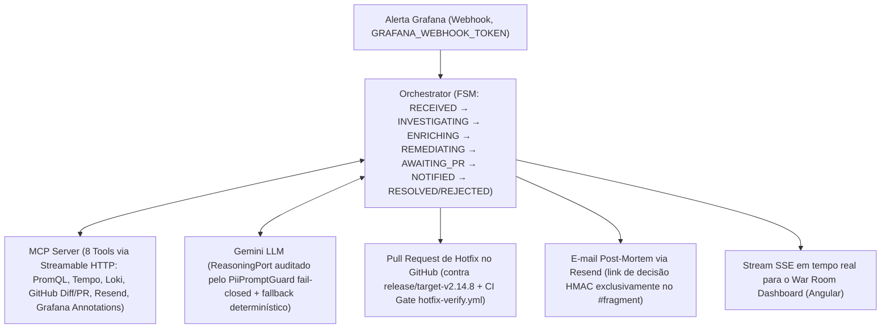

# ⚡ ZeroMTTR — Remediação Autônoma de Incidentes & Governança Humana

> **Read in English:** [README.md](./README.md) | **Leer en Español:** [README.es-ES.md](./README.es-ES.md)  
> **Trilha:** Logística & Automação (_Automação de fluxos operacionais e integração entre sistemas críticos_)  
> **Organização:** AGJ Works ([https://agjworks.com](https://agjworks.com))  
> **Repositório:** [https://github.com/AdmilsonGoncalves/zeromttr](https://github.com/AdmilsonGoncalves/zeromttr)  
> **Ambiente de Demonstração:** [https://zeromttr.agjworks.com](https://zeromttr.agjworks.com)

---

## 1. Visão Geral e Posicionamento

Em sistemas distribuídos de missão crítica — como liquidação de pagamentos instantâneos (PIX), separação e expedição logística, checkout ou faturamento — o tempo entre o disparo de um alerta e um hotfix revisável ainda é dominado por trabalho manual fragmentado entre métricas, traces, logs e diffs no Git.

O **ZeroMTTR** é uma plataforma autônoma de AIOps e remediação de incidentes que conecta observabilidade, análise de código e governança humana em um único fluxo:

- **Agnóstico ao serviço monitorado:** funciona com qualquer aplicação que emita telemetria OpenTelemetry e tenha repositório no GitHub (extensível para outros provedores Git), sem alterar o núcleo da plataforma.
- **Monitoramento ativo ou passivo:** integra-se a serviços cooperativos por manifesto de saúde ou monitora serviços externos/legados de forma passiva via Prometheus, sem exigir endpoints customizados na aplicação alvo.
- **Configuração em tempo real com auditoria:** políticas operacionais (janelas de cooldown, modelos de IA, parâmetros do alvo e nível de log) podem ser ajustadas direto pela interface, com persistência local, histórico de alterações e controle de acesso.

### Comparativo com Soluções de AIOps / AI-SRE

| Capacidade                          | HolmesGPT / OpenSRE                                    | Datadog Bits AI / Sentry Seer                | ZeroMTTR                                                                                                                                         |
| :---------------------------------- | :----------------------------------------------------- | :------------------------------------------- | :----------------------------------------------------------------------------------------------------------------------------------------------- |
| **Implantação e Protocolo**         | Self-hosted (CLI / ChatOps)                            | SaaS proprietário em nuvem                   | **100% Self-Hosted & Open Source**, expondo contrato aberto **Model Context Protocol (MCP)** sobre HTTP                                          |
| **Proteção de PII na Borda (LGPD)** | Sem pipeline nativo de borda para PII brasileira / PIX | Telemetria processada na nuvem do fornecedor | **Dupla barreira:** mascaramento de dados sensíveis na coleta antes do armazenamento + guarda _fail-closed_ antes de qualquer envio ao LLM       |
| **Telemetria FinOps de Payload**    | Dumps brutos de contexto                               | Cobrança gerenciada no SaaS                  | Sumarização determinística e truncamento de evidências com medição de payload bruto vs. compactado e estimativa de tokens poupados por incidente |
| **Governança de Remediação**        | Scripts ou sugestões via ChatOps                       | PR / sugestões proprietárias                 | **Pull Request de hotfix** contra branch de release + **validação automática em CI** + **aprovação humana assinada enviada apenas por e-mail**   |
| **Resiliência sem LLM**             | Dependente do LLM configurado                          | Dependente do SaaS                           | Diagnóstico com **fallback determinístico explícito** caso o LLM esteja indisponível ou bloqueado pela guarda de privacidade                     |

### Como o Sistema Demo Funciona

Pelo painel **Demonstração** no War Room, você pode testar a plataforma em dois modos sobre o serviço de exemplo **`api-pagamentos-core`** (enquanto o painel **Configurações**, sempre visível no ícone de engrenagem, permite consultar e ajustar políticas operacionais e histórico de alterações sem reiniciar a stack):

1. **Modo `Replay` (padrão público):**
   - Reproduz em tempo real a linha do tempo de uma execução real gravada, sem consumir cotas de APIs externas (Gemini, GitHub ou Resend).
2. **Modo `Live` (execução real ponta a ponta, via chave de avaliação ou Docker local):**
   1. **Injeção de falha:** ativa uma degradação controlada no pool de conexões do serviço de exemplo (`v2.14.7` → `v2.14.8`), simulando exaustão de conexões sob carga concorrente.
   2. **Tráfego sintético com PII fictícia:** envia requisições simuladas de PIX contendo dados sintéticos (CPF, CNPJ, e-mail e token) para demonstrar o mascaramento de privacidade.
   3. **Observabilidade e alerta:** a saturação gera erros e picos de latência no Prometheus, traces de erro no Tempo e logs já mascarados na borda antes de chegarem ao Loki; o Grafana detecta a anomalia e aciona o orquestrador.
   4. **Diagnóstico e remediação autônoma:** o orquestrador correlaciona métricas, traces, logs e o diff entre versões via servidor MCP, valida a ausência de PII, sintetiza causa raiz e correção, abre um Pull Request real no GitHub e envia o relatório post-mortem por e-mail com link assinado para aprovação humana.
   5. **Restauração:** limpa o estado de caos e devolve o serviço de exemplo à versão saudável (`v2.14.7`).

> Os detalhes de arquitetura, contratos de API, variáveis de ambiente e decisões técnicas estão documentados em [`docs/pt-BR/`](./docs/pt-BR/00_architecture_master.md).

---

## 2. Arquitetura e Fluxo Autônomo



---

## 3. Transparência Técnica e Limites do MVP

Para uma avaliação honesta e auditável, o ZeroMTTR explicita os limites atuais do MVP:

1. **Modo `Live` vs. Modo `Replay` na demonstração pública (`https://zeromttr.agjworks.com`):**
   - Visitantes anônimos na URL pública visualizam por padrão o **Modo `Replay`**, que reproduz fielmente um snapshot gravado de uma execução real (`data/last-recorded-incident.json`) para proteger as cotas externas de LLM, GitHub e e-mail.
   - Para testar o **Modo `Live`** ponta a ponta (raciocínio real no Gemini, PR real no GitHub e e-mail real via Resend), execute localmente com `docker compose up -d` usando suas chaves no `.env`, ou desbloqueie o modo `Live` na instância pública com a chave **`LIVE_DEMO_KEY`** (dedicada à avaliação e rotacionada imediatamente após o encerramento).
2. **Fronteira de Governança — Pull Request verificado por CI + Decisão Humana (sem auto-merge/redeploy):**
   - O ciclo autônomo encerra propositalmente na abertura do **Pull Request de hotfix validado por CI** (`.github/workflows/hotfix-verify.yml`) e no registro da **decisão humana assinada criptograficamente** (`approve` / `reject` via link HMAC no `#fragment` enviado exclusivamente por e-mail).
   - O ZeroMTTR **não** realiza merge automático na `master` nem redeploy automático no contêiner em execução.
3. **Escopo da Métrica FinOps e do Mascaramento de PII:**
   - **Métrica FinOps:** mede a **redução de payload obtida por sumarização e truncamento de política** no servidor MCP (`rawBytesFetched` vs. `compactedBytesSentToLlm`), usando estimativa proporcional conservadora de `Math.round(bytesSaved / 4)` tokens (não uma contagem proprietária de tokenizador).
   - **Mascaramento de PII:** cobre os **5 tipos oficiais de Chave PIX do Banco Central (BACEN)** — **CPF** e **CNPJ** (validados por dígito verificador Módulo-11 da Receita Federal), **telefone celular/fixo** (regras da ANATEL), **e-mail no formato padrão sem aspas** (`[A-Za-z0-9._%+-]+@domínio`, não cobrindo _quoted local parts_ como endereços com espaços) e **chave aleatória EVP (UUID v4 RFC 4122 em contexto PIX)** — além de **tokens JWT / `Bearer`**. UUIDs técnicos (como `request_id` e `trace_id`), _quoted local parts_ de e-mail e nomes próprios em texto livre ficam intencionalmente fora do escopo determinístico.

---

## 4. Como Conectar um Cliente MCP Externo (`.mcp.json`)

O `apps/mcp-server` implementa o padrão **Model Context Protocol (MCP)** sobre Streamable HTTP (`POST /mcp`). Qualquer cliente compatível (**MCP Inspector**, **Claude Code**, **Claude Desktop**, **Cursor**) pode se conectar diretamente. O arquivo [`.mcp.json`](./.mcp.json) na raiz fornece a configuração base:

```json
{
  "mcpServers": {
    "zeromttr-aiops": {
      "type": "http",
      "url": "http://localhost:8000/mcp",
      "headers": {
        "Authorization": "Bearer ${MCP_AUTH_TOKEN}"
      }
    }
  }
}
```

> **Nota para usuários do Cursor:** O Cursor lê configurações MCP de projeto em `.cursor/mcp.json` (não descobre automaticamente o `.mcp.json` da raiz) e utiliza `${env:MCP_AUTH_TOKEN}` para interpolação de variáveis de ambiente:
>
> ```json
> {
>   "mcpServers": {
>     "zeromttr-aiops": {
>       "url": "http://localhost:8000/mcp",
>       "headers": {
>         "Authorization": "Bearer ${env:MCP_AUTH_TOKEN}"
>       }
>     }
>   }
> }
> ```
>
> Certifique-se de exportar `MCP_AUTH_TOKEN` no ambiente do processo do cliente MCP — apenas copiar o arquivo `.env` não exporta a variável automaticamente.

### Ferramentas MCP Expostas (8)

| Categoria       | Ferramenta                  | Finalidade                                                                  |
| :-------------- | :-------------------------- | :-------------------------------------------------------------------------- |
| Métricas        | `execute_promql_range`      | Consulta séries temporais no Prometheus e retorna estatísticas sumarizadas  |
| Traces          | `search_traces_by_traceql`  | Busca traces anômalos no Tempo via TraceQL                                  |
| Traces          | `analyze_otel_trace`        | Extrai o caminho crítico e spans em erro de um `traceId`                    |
| Logs            | `query_loki_logs`           | Consulta logs mascarados na borda no Loki com truncamento de política       |
| Código          | `inspect_git_deploy_diff`   | Inspeciona o diff real no GitHub entre a tag saudável e a tag degradada     |
| Remediação      | `create_remediation_pr`     | Cria branch `hotfix/*` e abre Pull Request contra a branch de release       |
| Notificação     | `send_post_mortem_resend`   | Envia e-mail post-mortem com links de decisão HMAC no `#fragment`           |
| Observabilidade | `annotate_grafana_incident` | Publica anotações do ciclo do incidente diretamente nos gráficos do Grafana |

Teste rápido com o MCP Inspector (após subir a stack local):

```bash
export MCP_AUTH_TOKEN="$(grep '^MCP_AUTH_TOKEN=' .env | cut -d= -f2-)"
npx @modelcontextprotocol/inspector
# Conectar via Streamable HTTP em http://localhost:8000/mcp com o header:
# Authorization: Bearer <MCP_AUTH_TOKEN>
```

---

## 5. Cenário Determinístico de Demonstração (`v2.14.7` vs. `v2.14.8`)

Para reproduzir Pull Requests reais de forma determinística sem jamais comprometer a `master`:

- **Tag `v2.14.7` (na `master`):** versão saudável de `apps/target-app-demo` (`api-pagamentos-core`) com pool de conexões dimensionado corretamente. A `master` permanece sempre verde.
- **Tag `v2.14.8` (na branch `release/target-v2.14.8`):** regressão controlada em `apps/target-app-demo/src/repositories/payment.repository.ts` que provoca exaustão do pool (`KnexTimeoutError`).
- Ao detectar o incidente, o ZeroMTTR inspeciona o diff real `v2.14.7...v2.14.8`, gera o patch mínimo de correção, abre um Pull Request contra **`release/target-v2.14.8`** e aciona o workflow [`.github/workflows/hotfix-verify.yml`](./.github/workflows/hotfix-verify.yml), que executa a suíte de testes e comenta `✅ ZeroMTTR Autonomous CI Gate: PASSED`.

---

## 6. Baseline Medido (TTD / TTPR e Estabilidade LGTM)

O protocolo de medição e os scripts de verificação estão documentados em [07_demo_and_delivery.md](./docs/pt-BR/tech/07_demo_and_delivery.md).

Em comparação ao baseline manual de 7 etapas (1. triagem do alerta → 2. consulta PromQL → 3. inspeção de exemplar/trace no Tempo → 4. correlação de logs no Loki → 5. `git diff v2.14.7...v2.14.8` → 6. edição e testes do fix → 7. abertura de PR e redação do post-mortem):

| Modo de Execução                                                        | TTD (`RECEIVED -> REMEDIATING`) | TTPR (`RECEIVED -> AWAITING_PR`) | Post-Mortem (`RECEIVED -> NOTIFIED`)                   | Redução FinOps                 | PII Guard      |
| :---------------------------------------------------------------------- | :------------------------------ | :------------------------------- | :----------------------------------------------------- | :----------------------------- | :------------- |
| **Replay dourado** (`inc-live-demo-golden-1795134557970-1`)             | `11.51s` (meta `<= 15s`)        | `14.51s` (meta `<= 30s`)         | `19.51s` (meta `<= 45s`)                               | `94%` (`11.328` tokens est.)   | `passed: true` |
| **Live LGTM local** (`inc-d7a8aa3e`, modo fallback sem chaves externas) | `1.03s` (meta `<= 15s`)         | `1.06s` (meta `<= 30s`)          | `n/a` (interrompido em `401` no PR sem `GITHUB_TOKEN`) | `66.14%` (`5.014` tokens est.) | `passed: true` |

- **Estabilidade LGTM sob carga (`./scripts/load-test-lgtm.sh`):** `1.462` observações de histograma Prometheus em 9 buckets, `zeromttr-otel-collector` estável em `91.77 MiB` (`GOMEMLIMIT=200MiB`) e memória agregada dos 10 contêineres em `986.8 MiB` (`<= 2.200 MiB`, zero OOMKills).
- **Vídeo de Demonstração Live (3 min, en-US):** _Aguardando gravação final em modo Live (roteiro detalhado em [07_demo_and_delivery.md](./docs/pt-BR/tech/07_demo_and_delivery.md) §1)._

---

## 7. Desenvolvimento Local e Execução

### Pré-requisitos

- Node.js 24 LTS (`.nvmrc`)
- pnpm 10+ (`packageManager`)
- Docker & Docker Compose v2.40+

### Inicialização e Verificação

```bash
# 1. Clonar e configurar variáveis de ambiente
cp .env.prod.template .env

# 2. Instalar dependências com lockfile congelado
pnpm install --frozen-lockfile

# 3. Executar a checagem completa de qualidade (Prettier, ESLint, typecheck, testes, build)
pnpm run check:workspace

# 4. Subir toda a stack local (LGTM + OTel Collector + aplicações)
docker compose up -d --build
```

Endpoints locais:

- **War Room Dashboard:** [http://localhost:4200](http://localhost:4200)
- **Grafana:** [http://localhost:3000](http://localhost:3000)
- **Prometheus:** [http://localhost:9090](http://localhost:9090)
- **Servidor MCP:** `http://localhost:8000/mcp`
- **OTel Collector:** OTLP gRPC `4317` / HTTP `4318`

> **Nota sobre execução de scripts CLI no host com `.env`:** o `.env.prod.template` define `TARGET_APP_URL=http://target-app-demo:3001` para a rede interna do Docker. Ao executar `./scripts/chaos.sh`, `./scripts/reset.sh`, `./scripts/record-replay.sh` ou `./scripts/load-test-lgtm.sh` diretamente do host, sobrescreva a variável **inline por comando** (ex.: `TARGET_APP_URL=http://127.0.0.1:3001 ./scripts/reset.sh`). **Não** exporte `TARGET_APP_URL=http://127.0.0.1:3001` globalmente no `~/.zshrc` ou `~/.bashrc`, pois o Docker Compose prioriza variáveis do shell sobre o `.env` e faria o contêiner `orchestrator` apontar para o próprio loopback.

---

## 8. Documentação

- [Documento Mestre de Arquitetura](./docs/pt-BR/00_architecture_master.md)
- [Diagramas Comportamentais e de Rede](./docs/pt-BR/01_system_diagrams.md)
- [Architecture Decision Records — ADRs 001–011](./docs/pt-BR/adr/README.md)
- [Especificações Técnicas (`docs/pt-BR/tech/`)](./docs/pt-BR/tech/)
- [English Documentation (`docs/en-US/`)](./docs/en-US/README.md)
- [Documentación en Español (`docs/es-ES/`)](./docs/es-ES/README.md)
- [Guia de Contribuição (`CONTRIBUTING.md`)](./CONTRIBUTING.md)
- [Política de Segurança (`SECURITY.md`)](./SECURITY.md)
- [Instruções para Agentes (`AGENTS.md`)](./AGENTS.md)

---

## 9. Licença

MIT License — Copyright (c) 2026 AGJ Works. Consulte [LICENSE](./LICENSE).
