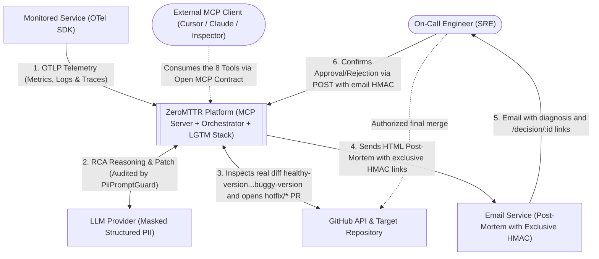
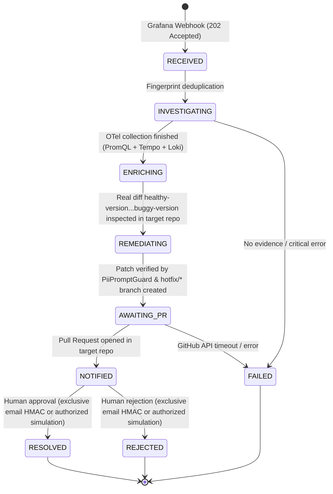

# System Architecture

**ZeroMTTR** is designed following **Clean Architecture** principles with complete decoupling from the monitored service: any application that emits **OpenTelemetry (OTLP)** telemetry and lives in a Git repository can be operated by the platform without changing the orchestrator or MCP server core.

## Architectural Style

| Aspect                   | Decision                                                                                                                                                                   |
| :----------------------- | :------------------------------------------------------------------------------------------------------------------------------------------------------------------------- |
| **Macro style**          | **Event-driven + Agentic** — Grafana webhooks trigger the autonomous workflow, with a deterministic fallback guaranteeing completion if the LLM provider fails.            |
| **Internal style**       | **Hexagonal Architecture (Ports & Adapters)** in `apps/orchestrator` and `apps/mcp-server`, isolating business rules from HTTP transport and external SDKs.                |
| **Lifecycle control**    | **Incident State Machine** governing every transition in a pure, predictable, and auditable way.                                                                           |
| **Integration protocol** | **MCP over HTTP** (_Streamable HTTP_), consumable by both the internal orchestrator and external MCP clients (`.mcp.json`).                                                |
| **Decision security**    | **Email-only HMAC** — approval/rejection signatures travel exclusively inside the `#fragment` of decision email links, never over SSE streams or read endpoints.           |
| **Deployment**           | Local development via `docker-compose.yml` and production on a Linux VPS via `docker-compose.prod.yml` with **Traefik + Let's Encrypt**, reading secrets outside the repo. |

## Component Patterns

| Component                                   | Pattern                                             | Organization                                                                                    |
| :------------------------------------------ | :-------------------------------------------------- | :---------------------------------------------------------------------------------------------- |
| **`apps/orchestrator` & `apps/mcp-server`** | **Hexagonal (Ports & Adapters)**                    | `domain` → `application` → `ports` → `adapters`, wired at the composition root in `main.ts`.    |
| **`apps/target-app-demo`**                  | **Layered MVC**                                     | `routes` → `controllers` → `services` → `repositories` (decoupled reference target service).    |
| **`apps/dashboard`**                        | **Single-Pane War Room with Signals** (Angular)     | Standalone components (`WarRoomComponent` + `DecisionComponent`) styled with PrimeNG Aura Dark. |
| **`apps/docs`**                             | **Multilingual Static Manual** (Docusaurus + Nginx) | `pt-BR`, `en-US`, and `es-ES` documentation served from a dedicated low-memory Nginx container. |

## Context View (C4 Level 1)

The diagram below shows ZeroMTTR's system boundary and how it interacts with the monitored service, external MCP clients, LLM provider, GitHub, email provider, and the on-call engineer:

## Incident State Machine

Every incident processed by the orchestrator advances through an explicit sequence of states, streamed live to the **Remediation Flow** bar at the top of the War Room:

### State Summary

| State           | What is happening                                                                                           |
| :-------------- | :---------------------------------------------------------------------------------------------------------- |
| `RECEIVED`      | Alert received via Grafana webhook and accepted after token verification and deduplication/cooldown checks. |
| `INVESTIGATING` | Correlated collection of metrics (Prometheus), error traces (Tempo), and masked logs (Loki) via MCP Server. |
| `ENRICHING`     | Code diff inspection between the previous healthy release and the current version in the target Git repo.   |
| `REMEDIATING`   | _Fail-closed_ privacy audit (`PiiPromptGuard`), RCA synthesis, and patch generation by the AI.              |
| `AWAITING_PR`   | Creation of the `hotfix/zeromttr-*` branch, patch commit, and Pull Request submission on GitHub.            |
| `NOTIFIED`      | Pull Request opened and Post-Mortem email delivered to the on-call engineer awaiting signed human decision. |
| `RESOLVED`      | Fix approved by the on-call engineer and incident closed successfully.                                      |
| `REJECTED`      | Fix rejected by the on-call engineer (activates the _Human Takeover_ post-rejection cooldown window).       |
| `FAILED`        | Critical failure during investigation or external integration, recorded for inspection in the War Room.     |

:::info Engineering Deep Dive
For container diagrams (C4 Level 2), end-to-end sequence diagrams, hexagonal class diagrams, VPS network topology, and full ADRs, see the [Engineering Documentation on GitHub](https://github.com/AdmilsonGoncalves/zeromttr/tree/master/docs).
:::
