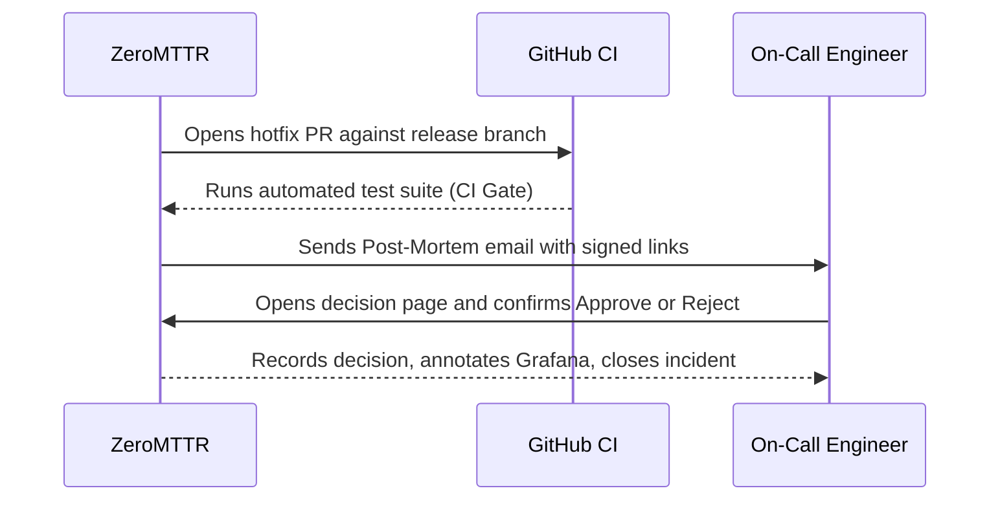

# Human Approval & Governance

ZeroMTTR enforces **Human-in-the-Loop** governance: automation accelerates investigation and produces a CI-tested fix, while **no change is merged or deployed to production without explicit human confirmation**.

## Decision Flow

## What's in the Post-Mortem Email

- **Executive root-cause summary** and affected services (blast radius).
- **Direct link to the GitHub Pull Request** to inspect the patch diff and CI check status.
- **Two cryptographically signed action buttons:** **Approve Hotfix** and **Reject Hotfix**, with a configurable expiration window (default: 15 minutes).

## Decision Link Security

- The HMAC signature travels **exclusively in the URL `#fragment`** — browsers never transmit fragments in HTTP `GET` requests, proxy logs, or `Referer` headers.
- Opening the link **never executes the decision automatically** (protecting against email-client link prefetching). The Decision screen displays the incident summary and requires an explicit confirmation click.
- Every incident accepts **only one final decision**. Repeated submissions after resolution are automatically rejected.

## What Happens After Approving or Rejecting

- **Approve:** the incident transitions to **Resolved**, adds a Grafana annotation, and — if demo auto-restore is enabled — clears chaos on the sample workload. Merging the PR remains under human control on GitHub.
- **Reject (Human Takeover):** the incident transitions to **Rejected**, the Pull Request remains unmerged, and ZeroMTTR activates a **post-rejection cooldown window** (default: 15 minutes) for that alert fingerprint — preventing duplicate incidents while the engineer investigates manually.

:::important Approving does not auto-merge or redeploy
Confirming **Approve** closes the incident in ZeroMTTR and records the approval annotation in Grafana, but **does not merge the Pull Request or trigger a production deploy**. After reviewing the diff and CI checks, the engineer performs the final merge manually on GitHub. See **[Scope, Limitations & Governance](/scope-and-limits)** for all operational boundaries.
:::
