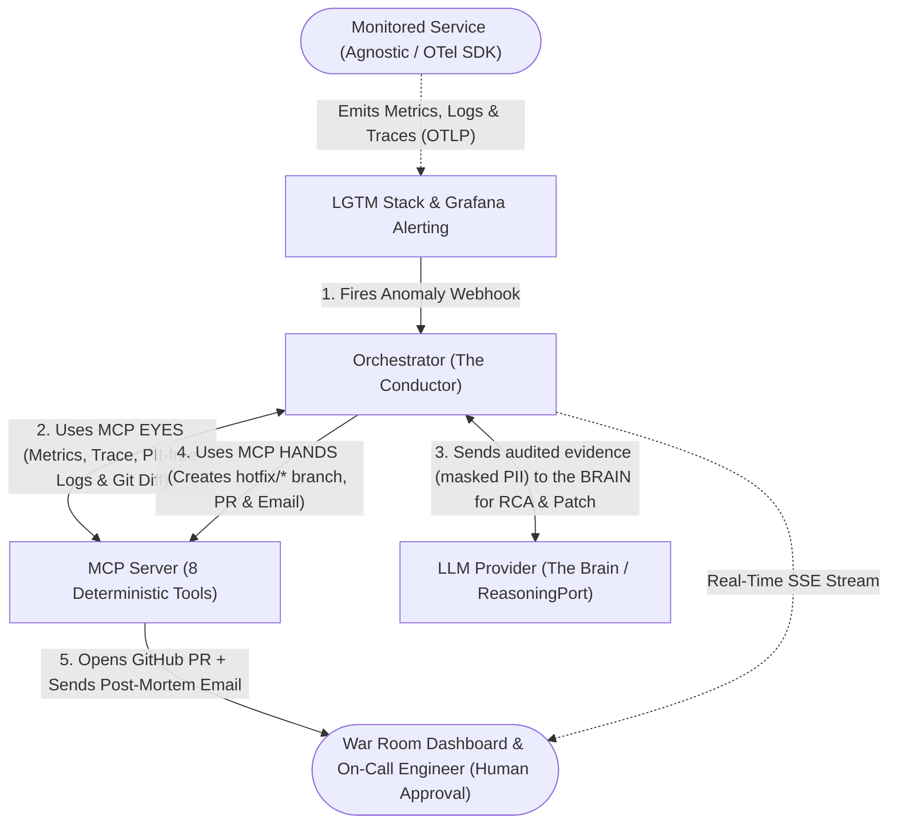

# Welcome to ZeroMTTR

**ZeroMTTR** is an autonomous **Incident Remediation & Human-in-the-Loop Governance** platform. When a monitored service degrades, ZeroMTTR automatically correlates metrics, distributed traces, logs, and recent code changes, opens a **hotfix Pull Request** (verified automatically when the target repository configures a CI workflow), and requests **signed human approval via email** — keeping final production control in the on-call engineer's hands.

:::important Human-in-the-Loop Governance
ZeroMTTR **never auto-merges Pull Requests and never triggers production redeploys**. On-call approval records the auditable decision and closes the incident; final merging remains explicitly under human control on GitHub. See full details in **[Scope, Limitations & Governance](/scope-and-limits)**.
:::

## Overall Objective

Deliver a functional, live-demonstrable, open-source platform that automates root-cause analysis (RCA) and hotfix Pull Request preparation for microservice incidents using **Model Context Protocol (MCP)**, **OpenTelemetry**, **verifiable edge PII masking**, and **human-in-the-loop governance**.

## The Essence of the System in 30 Seconds

To immediately understand the role of each building block, **ZeroMTTR** strictly separates **who executes tools (MCP Server)**, **who synthesizes diagnosis and code (AI Provider)**, and **who coordinates the workflow (Orchestrator)**:

### 1. MCP Server (`mcp-server`) — The "Eyes and Hands" (100% Deterministic, no embedded AI)

Exposes **8 standardized tools** over **Model Context Protocol (MCP)**, split between **context-pruned reading (FinOps)** and **auditable governance actions**:

**Eyes (Read, Diagnosis & FinOps Context Pruning):**

- **Prometheus (Metrics):** executes a PromQL range query and returns a statistical summary (`min`, `max`, `avg`, `latest`, and `p95`) for up to 5 time series along with FinOps payload reduction metrics.
- **Grafana Tempo (Trace Analysis):** analyzes an OpenTelemetry distributed trace to identify the _Blast Radius_ (affected services), top 5 error spans, and top 5 slowest spans.
- **Grafana Tempo (TraceQL Search):** searches traces via TraceQL (up to 20 results), supporting ad-hoc queries and acting as a fallback when no metric exemplar is present.
- **Grafana Loki (Sanitized Logs):** queries logs via LogQL with defensive truncation (up to 100 lines and 500 characters per line) and FinOps metrics, operating on logs already masked at ingestion.
- **GitHub (Deploy Diff Inspection):** inspects the real diff between the previous healthy release and the current version in the target repository, sanitizing author PII, capping output to 3 files and 1,500 characters per diff, and reporting FinOps savings.

**Hands (Action & Governance):**

- **GitHub (Pull Request Remediation):** idempotently creates or updates a `hotfix/zeromttr-*` branch, commits the patch, and opens a Pull Request with the RCA report and reasoning source (`llm` or `fallback`) — **never auto-merging**.
- **Grafana (Incident Annotations):** injects timeline annotations directly into monitoring charts marking remediation progress and the final human decision.
- **Email Service (Post-Mortem Notification):** delivers the executive report in escaped HTML containing cryptographically signed (HMAC) approval and rejection links exclusively inside the URL `#fragment`.

### 2. AI Provider (`ReasoningPort`) — The "Brain"

The **AI Provider** never accesses databases, observability backends, or GitHub directly. It receives only the compacted summary pruned by the **MCP Server** and approved by the _fail-closed_ privacy guard (`PiiPromptGuard`), synthesizes the root cause (RCA), and generates the code patch — explicitly recording whether the output came from the LLM (`llm`) or deterministic fallback (`fallback`).

### 3. Orchestrator (`orchestrator`) — The "Conductor" (Deterministic Workflow)

The **Orchestrator** coordinates the entire incident lifecycle predictably: it receives the alert from **Grafana**, invokes the **MCP Server**'s **Eyes** to gather evidence, verifies zero PII (`PiiPromptGuard`), sends the audited context to the **AI Provider** for RCA and patch generation, and triggers the **MCP Server**'s **Hands** to open the **GitHub** Pull Request (running branch CI when the target repository has a CI workflow whose triggers and filters match the hotfix push or PR) and email the on-call engineer for approval — while streaming every step live over SSE to the **War Room Dashboard**.

## Manual Map

| Section                                                            | What you'll find                                                                       |
| :----------------------------------------------------------------- | :------------------------------------------------------------------------------------- |
| **[System Architecture](/architecture)**                           | Architectural style, component patterns, C4 Level 1 context, and incident states.      |
| **[Using the War Room](/war-room)**                                | Walkthrough of every dashboard area, KPIs, telemetry cards, and evidence tabs.         |
| **[Replay vs. Live Mode](/demo-modes)**                            | How to explore the public replay demo and run real end-to-end incidents.               |
| **[Human Approval](/human-approval)**                              | How the Post-Mortem email, signed links, and decision screen work.                     |
| **[Scope, Limitations & Governance](/scope-and-limits)**           | What ZeroMTTR automates, intentional boundaries (no auto-merge), PII scope, and scale. |
| **[Live Settings](/settings)**                                     | How to update cooldowns, AI models, log level, and review the audit log.               |
| **[Connecting Your Service](/connect-service)**                    | How to integrate your own workloads (cooperative manifest or passive Prometheus mode). |
| **[MCP Integration](/mcp-clients)**                                | How to connect Cursor, Claude, or MCP Inspector to the 8 platform tools.               |
| **[Local Setup & Troubleshooting](/installation-troubleshooting)** | Running locally with Docker Compose, host CLI scripts, and common fixes.               |

:::tip Want to see it in action right now?
Open the **War Room** ([zeromttr.agjworks.com](https://zeromttr.agjworks.com)), click **Demo** in the top-right corner, and click **Simulate Incident** in Replay Mode. In ~25 seconds you will watch the entire autonomous flow live.
:::
