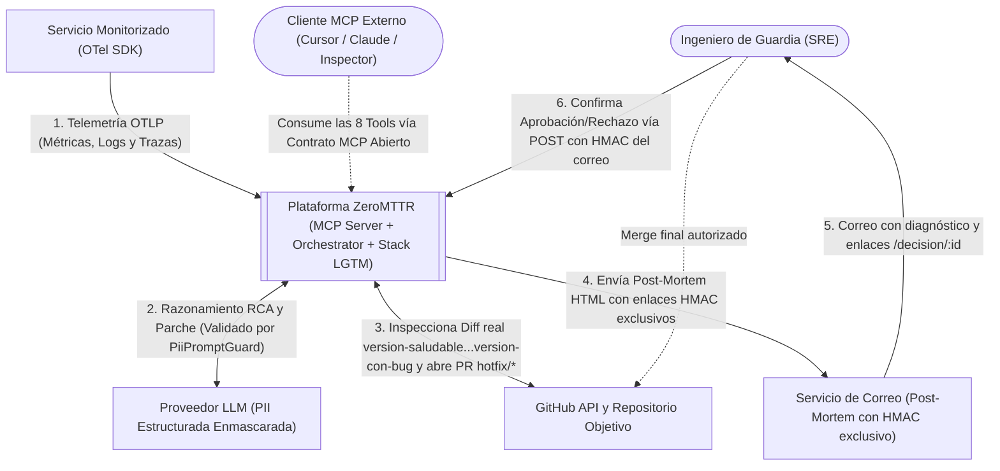
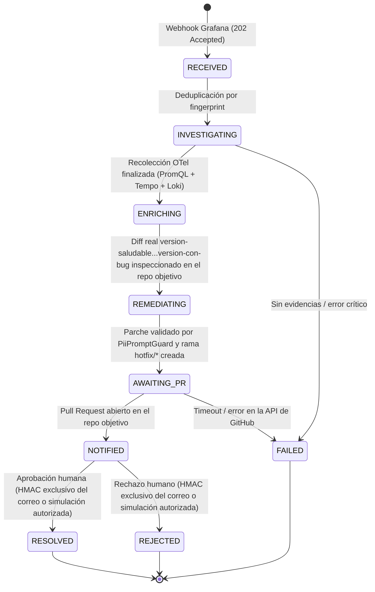

# Arquitectura del Sistema

**ZeroMTTR** está diseñado bajo principios de **Clean Architecture** y desacoplamiento total respecto al servicio monitorizado: cualquier aplicación que emita telemetría vía **OpenTelemetry (OTLP)** y cuente con un repositorio Git puede operar con la plataforma sin modificar el núcleo del orquestador ni del servidor MCP.

## Estilo Arquitectónico

| Aspecto                      | Decisión                                                                                                                                                                        |
| :--------------------------- | :------------------------------------------------------------------------------------------------------------------------------------------------------------------------------ |
| **Estilo macro**             | **Event-driven + Agentic** — los webhooks de Grafana disparan el flujo autónomo, con fallback determinístico que garantiza la finalización si falla el proveedor de IA.         |
| **Estilo interno**           | **Arquitectura Hexagonal (Ports & Adapters)** en `apps/orchestrator` y `apps/mcp-server`, aislando reglas de negocio del transporte HTTP y SDKs externos.                       |
| **Control de ciclo de vida** | **Máquina de Estados del Incidente** pura que gobierna cada transición de manera predecible y auditable.                                                                        |
| **Protocolo de integración** | **MCP sobre HTTP** (_Streamable HTTP_), consumible tanto por el orquestador interno como por clientes MCP externos (`.mcp.json`).                                               |
| **Seguridad de decisión**    | **HMAC exclusivo por correo** — las firmas de aprobación/rechazo viajan únicamente en el `#fragment` de los enlaces enviados por correo, nunca por SSE ni endpoints de lectura. |
| **Despliegue**               | Entorno local con `docker-compose.yml` y producción en VPS Linux con `docker-compose.prod.yml` + **Traefik + Let's Encrypt**, leyendo secretos fuera del repositorio.           |

## Patrones por Componente

| Componente                                  | Patrón                                               | Organización                                                                                            |
| :------------------------------------------ | :--------------------------------------------------- | :------------------------------------------------------------------------------------------------------ |
| **`apps/orchestrator` y `apps/mcp-server`** | **Hexagonal (Ports & Adapters)**                     | `domain` → `application` → `ports` → `adapters`, con composición de dependencias en `main.ts`.          |
| **`apps/target-app-demo`**                  | **MVC en capas**                                     | `routes` → `controllers` → `services` → `repositories` (servicio objetivo de demostración desacoplado). |
| **`apps/dashboard`**                        | **Single-Pane War Room con Signals** (Angular)       | Componentes standalone (`WarRoomComponent` + `DecisionComponent`) con PrimeNG Aura Dark.                |
| **`apps/docs`**                             | **Manual Estático Multilingüe** (Docusaurus + Nginx) | Documentación en `pt-BR`, `en-US` y `es-ES` servida en un contenedor Nginx dedicado de bajo consumo.    |

## Visión de Contexto (C4 Nivel 1)

El siguiente diagrama muestra los límites de la plataforma ZeroMTTR y cómo interactúa con el servicio monitorizado, clientes MCP externos, el proveedor de IA, GitHub, el servicio de correo y el ingeniero de guardia:

## Máquina de Estados del Incidente

Cada incidente procesado por el orquestador recorre una secuencia explícita de estados, transmitida en vivo al **Flujo de Remediación** en la parte superior del War Room:

### Resumen de Estados

| Estado          | Qué está ocurriendo                                                                                                   |
| :-------------- | :-------------------------------------------------------------------------------------------------------------------- |
| `RECEIVED`      | Alerta recibida vía webhook de Grafana y aceptada tras validar el token y comprobar deduplicación/cooldown.           |
| `INVESTIGATING` | Recolección correlacionada de métricas (Prometheus), trazas con error (Tempo) y logs enmascarados (Loki) vía MCP.     |
| `ENRICHING`     | Inspección del diff de código entre la versión saludable anterior y la versión actual en el repositorio Git objetivo. |
| `REMEDIATING`   | Auditoría _fail-closed_ de privacidad (`PiiPromptGuard`), síntesis de RCA y generación del parche por la IA.          |
| `AWAITING_PR`   | Creación de la rama `hotfix/zeromttr-*`, aplicación del commit correctivo y apertura del Pull Request en GitHub.      |
| `NOTIFIED`      | Pull Request abierto y correo Post-Mortem enviado al ingeniero de guardia a la espera de decisión humana firmada.     |
| `RESOLVED`      | Corrección aprobada por el ingeniero de guardia e incidente cerrado con éxito.                                        |
| `REJECTED`      | Corrección rechazada por el ingeniero de guardia (activa la ventana de _Human Takeover_ / cooldown post-rechazo).     |
| `FAILED`        | Fallo crítico durante la investigación o integración externa, registrado para inspección en el War Room.              |

:::info Profundización de Ingeniería
Para diagramas de contenedores (C4 Nivel 2), secuencia de extremo a extremo, clases hexagonales, topología de red en VPS y ADRs completos, consulta la [Documentación de Ingeniería en GitHub](https://github.com/AdmilsonGoncalves/zeromttr/tree/master/docs).
:::
