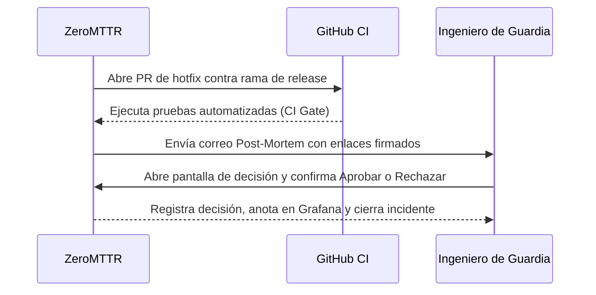

# Aprobación Humana y Gobernanza

ZeroMTTR sigue el principio de **Human-in-the-Loop**: la automatización acelera el diagnóstico y abre un Pull Request de corrección (validado automáticamente cuando el repositorio objetivo dispone de un workflow de CI configurado), pero **ningún cambio se fusiona ni despliega en producción sin confirmación humana explícita**.

## Flujo de decisión

## Qué incluye el correo Post-Mortem

- **Resumen ejecutivo de la causa raíz** y lista de servicios afectados.
- **Enlace directo al Pull Request** en GitHub para revisar el diff y el resultado de CI.
- **Dos botones firmados criptográficamente:** **Aprobar Hotfix** y **Rechazar Hotfix**, con vencimiento configurable (por defecto: 15 minutos).

## Seguridad de los enlaces de decisión

- La firma HMAC viaja **exclusivamente en el fragmento `#` de la URL**: los navegadores nunca envían el fragmento en peticiones HTTP `GET`, logs de proxy ni cabeceras `Referer`.
- Abrir el enlace **nunca ejecuta la decisión automáticamente** (protección contra precarga de clientes de correo o antivirus). La pantalla muestra el resumen del incidente y exige un clic explícito de confirmación.
- Cada incidente acepta **una única decisión final**. Los envíos repetidos tras el cierre se rechazan automáticamente.

## Qué ocurre tras Aprobar o Rechazar

- **Aprobar:** el incidente pasa a **Resuelto**, registra una anotación en Grafana y, si la restauración automática en modo demo está habilitada, limpia el estado de caos del servicio de ejemplo. El merge final del PR permanece bajo control humano en GitHub.
- **Rechazar (Human Takeover):** el incidente pasa a **Rechazado**, el Pull Request queda sin fusionar y ZeroMTTR activa una **ventana de cooldown tras rechazo** (por defecto: 15 minutos) para la misma alerta, evitando reabrir incidentes mientras el ingeniero investiga manualmente.

:::important Aprobar no realiza merge ni despliegue automático
Confirmar **Aprobar** cierra el incidente en ZeroMTTR y registra la anotación de aprobación en Grafana, pero **no fusiona el Pull Request ni dispara un despliegue en producción**. Tras revisar el diff y los checks de CI, el merge final se realiza manualmente en GitHub. Consulta **[Alcance, Limitaciones y Gobernanza](/scope-and-limits)** para conocer todos los límites operativos.
:::
