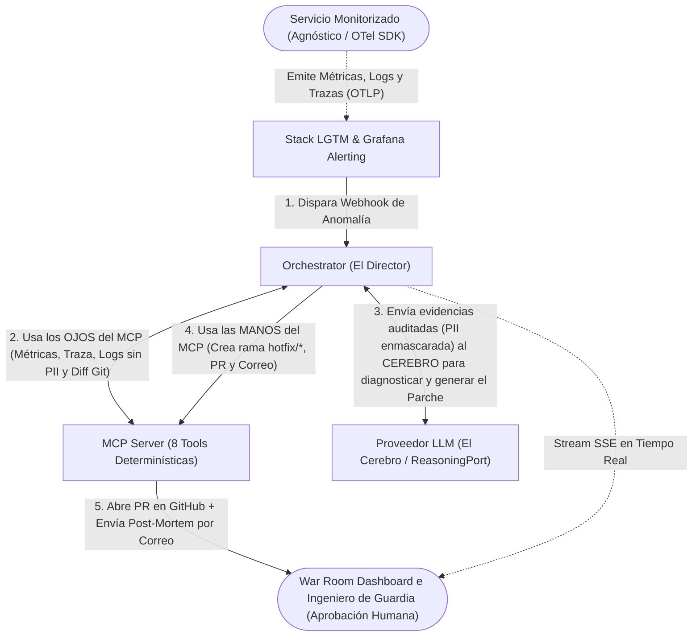

# Bienvenido a ZeroMTTR

**ZeroMTTR** es una plataforma autónoma de **Remediación de Incidentes y Gobernanza Humana**. Cuando un servicio monitorizado presenta degradación, ZeroMTTR correlaciona automáticamente métricas, trazas distribuidas, logs y cambios recientes en el código, abre un **Pull Request de hotfix** (validado automáticamente cuando el repositorio objetivo dispone de un workflow de CI configurado) y solicita **aprobación humana firmada por correo electrónico**, manteniendo el control final en manos del ingeniero de guardia.

:::important Gobernanza Human-in-the-Loop
ZeroMTTR **nunca realiza merge automático de Pull Requests ni dispara redespliegues a producción**. La aprobación del ingeniero registra la decisión auditable y cierra el incidente; el merge final permanece bajo control explícito del equipo en GitHub. Consulta todos los detalles en **[Alcance, Limitaciones y Gobernanza](/scope-and-limits)**.
:::

## Objetivo General

Entregar una plataforma funcional, demostrable en vivo y de código abierto que automatice la investigación de causa raíz (RCA) y la preparación de Pull Requests de corrección para incidentes en microservicios, utilizando **Model Context Protocol (MCP)**, **OpenTelemetry**, **enmascaramiento verificable de PII en el borde** y **gobernanza con humano en el circuito**.

## La Esencia del Sistema en 30 Segundos

Para comprender de inmediato el papel de cada bloque de la arquitectura, **ZeroMTTR** separa estrictamente **quién ejecuta herramientas (Servidor MCP)**, **quién sintetiza el diagnóstico y el código (Proveedor de IA)** y **quién coordina el flujo operativo (Orquestador)**:

### 1. Servidor MCP (`mcp-server`) — Los "Ojos y las Manos" (100% Determinístico, sin IA integrada)

Expone **8 herramientas estandarizadas** mediante **Model Context Protocol (MCP)**, divididas entre **lectura con poda de contexto (FinOps)** y **acciones auditables de gobernanza**:

**Ojos (Lectura, Diagnóstico y Poda de Contexto FinOps):**

- **Prometheus (Métricas):** ejecuta consultas PromQL por rango temporal, devolviendo un resumen estadístico (`min`, `max`, `avg`, `latest` y `p95`) para hasta 5 series temporales junto con las métricas de reducción de payload (FinOps).
- **Grafana Tempo (Análisis de Trazas):** analiza una traza distribuida OpenTelemetry para identificar el _Blast Radius_ (servicios afectados), los 5 spans con error más relevantes y los 5 spans más lentos.
- **Grafana Tempo (Búsqueda por TraceQL):** busca trazas mediante TraceQL (hasta 20 resultados), sirviendo tanto para consultas ad-hoc como para fallback cuando no existe un exemplar de métrica.
- **Grafana Loki (Logs Sanitizados):** consulta logs con LogQL aplicando truncamiento defensivo (hasta 100 líneas y 500 caracteres por línea) y telemetría FinOps sobre logs previamente enmascarados en la recolección.
- **GitHub (Inspección de Deploy Diff):** analiza el diff real entre la versión saludable anterior y la versión actual en el repositorio objetivo, sanitizando PII del autor, limitando la salida a 3 archivos y 1.500 caracteres por diff y devolviendo métricas FinOps.

**Manos (Acción y Gobernanza):**

- **GitHub (Remediación vía Pull Request):** crea o actualiza de forma idempotente una rama `hotfix/zeromttr-*`, aplica el parche y abre el Pull Request con el informe RCA y el origen del razonamiento (`llm` o `fallback`) — **sin realizar nunca merge automático**.
- **Grafana (Anotaciones de Incidente):** inyecta marcadores directamente en los gráficos de monitorización registrando la remediación y la decisión final del ingeniero de guardia.
- **Servicio de Correo (Notificación Post-Mortem):** envía el informe ejecutivo en HTML escapado con enlaces de aprobación y rechazo firmados criptográficamente (HMAC) únicamente en el fragmento `#` de la URL.

### 2. Proveedor de IA (`ReasoningPort`) — El "Cerebro"

El **Proveedor de IA** nunca accede directamente a bases de datos, sistemas de observabilidad ni GitHub. Recibe únicamente el resumen podado por el **Servidor MCP** y aprobado por la auditoría _fail-closed_ de privacidad (`PiiPromptGuard`), sintetiza la causa raíz (RCA) y genera el parche de código — registrando explícitamente si la respuesta provino del modelo de IA (`llm`) o del fallback determinístico (`fallback`).

### 3. Orquestador (`orchestrator`) — El "Director de Orquesta" (Flujo Determinístico)

El **Orquestador** coordina todo el ciclo del incidente de forma predecible: recibe la alerta de **Grafana**, acciona los **Ojos** del **Servidor MCP** para recopilar evidencias, valida la ausencia de PII (`PiiPromptGuard`), envía el contexto auditado al **Proveedor de IA** para diagnosticar y generar el parche y, finalmente, acciona las **Manos** del **Servidor MCP** para abrir el Pull Request en **GitHub** (ejecutando el CI de la rama cuando el repositorio objetivo dispone de un workflow cuyos disparadores y filtros coincidan con el push o PR de hotfix) y enviar el correo de aprobación al ingeniero de guardia — transmitiendo cada etapa en vivo vía SSE al **War Room Dashboard**.

## Mapa de este Manual

| Sección                                                                  | Qué encontrarás                                                                        |
| :----------------------------------------------------------------------- | :------------------------------------------------------------------------------------- |
| **[Arquitectura del Sistema](/architecture)**                            | Estilo arquitectónico, componentes, visión de contexto (C4 Nivel 1) y estados.         |
| **[Usando el War Room](/war-room)**                                      | Explicación de cada área del panel, KPIs, telemetría y pestañas de evidencias.         |
| **[Modo Replay vs. Modo Live](/demo-modes)**                             | Cómo probar la demostración pública y ejecutar incidentes reales de extremo a extremo. |
| **[Aprobación Humana](/human-approval)**                                 | Cómo funcionan el correo Post-Mortem, los enlaces firmados y la pantalla de decisión.  |
| **[Alcance, Limitaciones y Gobernanza](/scope-and-limits)**              | Qué automatiza ZeroMTTR, límites intencionales (sin auto-merge), alcance PII y escala. |
| **[Configuración en Tiempo Real](/settings)**                            | Cómo ajustar cooldowns, modelos de IA, nivel de log y consultar la auditoría.          |
| **[Conectando tu Servicio](/connect-service)**                           | Cómo integrar aplicaciones propias (modo cooperativo o pasivo vía Prometheus).         |
| **[Integración MCP](/mcp-clients)**                                      | Cómo conectar Cursor, Claude o MCP Inspector a las 8 herramientas de la plataforma.    |
| **[Instalación y Solución de Problemas](/installation-troubleshooting)** | Cómo ejecutar localmente con Docker Compose, scripts CLI y errores frecuentes.         |

:::tip ¿Quieres verlo funcionando ahora?
Abre el **War Room** ([zeromttr.agjworks.com](https://zeromttr.agjworks.com)), abre el menú **Demostración** en la esquina superior derecha y haz clic en **Simular Incidente** en Modo Replay. En ~25 segundos verás todo el flujo en tiempo real.
:::
