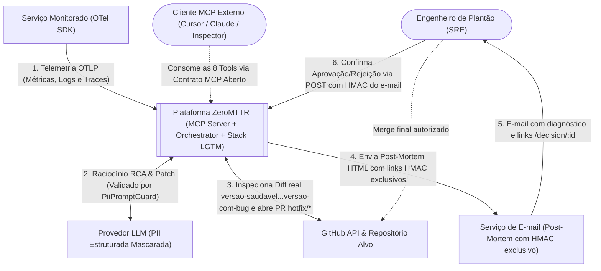
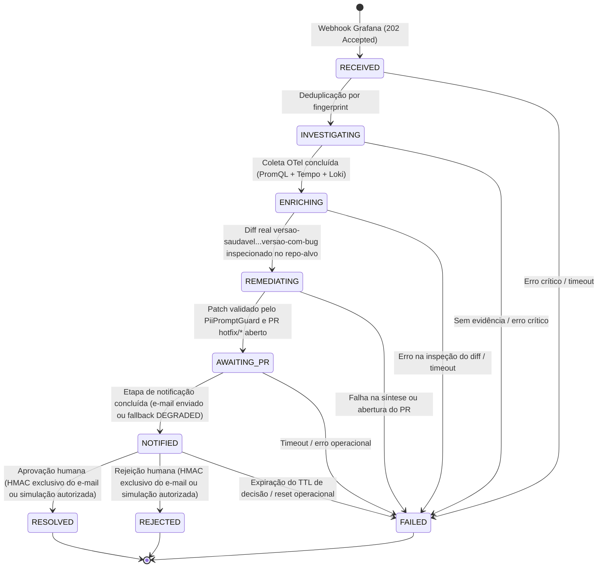

# Arquitetura do Sistema

O **ZeroMTTR** foi projetado com **Clean Architecture** e desacoplamento total em relação ao serviço monitorado: qualquer aplicação capaz de emitir telemetria via **OpenTelemetry (OTLP)** e versionada em Git pode ser operada pela plataforma sem alterar o núcleo do orquestrador nem do servidor MCP.

## Estilo Arquitetural

| Aspecto                     | Decisão                                                                                                                                                                      |
| :-------------------------- | :--------------------------------------------------------------------------------------------------------------------------------------------------------------------------- |
| **Estilo macro**            | **Event-driven + Agentic** — webhooks do Grafana disparam o fluxo autônomo, com fallback determinístico garantindo conclusão caso o provedor de IA falhe.                    |
| **Estilo interno**          | **Arquitetura Hexagonal (Ports & Adapters)** em `apps/orchestrator` e `apps/mcp-server`, isolando regras de negócio de detalhes HTTP e SDKs externos.                        |
| **Ciclo de vida**           | **Máquina de Estados do Incidente** pura controlando cada transição de forma auditável e previsível.                                                                         |
| **Protocolo de integração** | **MCP sobre HTTP** (_Streamable HTTP_), compatível tanto com o orquestrador interno quanto com clientes externos (`.mcp.json`).                                              |
| **Segurança de decisão**    | **HMAC exclusivo por e-mail** — assinaturas de aprovação/rejeição trafegam apenas no `#fragment` dos links enviados por e-mail, nunca no SSE ou em endpoints de leitura.     |
| **Implantação**             | Ambiente local via `docker-compose.yml` e produção em VPS Linux via `docker-compose.prod.yml` com **Traefik + Let's Encrypt**, lendo segredos de `.env` fora do repositório. |

## Padrões por Componente

| Componente                                  | Padrão                                               | Organização                                                                                        |
| :------------------------------------------ | :--------------------------------------------------- | :------------------------------------------------------------------------------------------------- |
| **`apps/orchestrator` e `apps/mcp-server`** | **Hexagonal (Ports & Adapters)**                     | `domain` → `application` → `ports` → `adapters`, com composição das dependências em `main.ts`.     |
| **`apps/target-app-demo`**                  | **MVC em camadas**                                   | `routes` → `controllers` → `services` → `repositories` (serviço alvo de demonstração desacoplado). |
| **`apps/dashboard`**                        | **Single-Pane War Room com Signals** (Angular)       | Componentes standalone (`WarRoomComponent` + `DecisionComponent`) com PrimeNG Aura Dark.           |
| **`apps/docs`**                             | **Manual Estático Multilíngue** (Docusaurus + Nginx) | Conteúdo em `pt-BR`, `en-US` e `es-ES` servido em container dedicado de baixa pegada de memória.   |

## Visão de Contexto (C4 Nível 1)

O diagrama abaixo apresenta as fronteiras da plataforma ZeroMTTR e como ela interage com o serviço monitorado, clientes MCP externos, provedor de IA, GitHub, serviço de e-mail e o engenheiro de plantão:

## Máquina de Estados do Incidente

Todo incidente processado pelo orquestrador percorre uma sequência explícita de estados, transmitida em tempo real para o **Fluxo de Remediação** no topo do War Room:

### Resumo dos Estados

| Estado          | O que está acontecendo                                                                                                                                                   |
| :-------------- | :----------------------------------------------------------------------------------------------------------------------------------------------------------------------- |
| `RECEIVED`      | Alerta recebido via webhook do Grafana e aceito após validação do token e verificação de deduplicação/cooldown.                                                          |
| `INVESTIGATING` | Coleta de métricas (Prometheus), traces com erro (Tempo) e logs mascarados (Loki) por meio das tools do MCP Server.                                                      |
| `ENRICHING`     | Inspeção do diff de código entre a versão saudável anterior e a versão atual no repositório Git alvo.                                                                    |
| `REMEDIATING`   | Auditoria _fail-closed_ de privacidade (`PiiPromptGuard`), síntese do RCA/patch pela IA, criação da branch `hotfix/zeromttr-*` e abertura do Pull Request no GitHub.     |
| `AWAITING_PR`   | Pull Request de remediação já aberto e registrado no GitHub, aguardando a etapa de notificação ao plantonista.                                                           |
| `NOTIFIED`      | Pull Request aberto e etapa de notificação concluída (e-mail Post-Mortem enviado ou registrado como `DEGRADED` em falha de entrega), aguardando decisão humana assinada. |
| `RESOLVED`      | Correção aprovada pelo engenheiro de plantão e incidente encerrado com sucesso.                                                                                          |
| `REJECTED`      | Correção rejeitada pelo plantonista (aciona a janela de _Human Takeover_ / cooldown pós-rejeição).                                                                       |
| `FAILED`        | Falha crítica durante a investigação ou integração externa, registrada para inspeção no War Room.                                                                        |

:::info Aprofundamento de Engenharia
Para diagramas detalhados de contêineres (C4 Nível 2), sequência ponta a ponta, classes hexagonais, topologia de rede na VPS e ADRs completos, consulte a [Documentação de Engenharia no GitHub](https://github.com/AdmilsonGoncalves/zeromttr/tree/master/docs).
:::
