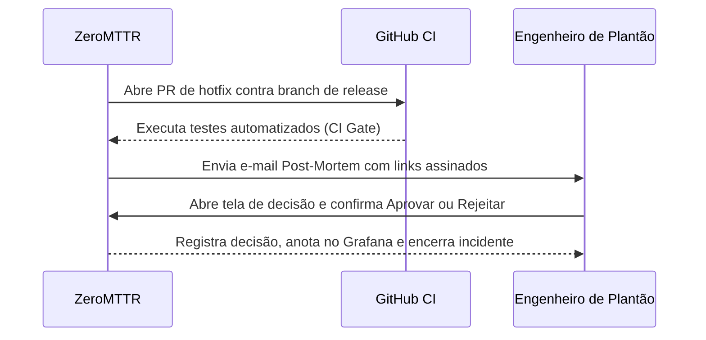

# Aprovação Humana e Governança

O ZeroMTTR segue o princípio de **Human-in-the-Loop**: a automação acelera o diagnóstico e prepara o Pull Request de correção (validado automaticamente quando o repositório alvo possui workflow de CI configurado), mas **nenhuma alteração é aplicada automaticamente em produção sem decisão explícita do plantonista**.

## Fluxo de decisão

## O que vem no e-mail Post-Mortem

- **Resumo executivo da causa raiz** e lista de serviços afetados.
- **Link direto para o Pull Request** no GitHub para revisar o diff e o resultado dos testes de CI.
- **Dois botões assinados criptograficamente:** **Aprovar Hotfix** e **Rejeitar Hotfix**, com prazo de expiração configurável (padrão: 15 minutos).

## Segurança dos links de decisão

- A assinatura criptográfica (HMAC) trafega **exclusivamente no fragmento `#` da URL** — navegadores nunca enviam o trecho após `#` em requisições HTTP `GET`, logs de proxy ou cabeçalhos `Referer`.
- Abrir o link do e-mail **não executa a decisão automaticamente** (proteção contra pré-carregamento de antivírus/clientes de e-mail). A tela exibe os detalhes do incidente e exige um clique explícito de confirmação.
- Cada incidente aceita **apenas uma decisão final**. Tentativas repetidas após o encerramento são rejeitadas automaticamente.

## O que acontece após Aprovar ou Rejeitar

- **Aprovar:** o incidente muda para **Resolvido**, registra uma anotação no Grafana e, se o modo de demonstração com restauração automática estiver habilitado, limpa o estado de caos do serviço de exemplo. O merge final do PR permanece sob controle humano no GitHub.
- **Rejeitar (Human Takeover):** o incidente muda para **Rejeitado**, o Pull Request permanece sem merge e o ZeroMTTR entra em **janela de cooldown pós-rejeição** (padrão: 15 minutos) para o mesmo alerta — evitando reabrir novos incidentes enquanto o engenheiro assume a investigação manual.

:::important Aprovar não faz merge nem deploy automático
Confirmar **Aprovar** encerra o incidente no ZeroMTTR e registra a aprovação no Grafana, mas **não executa `git merge` no Pull Request nem dispara deploy em produção**. Após revisar o diff e os checks de CI, o merge final é feito manualmente no GitHub. Consulte **[Escopo, Limitações e Governança](/scope-and-limits)** para conhecer todos os limites operacionais.
:::
