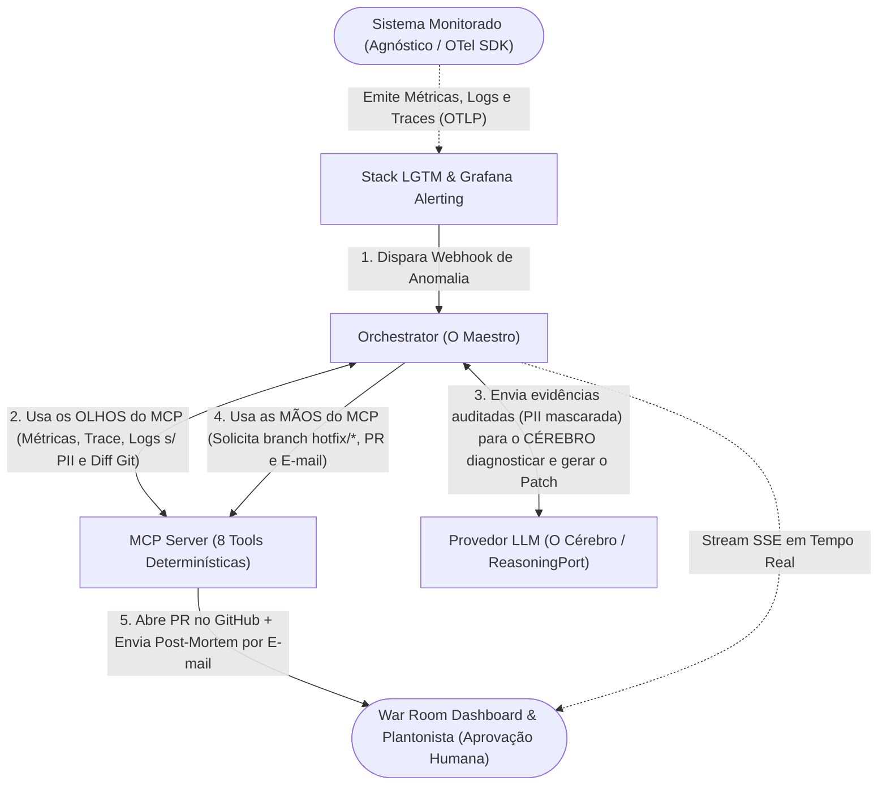

# Bem-vindo ao ZeroMTTR

O **ZeroMTTR** é uma plataforma autônoma de **Remediação de Incidentes e Governança Humana**. Quando um serviço monitorado apresenta degradação, o ZeroMTTR investiga automaticamente métricas, traces distribuídos, logs e mudanças recentes no código, propõe uma correção em um **Pull Request** (validado automaticamente quando o repositório alvo possui workflow de CI configurado) e solicita **aprovação humana por e-mail** — mantendo o controle final nas mãos do engenheiro de plantão.

:::important Governança Human-in-the-Loop
O ZeroMTTR **não realiza merge automático de Pull Requests nem dispara redeploy em produção**. A aprovação pelo plantonista registra a decisão auditável e encerra o incidente; o merge final permanece sob controle explícito da equipe no GitHub. Veja todos os detalhes em **[Escopo, Limitações e Governança](/scope-and-limits)**.
:::

## Objetivo Geral

Entregar uma plataforma funcional, demonstrável ao vivo e de código aberto que automatize a investigação de causa raiz (RCA) e a preparação de Pull Requests de correção para incidentes em microsserviços, utilizando **Model Context Protocol (MCP)**, **OpenTelemetry**, **mascaramento verificável de PII na borda** e **governança com humano no circuito**.

## A Essência do Sistema em 30 Segundos

Para compreender imediatamente o papel de cada bloco da arquitetura, o **ZeroMTTR** separa estritamente **quem executa ferramentas (Servidor MCP)**, **quem sintetiza o diagnóstico e o código (Provedor de IA)** e **quem coordena o fluxo operacional (Orquestrador)**:

### 1. Servidor MCP (`mcp-server`) — Os "Olhos e as Mãos" (100% Determinístico, sem IA embutida)

Expõe **8 ferramentas padronizadas** via **Model Context Protocol (MCP)**, divididas entre **leitura com poda de contexto (FinOps)** e **ações auditáveis de governança**:

**Olhos (Leitura, Diagnóstico e Poda de Contexto FinOps):**

- **Prometheus (Métricas):** executa consultas PromQL em intervalo de tempo, retornando um resumo estatístico (`min`, `max`, `avg`, `latest` e `p95`) para até 5 séries temporais, acompanhado das métricas de redução de payload (FinOps).
- **Grafana Tempo (Análise de Trace):** analisa um trace distribuído OpenTelemetry para identificar o _Blast Radius_ (serviços afetados), os 5 spans com erro mais relevantes e os 5 spans mais lentos.
- **Grafana Tempo (Busca por TraceQL):** pesquisa traces por consulta TraceQL (até 20 resultados), atendendo investigações sob demanda e atuando como fallback quando não há exemplar de métrica.
- **Grafana Loki (Logs Sanitizados):** consulta logs via LogQL aplicando truncamento defensivo (até 100 linhas e 500 caracteres por linha) e contabilização FinOps, operando sobre logs já mascarados na coleta.
- **GitHub (Inspeção de Deploy Diff):** analisa o diff real entre a versão saudável anterior e a versão atual no repositório alvo, sanitizando dados pessoais do autor, limitando a até 3 arquivos e 1.500 caracteres por diff e retornando métricas FinOps.

**Mãos (Ação e Governança):**

- **GitHub (Remediação via Pull Request):** cria ou atualiza de forma idempotente uma branch `hotfix/zeromttr-*`, aplica o patch e abre o Pull Request com o relatório RCA e a origem do raciocínio (`llm` ou `fallback`) — **sem nunca realizar merge automático**.
- **Grafana (Anotações de Incidente):** registra marcadores diretamente nos gráficos de monitoramento sinalizando a remediação e a decisão final do plantonista.
- **Serviço de E-mail (Notificação Post-Mortem):** envia o relatório executivo em HTML escapado contendo os links de aprovação e rejeição assinados criptograficamente (HMAC) exclusivamente no fragmento `#` da URL.

### 2. Provedor de IA (`ReasoningPort`) — O "Cérebro"

O **Provedor de IA** não acessa bancos de dados, ferramentas de observabilidade nem o GitHub diretamente. Ele recebe apenas o resumo podado pelo **Servidor MCP** e aprovado pela auditoria _fail-closed_ de privacidade (`PiiPromptGuard`), sintetiza a causa raiz (RCA) e gera o patch de código — registrando explicitamente se a resposta veio do modelo de IA (`llm`) ou do fallback determinístico (`fallback`).

### 3. Orquestrador (`orchestrator`) — O "Maestro" (Fluxo de Trabalho Determinístico)

O **Orquestrador** coordena todo o ciclo do incidente de forma previsível: recebe o alerta do **Grafana**, aciona os **Olhos** do **Servidor MCP** para coletar evidências, valida a ausência de PII (`PiiPromptGuard`), envia o contexto auditado ao **Provedor de IA** para diagnóstico e síntese do patch e, por fim, aciona as **Mãos** do **Servidor MCP** para abrir o Pull Request no **GitHub** (disparando o CI da branch quando o repositório alvo possui workflow configurado) e enviar o e-mail de aprovação ao plantonista — transmitindo cada etapa ao vivo via SSE para o **War Room Dashboard**.

## Mapa deste Manual

| Seção                                                             | O que você encontra                                                                      |
| :---------------------------------------------------------------- | :--------------------------------------------------------------------------------------- |
| **[Arquitetura do Sistema](/architecture)**                       | Estilo arquitetural, componentes, visão de contexto (C4 Nível 1) e máquina de estados.   |
| **[Usando o War Room](/war-room)**                                | Explicação de cada área do painel, KPIs, telemetria e abas de evidências.                |
| **[Modo Replay vs. Modo Live](/demo-modes)**                      | Como experimentar a demonstração pública e executar incidentes reais ponta a ponta.      |
| **[Aprovação Humana](/human-approval)**                           | Como funciona o e-mail Post-Mortem, links assinados e a tela de decisão.                 |
| **[Escopo, Limitações e Governança](/scope-and-limits)**          | O que o ZeroMTTR faz, o que não faz (sem auto-merge), limites de PII e escala.           |
| **[Configurações em Tempo Real](/settings)**                      | Como ajustar cooldowns, modelo de IA, nível de log e consultar o histórico de auditoria. |
| **[Conectando seu Serviço](/connect-service)**                    | Como integrar aplicações próprias (modo cooperativo ou passivo via Prometheus).          |
| **[Integração MCP](/mcp-clients)**                                | Como conectar Cursor, Claude ou MCP Inspector às 8 ferramentas da plataforma.            |
| **[Instalação e Troubleshooting](/installation-troubleshooting)** | Como rodar localmente com Docker Compose, usar scripts CLI e resolver problemas comuns.  |

:::tip Quer ver funcionando agora?
Acesse o **War Room** ([zeromttr.agjworks.com](https://zeromttr.agjworks.com)), abra o menu **Demonstração** no canto superior direito e clique em **Simular Incidente** no Modo Replay. Em ~25 segundos você acompanhará todo o fluxo em tempo real.
:::
