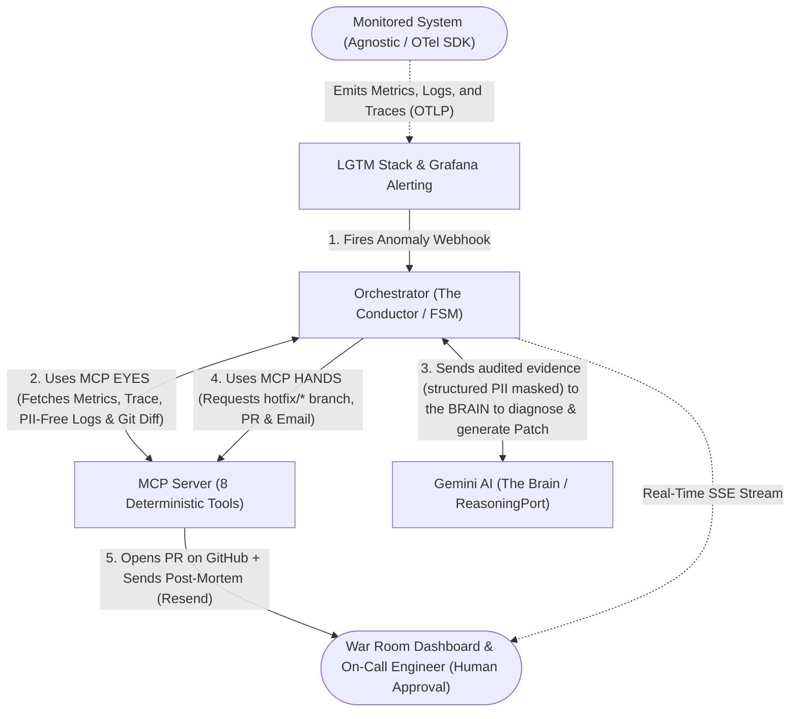
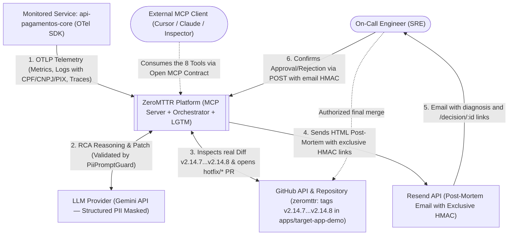
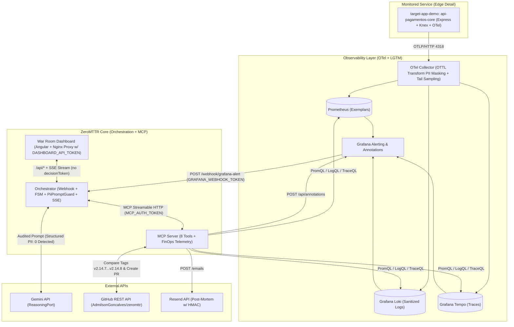
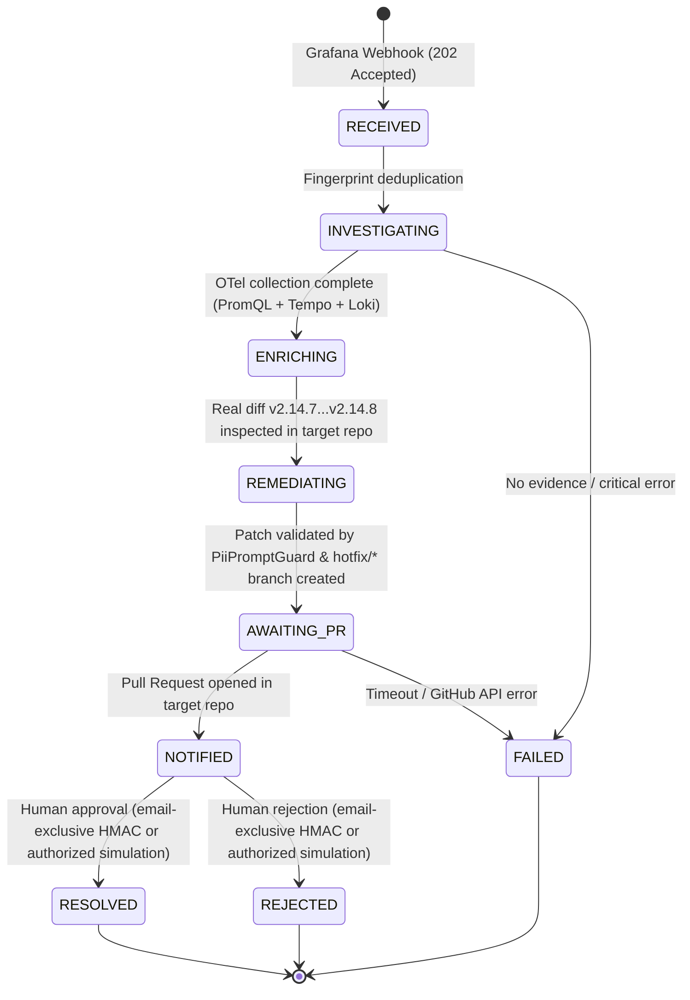
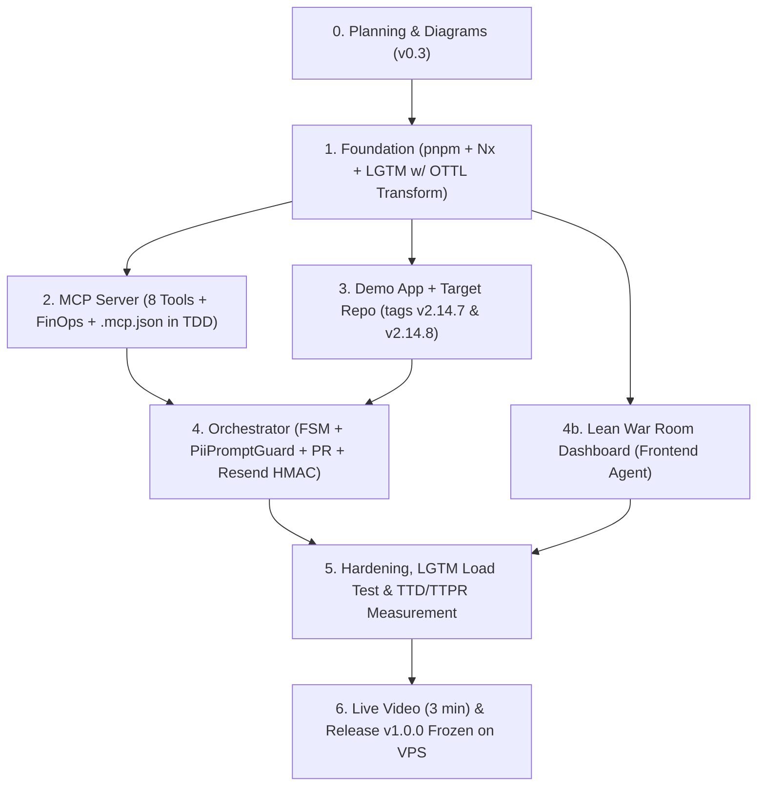

# ⚡ ZeroMTTR — Master Architecture Document and Project Plan

| Field | Value |
| :--- | :--- |
| **Project** | ZeroMTTR — Autonomous AIOps & Incident Remediation |
| **Primary Track** | **Logistics & Automation** (Operational workflow automation and autonomous integrations across critical systems) |
| **Domain-Agnostic Architecture** | Decoupled from the monitored service (*Clean Architecture* — the workload is an edge detail connected via OTLP and Git). Demonstrated with **`api-pagamentos-core`** (applicable to PIX settlement, logistics dispatch, e-commerce, etc.) |
| **Organization** | **AGJ Works** (`https://agjworks.com`) |
| **Production Environment (Demo)** | `https://zeromttr.agjworks.com` (Linux VPS + Traefik + Cloudflare) |
| **Repository (Single Monorepo)** | `https://github.com/AdmilsonGoncalves/zeromttr` (healthy `master` branch at tag `v2.14.7`; `release/target-v2.14.8` branch at tag `v2.14.8` containing the regression in `apps/target-app-demo` targeted by hotfix PRs) |
| **Status** | Planning (v0.3 — OTel/LGTM + Open MCP + GitHub Remediation + Isolated HMAC Resend). Implementation 100% written from scratch after 2026-11-04 21:00 BRT |
| **System Diagrams (UML / Network)** | [`docs/en-US/01_system_diagrams.md`](./01_system_diagrams.md) (Use Cases, E2E Sequence, Hexagonal Classes, and Network Topology) |
| **Technical Documents** | Implementation slices in [`docs/en-US/tech/`](./tech/) (see §12) |

---

## 1. Introduction and Positioning

### 1.1 Operational Workflow Automation and Open Architecture (Clean Architecture)
In microservice architectures that support critical operations in Brazil — such as instant payment processing (PIX), logistics dispatch systems, billing, or checkout — the time between a degradation alert and a production fix is still dominated by fragmented manual work. Following **Robert C. Martin's (*Clean Architecture*)** principle of **keeping the architecture open and deferring details**, **ZeroMTTR** was designed as an engine **100% agnostic to the monitored service's domain**: any application that emits OpenTelemetry (OTLP) telemetry and has a Git repository can be connected without changing a single line of the orchestrator or the MCP server.

In real-world operations, incident response faces three bottlenecks:
1. **Manual fragmentation across systems:** observability tools stop at the text alert, forcing the on-call engineer to manually cross-reference metrics (Prometheus), distributed traces (Tempo), logs (Loki), and deployment history (GitHub).
2. **Risk of leaking Brazilian PII when using AI:** production error logs frequently contain **CPF, CNPJ, PIX keys/emails, and JWT/Bearer tokens**. Sending these raw logs to external LLMs violates privacy rules and data governance.
3. **Unpredictable token costs:** sending raw time-series dumps, full span trees, and large *git diffs* overflows the context window and drives up LLM costs.

**ZeroMTTR** integrates these systems and automates the end-to-end workflow in seconds:

> **Alert (Grafana) → Edge PII Masking (OTel Collector `transform`) → Deterministic Collection via MCP (OTel/LGTM + GitHub Diff `v2.14.7...v2.14.8`) → Fail-Closed Audit (`PiiPromptGuard`) & Patch Synthesis via LLM (`ReasoningPort`) → CI-Validated Pull Request → Post-Mortem with Human Approval Signed Exclusively via Email (Resend HMAC in `#fragment`).**

### 1.2 Positioning and Differentiation (State of the Art in AI SRE)
The IT operations agent category features relevant commercial and open-source tools. **ZeroMTTR** does not aim to reinvent the generic "alert-to-PR" concept, but rather to deliver out of the box, in an integrated way, three capabilities that — to the extent verified in public tool documentation as of Nov/2026 — typically require external customization or proprietary SaaS licensing:

| Criterion | HolmesGPT (CNCF) / OpenSRE (Default Setup) | Datadog Bits AI / Sentry Seer | **ZeroMTTR (This Project)** |
| :--- | :--- | :--- | :--- |
| **Deployment Model** | Self-hosted (primary focus on investigation / ChatOps integration) | Proprietary SaaS (coupled to vendor cloud) | **100% Self-Hosted & Open Source**, with an **open MCP contract** consumable by external clients (Claude Desktop, Cursor, MCP Inspector) and by the orchestrator |
| **Verifiable PII Protection Before LLM** | No native algorithmic pre-prompt CPF/CNPJ guardrail identified in public documentation (Nov/2026) | Processed on the SaaS provider's infrastructure | **Independent dual barrier:** (1) OTTL (`transform`) masking at the OTel Collector edge and (2) **`PiiPromptGuard` (fail-closed)** with check-digit validation (modulo-11) for CPF/CNPJ and structural JWT detection before sending to the LLM |
| **Per-Incident Payload Reduction Measurement (FinOps)** | Focus on context window limits | Billing managed within SaaS license | **Context pruning metric per MCP tool call:** computes `raw_bytes_fetched` vs. `compacted_bytes_sent_to_llm` (statistical summarization + policy-based truncation) and displays estimated tokens saved (`bytes / 4`) |
| **Remediation Governance** | PR creation via configurable integrations | Opens PR directly in the SaaS platform | Opens **Pull Request against the release branch (`release/target-v2.14.8`)**, triggers verification CI (`hotfix-verify.yml`), and requires **human approval via an exclusive HMAC link in the email `#fragment` (Resend)** |

---

## 2. Objectives and Metrics

### 2.1 Overall Objective
Deliver a functional, live-demonstrable, open-source platform that automates root cause analysis (RCA) and the preparation of fix Pull Requests for microservice incidents, using **Model Context Protocol (MCP)**, **OpenTelemetry**, **verifiable edge PII masking**, and **human-in-the-loop governance**.

### 2.2 The Essence of the System in 30 Seconds (The Conductor, the Brain, and the Eyes/Hands)
To immediately understand the role of each architectural block, **ZeroMTTR** strictly separates **who executes tools (MCP)**, **who synthesizes the diagnosis and code (AI)**, and **who coordinates the workflow (Orchestrator)**:

1. **The `mcp-server` (MCP) = The "Eyes and Hands" (100% Deterministic, no embedded AI):**
   - The **Model Context Protocol (MCP)** acts as a universal interface exposing **8 standardized tools** divided into two groups:
     - **Eyes (Reading and FinOps Context Pruning):** `execute_promql_range` (Prometheus), `analyze_otel_trace` (Tempo), `search_traces_by_traceql` (ad-hoc TraceQL search and fallback when no exemplar is present), `query_loki_logs` (Loki), and `inspect_git_deploy_diff` (compares the previous healthy version with the current version on GitHub).
     - **Hands (Action and Governance):** `create_remediation_pr` (creates a `hotfix/zeromttr-*` branch, applies the fix commit — always at the semantic `PATCH` level — and opens the Pull Request on GitHub), `annotate_grafana_incident` (marks the Grafana chart), and `send_post_mortem_resend` (sends the report by email).
2. **The AI (`Gemini API` via `ReasoningPort`) = The "Brain":**
   - The AI does **not** access databases, observability backends, or GitHub directly. It receives only the summary pruned by MCP and validated in *fail-closed* mode by `PiiPromptGuard`, synthesizes the root cause (RCA), and writes the fixed code (the surgical patch), explicitly recording `reasoningSource: 'llm' | 'fallback'`.
3. **The `orchestrator` = The "Conductor" (Deterministic Workflow + FSM):**
   - Receives the Grafana alert → predictably executes the collection sequence on the **MCP Eyes** → validates the absence of PII (`PiiPromptGuard`) and sends it to the **Brain (AI)** to synthesize the RCA and generate the patch → invokes the **MCP Hands** to open the Pull Request on GitHub (triggering branch CI) and send the human approval email to the on-call engineer, while streaming everything live via SSE to the **War Room Dashboard**.



### 2.3 Measurable Operational Indicators (KPIs)
To avoid skewed comparisons with processes that include full production deployment, ZeroMTTR specifically measures the time to deterministic diagnosis (**TTD**) and the time to a tested Pull Request ready for human review (**TTPR**), compared against a **timed manual baseline** (the same 7 steps executed manually by an engineer):

| KPI | ZeroMTTR Target | Timed Manual Baseline (7 steps) |
| :--- | :--- | :--- |
| **TTD (Time to Deterministic RCA + Deploy Diff)** | **≤ 15 s** | ~12 to 18 min (correlate PromQL, exemplar, Tempo trace, Loki logs, and `git diff`) |
| **TTPR (Time to Reviewable Hotfix PR on GitHub)** | **≤ 30 s** | ~25 to 40 min (isolate faulty line, create branch, code fix, run tests, and open PR) |
| **Time to signed Post-Mortem delivery (Resend)** | **≤ 45 s** | ~45 to 60 min (write executive summary with evidence and links) |
| **Automated test coverage (`domain/` + `application/`)** | **≥ 80%** | — |

### 2.4 Five Verifiable Technical Differentiators
1. **Independent Dual PII Protection Barrier (OTTL `transform` + Fail-Closed `PiiPromptGuard` covering structured patterns of all 5 Official BACEN PIX Key Types):** in the 1st barrier, the OTel Collector applies an OTTL transformation (`replace_pattern` on `log.body` and attributes) masking CPF, CNPJ, Email, Phone (ANATEL standard), Random PIX Key (EVP / UUID v4 conditioned on PIX label), and Bearer/JWT at ingestion; in the 2nd (independent) barrier, `PiiPromptGuard` inspects all free-text fields (logs, span error messages, commits, and Git diff — excluding raw Prometheus numeric series), validating check digits (Brazilian Federal Revenue modulo-11) for CPF/CNPJ (with or without punctuation), ANATEL rules for mobile (`9xxxx-xxxx`) and landline (`[2-5]xxx-xxxx`) phones, emails, EVP random keys (`UUID v4` `4xxx-[89ab]xxx` conditioned on PIX label), and JWT structure (`eyJ...` even without `Bearer`). If any residual leak is detected (`leakedPatternsDetected > 0`), it **aborts sending to the external LLM (fail-closed)** and triggers the local fallback.
2. **FinOps Payload Reduction Telemetry (Context Pruning) in MCP:** each tool computes `raw_bytes_fetched` vs. `compacted_bytes_sent_to_llm` (obtained via statistical series summarization and policy-based truncation), dynamically displaying at the top of the dashboard the percentage byte reduction and estimated tokens saved (`Math.round((raw - compacted) / 4)`).
3. **Open MCP Contract (Interoperable with External Clients):** the 8 MCP tools are not locked to the orchestrator's workflow; the repository includes a `.mcp.json` configuration allowing any external MCP Host (**MCP Inspector / Cursor / Claude Desktop**) to freely select and invoke tools over the LGTM stack and GitHub.
4. **Evidence Coverage Score (`0–100%` / `4 of 4 signals`) & Blast Radius:** linearly and transparently measures how many independent signals converged on the diagnosis (+25% PromQL anomaly, +25% `trace_id` via Exemplar, +25% error Span in Tempo, +25% correlated Log in Loki + isolated commit in `v2.14.7...v2.14.8` diff = `4/4 Signals — 100%`), degrading proportionally (`3/4 — 75%`, `2/4 — 50%`) if any signal is missing, while also listing affected services (`services_involved`).
5. **Real Live Execution (< 25s) with Explicit `reasoningSource` + Transparent Replay Mode:** the demo video and evaluations with a key (`LIVE_DEMO_KEY`) or via local Docker run the **100% real `Live` flow** (displaying `reasoningSource: 'llm'` in SSE and in the PR body to prove the synthesis came from live Gemini, not fallback). On the public internet-facing VPS, anonymous visitors without a key watch `Replay` mode by default (clearly labeled in the UI and README) to protect API quotas.

### 2.5 Out of Scope and Declared Limits (MVP)
- **No automatic merge or production redeploy:** by governance decision (*human-in-the-loop*), the autonomous cycle ends upon opening the CI-validated Pull Request on the release branch (`release/target-v2.14.8`) and recording the signed human decision. In the demo, fault simulation in the `target-app-demo` container is controlled by in-memory state and restored via the reset script/button.
- **PII detection scope:** OTTL masking and `PiiPromptGuard` cover the **structured patterns of the 5 official Central Bank of Brazil (BACEN) PIX Key types** (CPF and CNPJ with Federal Revenue Modulo-11, Mobile/Landline Phone with ANATEL rules, standard unquoted Email `[A-Za-z0-9._%+-]+@domain` excluding quoted local parts permitted by RFC 5322, and Random EVP/UUID v4 RFC 4122 Key conditioned on `pix`/`pixKey`/`chave_pix`/`evp` context), as well as JWT/Bearer tokens (unmasked phones and UUID v4 require a contextual marker to avoid false positives with correlation IDs/Unix timestamps; proper names in free text are outside the deterministic scope).
- Multi-tenancy, multi-node high availability, and long-term retention for metrics/logs/traces.

---

## 3. Scope and Stakeholders

| Stakeholder | Interest |
| :--- | :--- |
| On-Call Engineer (SRE) / Logistics Operations | Receive RCA correlated to the offending commit and a tested Pull Request in seconds; approve or reject via a signed link in their email |
| Platform / FinOps Team | Ensure no personal data (CPF/CNPJ/PIX/JWT) is sent to external LLMs and keep token consumption predictable |
| Developers / Open Source Community | Connect any MCP-compatible client (`.mcp.json`) to the 8 observability and remediation tools |

---

## 4. Technologies Involved

| Layer | Technology | Role |
| :--- | :--- | :--- |
| Runtime & Monorepo | **Node.js 24 LTS**, **pnpm** (`pnpm-workspace.yaml`), **Nx** (`nx.json`), TypeScript (`strict`, `ES2024`, `NodeNext`) | Task orchestration, build/test caching, and packages in `apps/*` and `libs/*` |
| Instrumentation | OpenTelemetry SDK (Node) | Emission of traces, metrics (with exemplars), and structured logs |
| Ingestion & Sanitization | OTel Collector Contrib 0.114+ | `memory_limiter`, **`transform` (OTTL regex masking on `log.body` and attributes)**, `redaction` (spans), `tail_sampling` |
| Storage | Prometheus (exemplars), Loki, Tempo | LGTM stack |
| Visualization / Trigger | Grafana 11.2+ (Alerting) | Incident webhook and annotations API (`POST /api/annotations`) |
| Agent Protocol | **MCP** (`@modelcontextprotocol/sdk`) | Standardized open interface of 8 AIOps tools |
| Agent LLM | Google Gemini API (`ReasoningPort`, model configurable via `LLM_MODEL`, default `gemini-3.5-flash`) | RCA synthesis and surgical patch generation (with explicit `reasoningSource: 'llm' \| 'fallback'`) |
| **Deploy Inspection & Auto-Remediation** | **GitHub REST API (Octokit)** on `apps/target-app-demo` in the `zeromttr` repository | Real comparison between tags `v2.14.7...v2.14.8`, code reading, `hotfix/zeromttr-*` branch creation, and Pull Request creation targeting `release/target-v2.14.8` |
| **Notification & Governance** | **Resend** | HTML Post-Mortem delivery (`sre@zeromttr.agjworks.com`) exclusively containing HMAC-signed decision links |
| Testing | Vitest, Supertest, `nock`/MSW + **Test Helpers (`test/helpers/`)** | **Testing Trophy (Integration & E2E priority)** exercising HTTP routes, MCP, and `PiiPromptGuard` end-to-end (Happy & Unhappy Paths); unit tests restricted to pure helper functions |
| Quality | ESLint, Prettier, Husky + lint-staged, Commitlint | Code standards and hexagonal boundary enforcement |
| Infrastructure | Docker, Docker Compose | Local execution (`docker-compose.yml`) and VPS production (`docker-compose.prod.yml`) |
| CI/CD | GitHub Actions | `ci.yml`, `hotfix-verify.yml` (verifies `hotfix/zeromttr-*` PRs), and `cd-release.yml` (VPS deploy frozen only for `v1.*.*` tags or manual dispatch) |
| Demo Workload | Express + Knex + PostgreSQL | `api-pagamentos-core` service with reproducible connection pool saturation fault |
| Frontend | **Angular (latest stable)**, **PrimeNG (Aura Dark preset)**, Tailwind CSS v4 + `tailwindcss-primeui` | Lean War Room Dashboard (Single-Pane with interactive horizontal FSM Flow bar at top + OTel/PII/Diff evidence panel + PR/Resend panel) + `/decision/:id` route |

---

## 5. System Architecture

### 5.1 Architectural Style
| Aspect | Decision |
| :--- | :--- |
| Macro style | **Event-driven + Agentic** (webhook triggers the agent; deterministic fallback guarantees completion if the LLM fails) |
| Internal style | **Hexagonal (Ports & Adapters) / Clean Architecture** in `apps/orchestrator` and `apps/mcp-server` |
| Behavior | Pure **Finite State Machine (FSM)** controlling the incident lifecycle |
| Integration | **MCP over HTTP** (Streamable HTTP; compatible with external clients via `.mcp.json`) |
| Decision Security | **Email-exclusive HMAC:** approval/rejection signatures travel only in the email sent by Resend, never in SSE or public read endpoints |
| Deployment | Local via `docker-compose.yml` · Production on **Linux VPS** via `docker-compose.prod.yml` + **Traefik + Cloudflare**, reading secrets from an external file outside the repository (e.g., `/path/to/secrets/.env`) |

### 5.2 Patterns per Component
| Component | Pattern | Organization |
| :--- | :--- | :--- |
| `apps/orchestrator/` and `apps/mcp-server/` | **Hexagonal (Ports & Adapters)** | `domain` → `application` → `ports` → `adapters`, with composition root in `main.ts` |
| `apps/target-app-demo/` | **Layered MVC** | `routes` → `controllers` → `services` → `repositories` (`payment.repository.ts`) |
| `apps/dashboard/` | **Single-Pane War Room with Signals** (Angular + PrimeNG Aura Dark) | Standalone Components (`WarRoomComponent` + `DecisionComponent`) focused on the 3-minute main flow |

### 5.3 Context View (C4 Level 1)


### 5.4 Container View (C4 Level 2)


### 5.5 Incident State Machine (FSM)


> [!NOTE]
> For detailed **behavioral** modeling (Use Case Diagram and End-to-End Sequence Diagram) and **static** modeling (Hexagonal Class Diagrams for `apps/orchestrator` and `apps/mcp-server`, plus VPS Network Isolation Topology), refer to [`01_system_diagrams.md`](./01_system_diagrams.md).

### 5.6 Architectural Decisions (ADRs Summary)
| ID | Decision | Rationale | Rejected Alternative |
| :--- | :--- | :--- | :--- |
| ADR-001 | Single **pnpm + Nx** monorepo (`apps/*`) with healthy `master` branch (`v2.14.7`) and dedicated `release/target-v2.14.8` branch (`v2.14.8`) for the `apps/target-app-demo` regression | Everything stays in a single repository (`AdmilsonGoncalves/zeromttr`), keeping `master` 100% green in CI while allowing real tag comparisons `v2.14.7...v2.14.8` and PRs targeting `release/target-v2.14.8` | Leaving broken code on `master` or maintaining multiple repositories |
| ADR-002 | Hexagonal Architecture in orchestrator and MCP | Domain isolated from HTTP and external SDKs; TDD testability with fakes | Coupled layers |
| ADR-003 | MCP as an open tool contract (`.mcp.json` included) | Allows both `orchestrator` and external clients (Cursor/Claude/Inspector) to consume the same 8 tools | Ad-hoc internal REST calls |
| ADR-004 | LLM isolated behind `ReasoningPort` + `PiiPromptGuard` + Deterministic Fallback | Guarantees zero-PII audit before external calls and operational continuity even if the LLM provider fails | Direct SDK call without guardrail |
| ADR-005 | Defensive truncation and FinOps in MCP | Strict token control and exact measurement of bytes saved per tool call | Sending raw payloads |
| ADR-006 | Token segregation and **email-exclusive HMAC** for human approval | Prevents public demo visitors from reading `decisionToken` via SSE/REST and approving incidents without access to the on-call engineer's email | Exposing `decisionToken` in the dashboard API or sharing the same token between webhook and UI |
| ADR-007 | In-memory + JSON file incident persistence (MVP) | Operational simplicity and native support for recording artifacts for Replay mode | Dedicated relational database for the orchestrator |
| ADR-008 | The 8 tools and their HTTP adapters live in `apps/mcp-server`; `apps/orchestrator` consumes via `ToolsPort` | Zero adapter duplication; 100% standalone MCP server | Duplicated adapters across both services |
| ADR-009 | PII masking in logs via **`transform` (OTTL `replace_pattern`)** processor in the OTel Collector | Guarantees deterministic sanitization directly on `log.body` and attributes in any Collector 0.114+ version | Relying solely on the `redaction` processor (restricted to span attributes in some versions) |

---

## 6. Development Principles and Rules

### 6.1 TDD & Testing Trophy (Integration & E2E Priority)
**Red → Green → Refactor** cycle focused on the *Testing Trophy* philosophy:
- Every use case and integrated flow starts from failing integration tests (*Happy* and *Unhappy Paths*), written before the implementation using reusable helpers in `test/helpers/`.
- External adapters (GitHub API, Resend, Prometheus, Loki, Tempo, Grafana) are exercised in integration tests with outbound HTTP interception (`nock`/MSW). **They never call real APIs in CI.**
- *Testing Trophy*: integration and E2E tests exercise HTTP routes, MCP, `PiiPromptGuard`, and the FSM end-to-end; unit tests are reserved for pure helper functions (Modulo-11, ANATEL/BACEN regexes, FinOps, HTML escaping).
- Coverage target: ≥ 80% in `domain/` and `application/`.

### 6.2 Applied SOLID
| Principle | Concrete Application |
| :--- | :--- |
| **S** | One file per tool; one use case per class |
| **O** | New adapters (another LLM, another Git provider, another notification channel) without changing the domain |
| **L** | Any port implementation is substitutable by a fake |
| **I** | Cohesive ports: `MetricsPort`, `LogsPort`, `TracesPort`, `RepoInspectorPort`, `RemediationPort`, `NotifierPort`, `AnnotationPort` |
| **D** | Use cases depend exclusively on ports; composition in `main.ts` |

### 6.3 Other Rules
- **Clean Code / DRY / YAGNI / KISS**; small functions, no `any` outside boundaries (use `zod` to validate external inputs).
- **Language:** code, tools, logs, and commits in en-US; main documentation and README in en-US and pt-BR.
- **Security by default:** three distinct tokens (`MCP_AUTH_TOKEN`, `GRAFANA_WEBHOOK_TOKEN`, `DASHBOARD_API_TOKEN`), `decisionToken` restricted to email, HTML escaping in templates, edge OTTL redaction + pre-LLM `PiiPromptGuard`.

---

## 7. Folder Structure (pnpm + Nx Monorepo)

```text
zeromttr/
├── package.json                  # Root scripts delegating to Nx (check:workspace, lint:workspace, test:workspace, build:workspace)
├── pnpm-workspace.yaml           # packages: ['apps/*', 'libs/*']
├── nx.json                       # Task pipeline, caching, and affected (Nx package-based)
├── tsconfig.base.json            # Shared strict TS config (NodeNext, ES2024)
├── .mcp.json                     # Ready-to-use config for connecting external MCP clients (Inspector / Cursor / Claude)
├── .nvmrc                        # Node 24
├── .dockerignore                 # Keeps Docker build context < 2 MB
├── README.md                     # en-US (includes track, positioning, and Live vs Replay distinction)
├── README.pt-BR.md
├── AGENTS.md                     # Context and rules for coding agents
├── GEMINI.md                     # Pointer: instructs Gemini to read AGENTS.md
├── LICENSE                       # MIT
├── docker-compose.yml            # Local development environment
├── docker-compose.prod.yml       # Linux VPS (Traefik + safe RAM limits + external env_file, zero host ports)
├── .github/workflows/
│   ├── ci.yml                    # Lint, typecheck, Gitleaks, Vitest (≥80%), Compose smoke (via pnpm + Nx)
│   ├── hotfix-verify.yml         # Automated gate on hotfix/zeromttr-* PRs opened against release/target-v2.14.8
│   └── cd-release.yml            # GHCR push on main/tags; VPS deploy frozen ONLY for v* tags or workflow_dispatch
├── .env.prod.template            # Environment template (local dev .env & VPS secrets)
├── infra/
│   ├── otel-collector-config.yaml
│   ├── otel-collector-config.prod.yaml
│   ├── prometheus.yml
│   ├── tempo-config.yaml
│   ├── loki-config.yaml
│   └── grafana/provisioning/
│       ├── datasources/datasources.yaml
│       └── alerting/{rules.yaml,contact-points.yaml,policies.yaml}
├── libs/
│   └── utils/                    # Shared utilities and Type Guards package (@zeromttr/utils)
│       ├── src/
│       │   ├── string.utils.ts   # isNonEmptyString, sanitize, truncate, etc.
│       │   ├── object.utils.ts   # isEmpty, isFilled, omit, pick, etc.
│       │   ├── array.utils.ts    # compact, chunk, etc.
│       │   ├── http.utils.ts     # HTTP helpers (isolated, consumed by adapters, infra, and telemetry; forbidden in domain and application)
│       │   └── index.ts          # Barrel export of pure functions
│       └── test/unit/            # Pure unit tests with Vitest
├── apps/
│   ├── mcp-server/               # Hexagonal (8 tools + FinOps telemetry + LGTM/GitHub/Resend adapters)
│   │   ├── src/
│   │   │   ├── domain/           # summarize-series, truncate, span-analysis, finops
│   │   │   ├── application/      # use cases (one tool = one use case)
│   │   │   ├── ports/            # MetricsPort, LogsPort, TracesPort, RepoInspectorPort, RemediationPort, NotifierPort, AnnotationPort
│   │   │   ├── adapters/         # prometheus, loki, tempo, github-inspector, github-remediation, resend, grafana-annotations (HTTP)
│   │   │   ├── transport/        # Streamable HTTP MCP server + auth
│   │   │   ├── config/
│   │   │   └── main.ts           # composition root
│   │   └── test/{helpers,integration,unit}/
│   ├── orchestrator/             # Hexagonal + FSM + PiiPromptGuard
│   │   ├── src/
│   │   │   ├── domain/           # Incident, IncidentState (FSM), RcaReport, EvidenceCoverage, DecisionHmac, PiiPromptGuard
│   │   │   ├── application/      # HandleAlert, InvestigateIncident, EnrichWithDeployDiff, DispatchRemediation, NotifyOnCall, RecordDecision
│   │   │   ├── ports/            # ReasoningPort, ToolsPort (MCP client), IncidentRepository, TargetStatusPort, Clock
│   │   │   ├── adapters/         # llm.gemini (with PiiPromptGuard), mcp.client, repo.file, target-status.http, target-status.prometheus
│   │   │   ├── http/             # Grafana webhook (GRAFANA_WEBHOOK_TOKEN), REST API (DASHBOARD_API_TOKEN), HMAC decisions, SSE
│   │   │   └── main.ts
│   │   └── test/
│   ├── target-app-demo/          # Layered MVC (api-pagamentos-core — local OTel emitter + neutral /ops/status)
│   │   ├── src/{routes,controllers,services,repositories,models,telemetry,chaos}/ # includes ops.routes.ts & ops-status.controller.ts
│   │   └── test/
│   └── dashboard/                # Lean Angular + PrimeNG (Aura Dark) War Room, Phase 4b
├── scripts/                      # demo.sh, chaos.sh, reset.sh, measure-mttr.sh, smoke-integrations.sh
└── docs/
    ├── pt-BR/
    ├── es-ES/
    └── en-US/
        ├── 00_architecture_master.md
        ├── 01_system_diagrams.md # Use Cases, E2E Sequence, Hexagonal Classes, and Network Topology
        ├── tech/                 # implementation documents by slice (01 to 09)
        └── adr/
```

---

## 8. Project Phases and Deliverables

| Phase | Objective | Deliverables | Acceptance Criteria (Phase DoD) |
| :--- | :--- | :--- | :--- |
| **0 — Planning** | Architecture v0.3, UML diagrams, technical specifications, and credentials | This document, `01_system_diagrams.md`, `tech/01..08.md` | Specifications reviewed with no loose ends |
| **1 — Foundation** | Monorepo (`pnpm` + `Nx`), CI, LGTM stack with OTTL `transform` for PII | `pnpm-workspace.yaml`, `nx.json`, `docker-compose`, `infra/`, green CI | `docker compose up` healthy; Collector masks CPF/CNPJ/PIX/JWT in `log.body` |
| **2 — MCP Server (TDD)** | 8 tools with ports/adapters, FinOps, and `.mcp.json` | `apps/mcp-server/` with tests, auth, and external MCP Inspector support | Coverage ≥ 80%; 8 tools respond to Orchestrator and MCP Inspector |
| **3 — Demo App + Git Tags** | `api-pagamentos-core` workload + `release/target-v2.14.8` branch (`v2.14.7` and `v2.14.8` created **after** workflows, `pnpm-lock.yaml`, and tests exist) | `apps/target-app-demo/`, protected real tags `v2.14.7`/`v2.14.8`, and `hotfix-verify.yml` | Fault triggers Grafana alert; `compare/v2.14.7...v2.14.8` returns real diff and PR triggers `hotfix-verify.yml` |
| **4 — Orchestrator (TDD)** | Segregated webhook, FSM, `PiiPromptGuard`, GitHub PR, exclusive HMAC Resend | `apps/orchestrator/` with security and prompt audit tests | E2E: alert → diff → PR → email in < 30 s; zero `decisionToken` in SSE |
| **4b — Lean Dashboard** | War Room Dashboard focused on the 3-minute script | `apps/dashboard/` (`WarRoomComponent` + `DecisionComponent`), mock server, and Nginx | Full golden path on screen with mock and with real orchestrator |
| **5 — Hardening & Baseline** | Timed TTD/TTPR measurement and load tests within RAM limits | `measure-mttr.sh`, documented baseline, E2E tests | TTD/TTPR measured against manual baseline; LGTM stable under load |
| **6 — Release & Submission** | Final documentation, 3-minute `Live` mode video, and frozen VPS deploy | en/pt-BR README, `v1.0.0` release deployed on VPS | Delivery checklist 100% met (see `tech/07`) |



---

## 9. Non-Functional Requirements

| Attribute | Requirement |
| :--- | :--- |
| Performance | TTD (RCA + Diff) ≤ 15 s; TTPR (PR creation) ≤ 30 s; tool responses ≤ 5 s (p95) |
| Token Economy (FinOps) | ≤ 500 chars/log line, ≤ 100 lines, ≤ 1500 chars/GitHub diff, ≤ 5 PromQL series |
| Security & Governance | Three segregated tokens (`MCP_AUTH_TOKEN`, `GRAFANA_WEBHOOK_TOKEN`, `DASHBOARD_API_TOKEN`); `decisionToken` sent **only** in email; PII masked at the edge (OTTL `transform`) and audited pre-LLM (`PiiPromptGuard`) |
| Reliability | Timeouts; retry with backoff; idempotency by `incident_id`; alert deduplication by fingerprint; deterministic fallback if LLM fails |
| Production Stability | VPS deploy triggered only on platform release tags `v1.*.*` or `workflow_dispatch` (never on regular pushes to main or on `v2.14.*` demo workload tags), keeping the environment stable during evaluations |
| Licensing | MIT |

---

## 10. Quality Strategy and CI/CD (GitHub Actions)

- **Testing Strategy (*Testing Trophy* — Integration & E2E Priority):** prioritize HTTP integration tests (`Supertest` + `nock` with reusable helpers in `test/helpers/`) and E2E tests covering both **Happy Paths** and **Unhappy Paths** before implementation, reserving isolated unit tests only for pure helper functions (CPF/CNPJ Modulo-11, ANATEL rules, FinOps calculation, `EvidenceCoverage`, and pure FSM transitions).
- **Local Pre-commit and Pre-push:** ESLint (with `no-restricted-imports` enforcing hexagonal boundaries and `no-floating-promises`), Prettier, typecheck, and tests (`pnpm run check:workspace`).
- **3-Workflow CI/CD Pipeline on GitHub Actions (`.github/workflows/`):**
  1. **`ci.yml` (Continuous Integration on Push and PRs to `master`):**
     - **Quality & Security Gate:** ESLint, Prettier, `tsc --noEmit`, secret scanning (`gitleaks-action`), and `pnpm audit --prod --audit-level=critical`.
     - **Integration, Security & Support Unit Tests + Coverage Gate:** Vitest with ≥ 80% coverage in `domain/` + `application/` (including the `PiiPromptGuard` and HTTP/MCP pipeline Happy/Unhappy Paths integration suite).
     - **Docker & Compose Smoke Test:** validates `docker compose config` and image builds.
  2. **`hotfix-verify.yml` (Automated Validation of Autonomous PRs):**
     - Triggers on `hotfix/zeromttr-*` Pull Requests (opened by ZeroMTTR against the `release/target-v2.14.8` branch), runs the `apps/target-app-demo` regression suite (`payment.repository.ts`), and posts the certification comment (`✅ ZeroMTTR Autonomous CI Gate: PASSED`).
  3. **`cd-release.yml` (GHCR Publishing & Controlled VPS Deploy):**
     - Publishes images to **GitHub Container Registry (`ghcr.io/admilsongoncalves/zeromttr/*`)**.
     - The `deploy-vps` job runs **only when a platform release tag `v1.*.*` is created (ignoring `v2.14.*` demo tags) or via manual `workflow_dispatch`**, preventing intermediate commits from taking down or restarting the VPS during the evaluation period.

---

## 11. Technical Risks and Mitigations

| # | Risk | Prob. | Impact | Mitigation |
| :--- | :--- | :--- | :--- | :--- |
| R1 | LLM API unavailability, timeout, or model version change | Low | High | Model configurable via env (`LLM_MODEL=gemini-3.5-flash`, validated in Phase 1 smoke test); deterministic fallback on network failure, displaying `reasoningSource: 'llm' \| 'fallback'` in SSE and PR |
| R2 | Anonymous visitor attempting to approve an incident or exhaust quotas on the public VPS | Medium | High | `decisionToken` removed from SSE/REST (sent only via email); `replay` mode as default for visitors without `LIVE_DEMO_KEY`; 2-min global cooldown |
| R3 | `redaction` processor not covering log bodies (`log.body`) in Collector | Medium | High | Explicit use of the **`transform` processor (OTTL `replace_pattern` on `log.body`)** combined with deterministic auditing in **`PiiPromptGuard`** before `ReasoningPort` |
| R4 | Demo regression breaking `master` CI, PR failing to trigger `hotfix-verify.yml`, or PAT altering `master` | Medium | Medium | Create `v2.14.7` and `release/target-v2.14.8` **only after** `.github/workflows/hotfix-verify.yml` and `target-app-demo` tests are ready (End of Phase 3); enable **Branch Protection on `master`** and **Tag Protection on `v2.14.*`**; cleanup via `scripts/reset.sh` |
| R5 | OOMKill in LGTM stack services on the VPS during concurrent queries | Low | Medium | Limits sized with safe headroom (`prometheus: 512M`, `loki: 512M`, `tempo: 384M`, Collector `256M` with `limit_mib: 200`) validated under load in Phase 5 |

---

## 12. Map of Technical Documents (Slices for AI Agents)

Each document is **self-contained** and ends with verifiable tasks and acceptance criteria. Recommended execution order:

| # | Document | Phase | Depends On |
| :--- | :--- | :--- | :--- |
| 01 | [tech/01_foundation_and_infrastructure.md](./tech/01_foundation_and_infrastructure.md) | 1 | — |
| 02 | [tech/02_mcp_server.md](./tech/02_mcp_server.md) | 2 | 01 |
| 03 | [tech/03_target_app_demo.md](./tech/03_target_app_demo.md) | 3 | 01 |
| 04 | [tech/04_partner_integrations.md](./tech/04_partner_integrations.md) | 2 and 4 | 02 |
| 05 | [tech/05_orchestrator.md](./tech/05_orchestrator.md) | 4 | 02, 03, 04 |
| 06 | [tech/06_testing_and_quality.md](./tech/06_testing_and_quality.md) | all | — |
| 07 | [tech/07_demo_and_delivery.md](./tech/07_demo_and_delivery.md) | 5–6 | 05, 08 |
| 08 | [tech/08_dashboard_frontend.md](./tech/08_dashboard_frontend.md) | 4b | contract in §4 (mock); integrates with 05 |
| 09 | [tech/09_contracts_and_llm_synthesis.md](./tech/09_contracts_and_llm_synthesis.md) | 2, 4, 4b | 01, 02, 05 |

> [!TIP]
> Standard prompt for agents: *"Read `AGENTS.md`, `docs/en-US/00_architecture_master.md`, and `docs/en-US/tech/NN_*.md`. Implement only that document, from scratch using TDD, and stop when all acceptance criteria are green."*

---

## 13. Glossary
- **ADR:** *Architecture Decision Record*
- **AIOps:** *Artificial Intelligence for IT Operations*
- **CI/CD:** *Continuous Integration / Continuous Delivery*
- **CNPJ:** *Cadastro Nacional da Pessoa Jurídica* (*Brazilian Corporate Taxpayer Registry*)
- **CPF:** *Cadastro de Pessoas Físicas* (*Brazilian Individual Taxpayer Registry*)
- **CVE:** *Common Vulnerabilities and Exposures*
- **DoD:** *Definition of Done*
- **DRY:** *Don't Repeat Yourself*
- **E2E:** *End-to-End*
- **FinOps:** *Financial Operations* (cloud, infrastructure, and AI token consumption financial management)
- **FSM:** *Finite State Machine*
- **GHCR:** *GitHub Container Registry*
- **HMAC:** *Hash-based Message Authentication Code*
- **JWT:** *JSON Web Token*
- **KISS:** *Keep It Simple, Stupid*
- **KPI:** *Key Performance Indicator*
- **LGPD:** *Lei Geral de Proteção de Dados* (*Brazilian General Data Protection Law*)
- **LGTM:** *Loki, Grafana, Tempo, Metrics / Mimir* (observability stack for logs, visualization, traces, and metrics)
- **LLM:** *Large Language Model*
- **LogQL:** *Log Query Language* (Grafana Loki log query language)
- **MCP:** *Model Context Protocol* (open model context protocol for integrating tools with AI agents)
- **MTTD:** *Mean Time to Detect*
- **MTTR:** *Mean Time to Resolve / Recovery*
- **MVC:** *Model-View-Controller*
- **MVP:** *Minimum Viable Product*
- **OTel:** *OpenTelemetry* (open instrumentation and telemetry framework and standard)
- **OTLP:** *OpenTelemetry Protocol* (native OpenTelemetry data transport protocol)
- **OTTL:** *OpenTelemetry Transformation Language* (telemetry transformation language used by the OTel Collector `transform` processor)
- **PAT:** *Personal Access Token* (personal access token for GitHub API authentication)
- **PII:** *Personally Identifiable Information*
- **PIX:** *Pagamento Instantâneo Brasileiro* (Central Bank of Brazil instant payment system)
- **PR:** *Pull Request*
- **PromQL:** *Prometheus Query Language*
- **RCA:** *Root Cause Analysis*
- **SOLID:** *Single Responsibility, Open-Closed, Liskov Substitution, Interface Segregation, Dependency Inversion*
- **SPA:** *Single-Page Application*
- **SRE:** *Site Reliability Engineering / Engineer*
- **SRP:** *Single Responsibility Principle*
- **SSE:** *Server-Sent Events* (real-time server-to-browser events over HTTP)
- **TDD:** *Test-Driven Development*
- **TraceQL:** *Trace Query Language* (Grafana Tempo distributed trace query language)
- **TTD:** *Time to Deterministic Diagnosis* (elapsed time from alert to deterministic isolation of root cause and deploy diff)
- **TTL:** *Time to Live*
- **TTPR:** *Time to Reviewable Pull Request* (elapsed time from alert to opening a CI-validated hotfix Pull Request)
- **VPS:** *Virtual Private Server*
- **YAGNI:** *You Aren't Gonna Need It*
