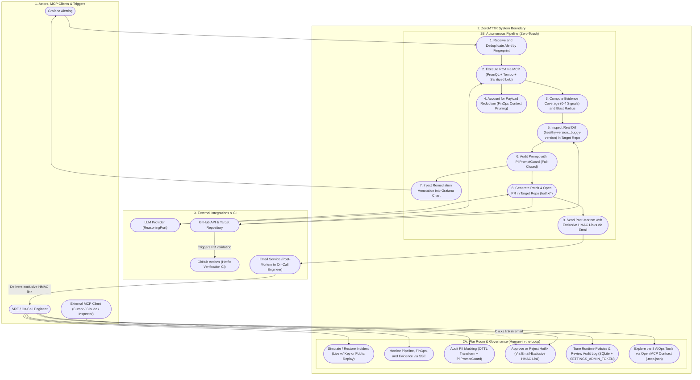
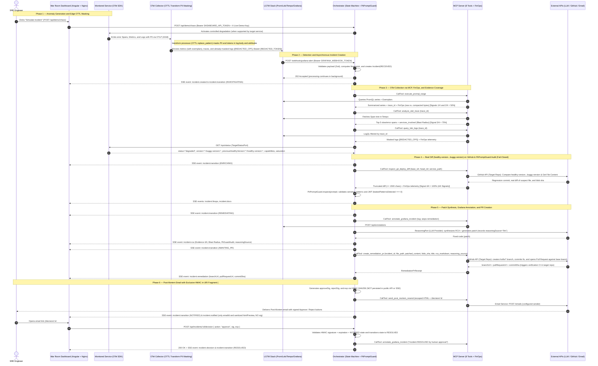
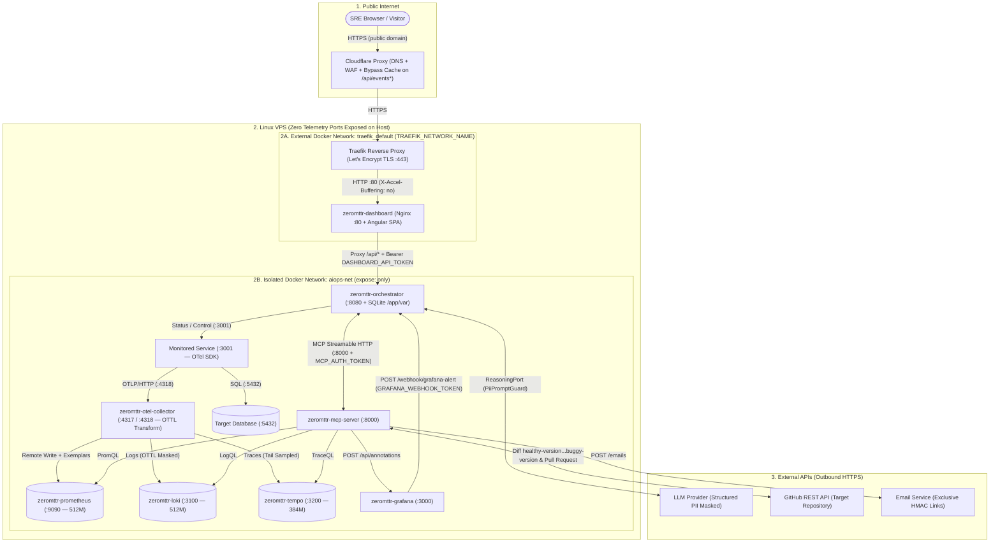

# 📐 ZeroMTTR — Behavioral and Static System Diagrams

| Field | Value |
| :--- | :--- |
| **Project** | ZeroMTTR — Autonomous AIOps & Incident Remediation |
| **Track** | Logistics & Automation (Operational workflow automation and cross-system integrations) |
| **Master Document** | [`00_architecture_master.md`](./00_architecture_master.md) |
| **Scope** | Behavioral modeling (Use Cases and Sequence) and structural/static modeling (Hexagonal Classes and Network Topology) |

---

## 1. Use Case Diagram

Visually defines the **Actors** (including external MCP clients such as Cursor / Claude Desktop / MCP Inspector), **Interactive Operation / Human Governance (Human-in-the-Loop)**, the **Autonomous Pipeline (Zero-Touch)**, and **External Integrations**.

---

## 2. End-to-End Sequence Diagram (Behavioral Flow)

Represents the complete chronological interaction across containers and external APIs, highlighting:
1. PII masking in the log body (`transform` OTTL in the Collector) **before** storage in Loki;
2. Deterministic validation by **`PiiPromptGuard`** **before** sending the prompt to Gemini;
3. Inspection of real tags `v2.14.7...v2.14.8` (`apps/target-app-demo`) and opening the PR against branch `release/target-v2.14.8` in repository `AdmilsonGoncalves/zeromttr`;
4. Segregation between `GRAFANA_WEBHOOK_TOKEN` and `DASHBOARD_API_TOKEN`, keeping the **HMAC `decisionToken` restricted exclusively to the email sent by Resend** (never exposed in SSE or `GET /api/incidents/:id`).

---

## 3. Class Diagrams — Hexagonal Architecture

Because `apps/orchestrator` and `apps/mcp-server` follow **Hexagonal Architecture (Ports & Adapters)** with **mandatory TDD**, the diagrams below present the domain entities (including `PiiPromptGuard` and `EvidenceCoverage`), use cases, ports (interfaces), and adapters.

### 3.1 `apps/orchestrator` — Domain and Ports

```mermaid
classDiagram
    direction TB

    class Incident {
        +string id
        +string fingerprint
        +string service
        +string severity
        +IncidentState state
        +string mode
        +Date startedAt
        +TransitionRecord[] transitions
        +RcaReport rca
        +FinOpsSummary finops
        +DeployDiffSource[] docs
        +RemediationInfo remediation
        +NotificationInfo notification
        +string decision
        +string decisionSource
        +applyTransition(to: IncidentState, at: Date, reason?: string) void
    }

    class IncidentState {
        <<enumeration>>
        RECEIVED
        INVESTIGATING
        ENRICHING
        REMEDIATING
        AWAITING_PR
        NOTIFIED
        RESOLVED
        REJECTED
        FAILED
        +canTransitionTo(from: IncidentState, to: IncidentState)$ boolean
    }

    class RcaReport {
        +string summary
        +string reasoningSource
        +number evidenceCoveragePercent
        +number signalsCollected
        +number signalsTotal
        +EvidenceBreakdown evidenceBreakdown
        +string[] blastRadius
        +number diagnosisSeconds
        +string traceId
        +string criticalSpan
        +SpanNode[] spans
        +string rawEdgeLogPreCollector
        +string logSample
        +PiiGuardAudit piiGuardAudit
        +string deployVersion
        +string[] mitigations
        +number grafanaAnnotationId
    }

    class PiiPromptGuard {
        +inspectAndEnforceFailClosed(promptText: string)$ PiiGuardAudit
    }

    class DecisionHmac {
        +sign(incidentId: string, action: string, exp: number, secret: string)$ string
        +verify(incidentId: string, action: string, sig: string, exp: number, now: number, secret: string)$ boolean
    }

    class IncidentRepository {
        <<interface>>
        +findById(id: string) Promise~Incident~
        +findOpenByFingerprint(fp: string) Promise~Incident~
        +findLatestByFingerprint(fp: string) Promise~Incident~
        +findAll() Promise~Incident[]~
        +save(incident: Incident) Promise~void~
    }

    class SettingsRepositoryPort {
        <<interface>>
        +getSettings() SystemSettings
        +updateSettings(patch: SystemSettingsPatch, actor: string) SystemSettings
        +listAuditEntries(limit?: number) SettingsAuditEntry[]
    }

    class ToolsPort {
        <<interface>>
        +executePromqlRange(input: PromqlInput) Promise~PromqlOutput~
        +queryLokiLogs(input: LokiInput) Promise~LokiOutput~
        +analyzeOtelTrace(traceId: string) Promise~TraceAnalysisOutput~
        +searchTracesByTraceQL(input: TraceQlInput) Promise~TraceQlOutput~
        +inspectGitDeployDiff(input: GitDiffInput) Promise~GitDiffOutput~
        +createRemediationPr(input: CreatePrInput) Promise~CreatePrOutput~
        +sendPostMortemResend(input: ResendInput) Promise~ResendOutput~
        +annotateGrafanaIncident(input: AnnotationInput) Promise~AnnotationOutput~
    }

    class ReasoningPort {
        <<interface>>
        +synthesizeRcaAndPatch(evidence: CollectedEvidence) Promise~RcaAndPatchSynthesis~
    }

    class TargetStatusPort {
        <<interface>>
        +getStatus() Promise~TargetStatus~
    }

    Incident *-- IncidentState
    Incident *-- RcaReport
    RcaReport ..> PiiPromptGuard
```

### 3.2 `apps/orchestrator` — Use Cases and Adapters

```mermaid
classDiagram
    direction TB

    class HandleAlert {
        +execute(payload: GrafanaWebhookPayload) Promise~Incident~
    }
    class InvestigateIncident {
        +execute(incidentId: string) Promise~RcaReport~
    }
    class EnrichWithDeployDiff {
        +execute(incidentId: string) Promise~DeployDiffSource[]~
    }
    class DispatchRemediation {
        +execute(incidentId: string) Promise~RemediationInfo~
    }
    class NotifyOnCall {
        +execute(incidentId: string) Promise~NotificationInfo~
    }
    class RecordDecision {
        +execute(incidentId: string, action: string, sig: string, exp: number) Promise~Incident~
        +executeSimulated(incidentId: string, action: string) Promise~Incident~
    }

    class IncidentRepository {
        <<interface>>
    }
    class ToolsPort {
        <<interface>>
    }
    class ReasoningPort {
        <<interface>>
    }
    class TargetStatusPort {
        <<interface>>
    }
    class SettingsRepositoryPort {
        <<interface>>
    }

    class FileIncidentRepository
    class SqliteSettingsRepository
    class McpClientAdapter
    class GeminiReasoningAdapter
    class DeterministicFallbackReasoningAdapter
    class HttpTargetStatusAdapter
    class PrometheusTargetStatusAdapter

    HandleAlert --> IncidentRepository
    HandleAlert --> SettingsRepositoryPort
    InvestigateIncident --> ToolsPort
    InvestigateIncident --> TargetStatusPort
    InvestigateIncident --> IncidentRepository
    EnrichWithDeployDiff --> ToolsPort
    EnrichWithDeployDiff --> SettingsRepositoryPort
    EnrichWithDeployDiff --> IncidentRepository
    DispatchRemediation --> ReasoningPort
    DispatchRemediation --> ToolsPort
    DispatchRemediation --> IncidentRepository
    NotifyOnCall --> ToolsPort
    NotifyOnCall --> SettingsRepositoryPort
    NotifyOnCall --> IncidentRepository
    RecordDecision --> IncidentRepository
    RecordDecision --> ToolsPort

    FileIncidentRepository ..|> IncidentRepository
    SqliteSettingsRepository ..|> SettingsRepositoryPort
    McpClientAdapter ..|> ToolsPort
    GeminiReasoningAdapter ..|> ReasoningPort
    DeterministicFallbackReasoningAdapter ..|> ReasoningPort
    HttpTargetStatusAdapter ..|> TargetStatusPort
    PrometheusTargetStatusAdapter ..|> TargetStatusPort
    PrometheusTargetStatusAdapter --> ToolsPort
```

---

### 3.3 `apps/mcp-server` — Pure Domain, 8 Tools, Ports, and HTTP Adapters

```mermaid
classDiagram
    direction TB

    class SeriesSummarizer {
        +summarize(series: RawPromSeries[], maxSeries: number)$ SeriesSummary[]
    }
    class LogTruncator {
        +truncateLines(lines: string[], maxLines: number, maxChars: number)$ string[]
    }
    class SpanAnalyzer {
        +analyze(spans: RawSpan[])$ TraceSummary
    }
    class FinOpsCalculator {
        +calculate(rawBytes: number, compactedBytes: number)$ FinOpsMetrics
    }

    class ExecutePromqlRange {
        +execute(input: PromqlToolInput) Promise~PromqlToolOutput~
    }
    class QueryLokiLogs {
        +execute(input: LokiToolInput) Promise~LokiToolOutput~
    }
    class AnalyzeOtelTrace {
        +execute(input: TraceToolInput) Promise~TraceToolOutput~
    }
    class SearchTracesByTraceQL {
        +execute(input: TraceQlToolInput) Promise~TraceQlToolOutput~
    }
    class InspectGitDeployDiff {
        +execute(input: GitDiffToolInput) Promise~GitDiffToolOutput~
    }
    class CreateRemediationPr {
        +execute(input: CreatePrToolInput) Promise~CreatePrToolOutput~
    }
    class SendPostMortemResend {
        +execute(input: ResendToolInput) Promise~ResendToolOutput~
    }
    class AnnotateGrafanaIncident {
        +execute(input: AnnotationToolInput) Promise~AnnotationToolOutput~
    }

    class MetricsPort {
        <<interface>>
    }
    class LogsPort {
        <<interface>>
    }
    class TracesPort {
        <<interface>>
    }
    class RepoInspectorPort {
        <<interface>>
    }
    class RemediationPort {
        <<interface>>
    }
    class NotifierPort {
        <<interface>>
    }
    class AnnotationPort {
        <<interface>>
    }

    class PrometheusHttpAdapter
    class LokiHttpAdapter
    class TempoHttpAdapter
    class GithubInspectorHttpAdapter
    class GithubRemediationHttpAdapter
    class ResendHttpAdapter
    class GrafanaAnnotationsHttpAdapter

    ExecutePromqlRange --> SeriesSummarizer
    ExecutePromqlRange --> FinOpsCalculator
    ExecutePromqlRange --> MetricsPort

    QueryLokiLogs --> LogTruncator
    QueryLokiLogs --> FinOpsCalculator
    QueryLokiLogs --> LogsPort

    AnalyzeOtelTrace --> SpanAnalyzer
    AnalyzeOtelTrace --> TracesPort

    SearchTracesByTraceQL --> TracesPort

    InspectGitDeployDiff --> FinOpsCalculator
    InspectGitDeployDiff --> RepoInspectorPort

    CreateRemediationPr --> RemediationPort
    SendPostMortemResend --> NotifierPort
    AnnotateGrafanaIncident --> AnnotationPort

    PrometheusHttpAdapter ..|> MetricsPort
    LokiHttpAdapter ..|> LogsPort
    TempoHttpAdapter ..|> TracesPort
    GithubInspectorHttpAdapter ..|> RepoInspectorPort
    GithubRemediationHttpAdapter ..|> RemediationPort
    ResendHttpAdapter ..|> NotifierPort
    GrafanaAnnotationsHttpAdapter ..|> AnnotationPort
```

---

## 4. Static Deployment and Network Isolation Diagram

Illustrates defense in depth on the Linux VPS:
- **No container publishes host ports (`ports:` omitted)**;
- Only the `dashboard` container (Nginx) participates simultaneously in the external Traefik network (`traefik_default` / `${TRAEFIK_NETWORK_NAME}`) and the isolated internal network (`aiops-net`);
- **Strict credential segregation:** Nginx injects `Authorization: Bearer ${DASHBOARD_API_TOKEN}` on Dashboard `/api/*` routes, while Grafana Alerting uses an exclusive token (`GRAFANA_WEBHOOK_TOKEN`) to trigger `POST /webhook/grafana-alert` internally on the `aiops-net` network.

