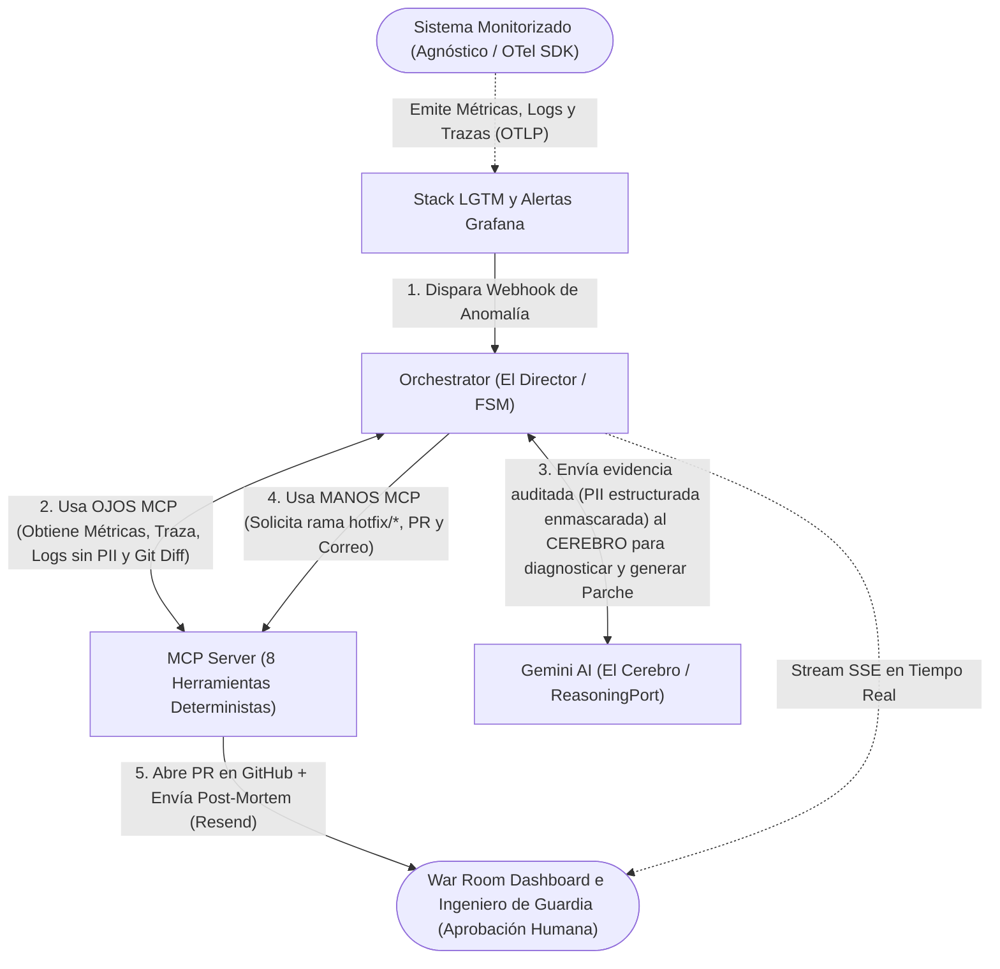
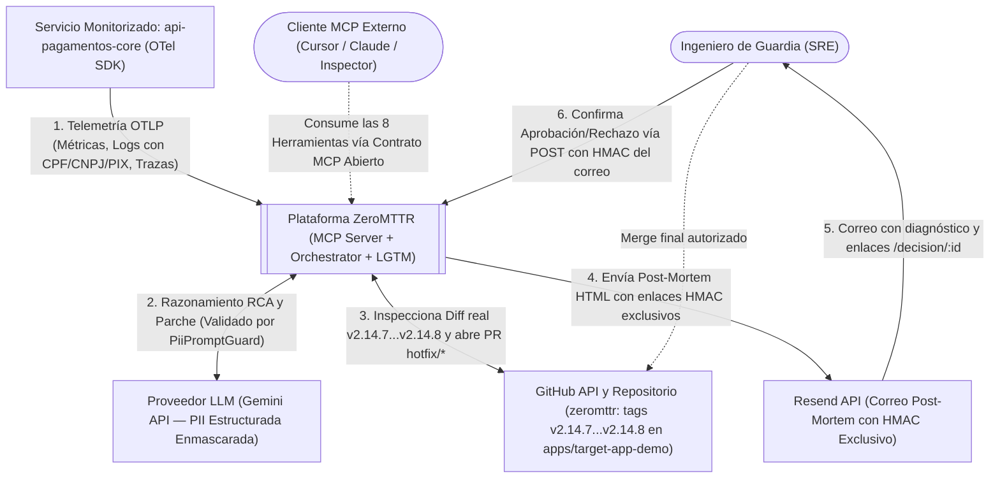
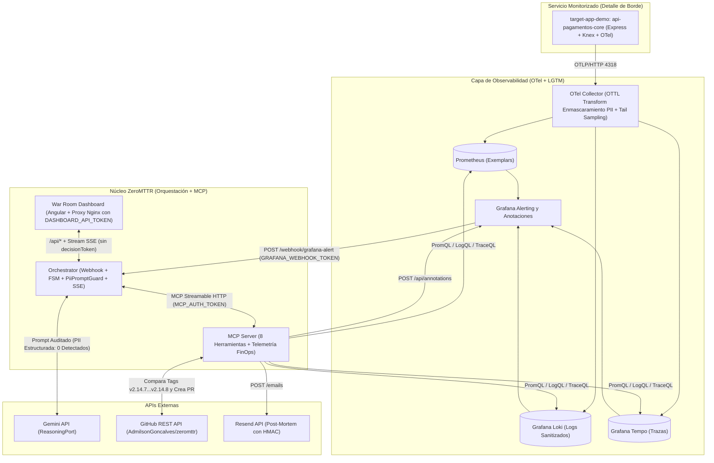
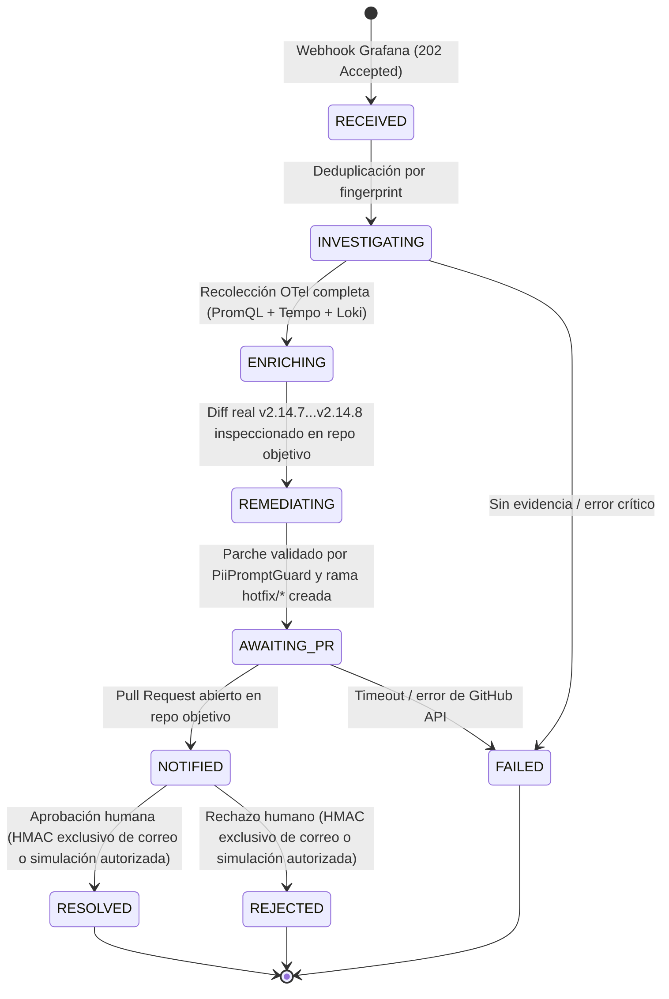
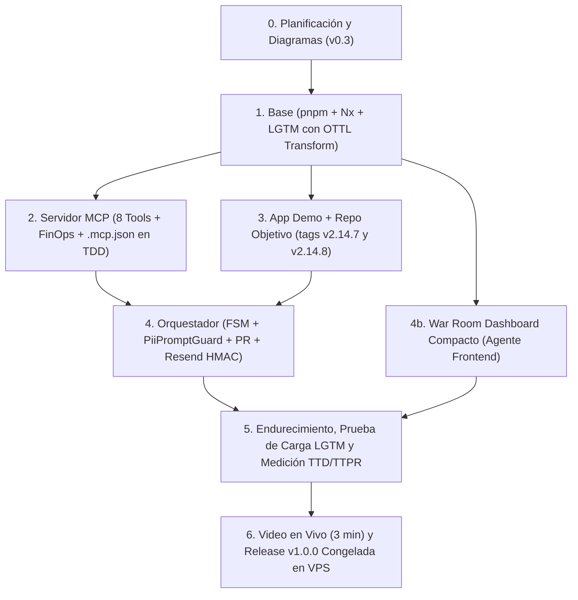

# ⚡ ZeroMTTR — Documento Maestro de Arquitectura y Plan del Proyecto

| Campo | Valor |
| :--- | :--- |
| **Proyecto** | ZeroMTTR — AIOps Autónomo y Remediación de Incidentes |
| **Categoría Principal** | **Logística y Automatización** (Automatización de flujos operativos e integraciones autónomas entre sistemas críticos) |
| **Arquitectura Agnóstica al Dominio** | Desacoplada del servicio monitorizado (*Clean Architecture* — la carga de trabajo es un detalle de borde conectado vía OTLP y Git). Demostrada con **`api-pagamentos-core`** (aplicable a liquidación PIX, despacho logístico, comercio electrónico, etc.) |
| **Organización** | **AGJ Works** (`https://agjworks.com`) |
| **Entorno de Producción (Demo)** | `https://zeromttr.agjworks.com` (VPS Linux + Traefik + Cloudflare) |
| **Repositorio (Monorepo Único)** | `https://github.com/AdmilsonGoncalves/zeromttr` (rama saludable `master` en tag `v2.14.7`; rama `release/target-v2.14.8` en tag `v2.14.8` con la regresión en `apps/target-app-demo` a la que apuntan los PRs de hotfix) |
| **Estado** | Planificación (v0.3 — OTel/LGTM + Open MCP + Remediación en GitHub + Resend HMAC Aislado). Implementación escrita al 100% desde cero después de 2026-11-04 21:00 BRT |
| **Diagramas del Sistema (UML / Red)** | [`docs/es-ES/01_system_diagrams.md`](./01_system_diagrams.md) (Casos de Uso, Secuencia E2E, Clases Hexagonales y Topología de Red) |
| **Documentos Técnicos** | Cortes de implementación en [`docs/es-ES/tech/`](./tech/) (ver §12) |

---

## 1. Introducción y Posicionamiento

### 1.1 Automatización de Flujos Operativos y Arquitectura Abierta (Clean Architecture)
En arquitecturas de microservicios que soportan operaciones críticas en Brasil — como procesamiento de pagos instantáneos (PIX), sistemas de despacho logístico, facturación o checkout — el tiempo entre una alerta de degradación y una corrección en producción sigue dominado por trabajo manual fragmentado. Siguiendo el principio de **Robert C. Martin (*Clean Architecture*)** de **mantener la arquitectura abierta y diferir detalles**, **ZeroMTTR** fue diseñado como un motor **100% agnóstico al dominio del servicio monitorizado**: cualquier aplicación que emita telemetría OpenTelemetry (OTLP) y cuente con un repositorio Git puede conectarse sin cambiar una sola línea del orquestador ni del servidor MCP.

En operaciones reales, la respuesta a incidentes enfrenta tres cuellos de botella:
1. **Fragmentación manual entre sistemas:** las herramientas de observabilidad se detienen en la alerta de texto, obligando al ingeniero de guardia a cruzar manualmente métricas (Prometheus), trazas distribuidas (Tempo), logs (Loki) e historial de despliegues (GitHub).
2. **Riesgo de fuga de PII brasileña al usar IA:** los logs de error en producción contienen frecuentemente **CPF, CNPJ, claves/correos PIX y tokens JWT/Bearer**. Enviar estos logs sin tratar a LLMs externos viola reglas de privacidad y gobernanza de datos.
3. **Costos de tokens impredecibles:** enviar volcados brutos de series temporales, árboles completos de spans y grandes *git diffs* desborda la ventana de contexto y encarece las llamadas a LLM.

**ZeroMTTR** integra estos sistemas y automatiza el flujo de extremo a extremo en segundos:

> **Alerta (Grafana) → Enmascaramiento de PII en Borde (OTel Collector `transform`) → Recolección Determinista vía MCP (OTel/LGTM + GitHub Diff `v2.14.7...v2.14.8`) → Auditoría Fail-Closed (`PiiPromptGuard`) y Síntesis de Parche vía LLM (`ReasoningPort`) → Pull Request Validado por CI → Post-Mortem con Aprobación Humana Firmada Exclusivamente por Correo (Resend HMAC en `#fragment`).**

### 1.2 Posicionamiento y Diferenciación (Estado del Arte en AI SRE)
La categoría de agentes para operaciones TI cuenta con herramientas comerciales y de código abierto relevantes. **ZeroMTTR** no pretende reinventar el concepto genérico de "alert-to-PR", sino ofrecer de serie, de forma integrada, tres capacidades que — según lo verificado en documentación pública hasta nov/2026 — normalmente requieren personalización externa o licencias SaaS propietarias:

| Criterio | HolmesGPT (CNCF) / OpenSRE (Setup Base) | Datadog Bits AI / Sentry Seer | **ZeroMTTR (Este Proyecto)** |
| :--- | :--- | :--- | :--- |
| **Modelo de Despliegue** | Self-hosted (enfoque principal en investigación / integración ChatOps) | SaaS propietario (acoplado a la nube del proveedor) | **100% Self-Hosted y Open Source**, con un **contrato MCP abierto** consumible por clientes externos (Claude Desktop, Cursor, MCP Inspector) y por el orquestador |
| **Protección Verificable de PII Pre-LLM** | No se identificó guardia algorítmica nativa pre-prompt para CPF/CNPJ en documentación pública (nov/2026) | Procesado en la infraestructura del proveedor SaaS | **Doble barrera independiente:** (1) enmascaramiento OTTL (`transform`) en el borde del OTel Collector y (2) **`PiiPromptGuard` (fail-closed)** con validación de dígito verificador (módulo-11) para CPF/CNPJ y detección estructural de JWT antes del envío al LLM |
| **Medición de Reducción de Payload por Incidente (FinOps)** | Enfoque en límites de ventana de contexto | Facturación gestionada dentro de la licencia SaaS | **Métrica de poda de contexto por llamada MCP:** calcula `raw_bytes_fetched` vs. `compacted_bytes_sent_to_llm` (sumarización estadística + truncamiento por política) y muestra tokens ahorrados estimados (`bytes / 4`) |
| **Gobernanza de Remediación** | Creación de PR vía integraciones configurables | Abre PR directamente en la plataforma SaaS | Abre **Pull Request contra la rama de release (`release/target-v2.14.8`)**, dispara CI de verificación (`hotfix-verify.yml`) y exige **aprobación humana mediante enlace HMAC exclusivo en el `#fragment` del correo (Resend)** |

---

## 2. Objetivos y Métricas

### 2.1 Objetivo General
Entregar una plataforma funcional, demostrable en vivo y de código abierto que automatice el análisis de causa raíz (RCA) y la preparación de Pull Requests de corrección para incidentes de microservicios, utilizando **Model Context Protocol (MCP)**, **OpenTelemetry**, **enmascaramiento verificable de PII en el borde** y **gobernanza con humano en el circuito**.

### 2.2 La Esencia del Sistema en 30 Segundos (El Director, el Cerebro y los Ojos/Manos)
Para comprender de inmediato el papel de cada bloque arquitectónico, **ZeroMTTR** separa estrictamente **quién ejecuta herramientas (MCP)**, **quién sintetiza el diagnóstico y el código (IA)** y **quién coordina el flujo (Orquestador)**:

1. **El `mcp-server` (MCP) = Los "Ojos y Manos" (100% Determinista, sin IA integrada):**
   - El **Model Context Protocol (MCP)** actúa como interfaz universal que expone **8 herramientas estandarizadas** divididas en dos grupos:
     - **Ojos (Lectura y Poda de Contexto FinOps):** `execute_promql_range` (Prometheus), `analyze_otel_trace` (Tempo), `search_traces_by_traceql` (búsqueda ad-hoc en TraceQL y respaldo cuando falta exemplar), `query_loki_logs` (Loki) e `inspect_git_deploy_diff` (compara la versión saludable anterior con la versión actual en GitHub).
     - **Manos (Acción y Gobernanza):** `create_remediation_pr` (crea una rama `hotfix/zeromttr-*`, aplica el commit de corrección — siempre a nivel semántico `PATCH` — y abre el Pull Request en GitHub), `annotate_grafana_incident` (marca el gráfico en Grafana) y `send_post_mortem_resend` (envía el informe por correo).
2. **La IA (`Gemini API` vía `ReasoningPort`) = El "Cerebro":**
   - La IA **no** accede directamente a bases de datos, backends de observabilidad ni a GitHub. Recibe únicamente el resumen podado por MCP y validado en modo *fail-closed* por `PiiPromptGuard`, sintetiza la causa raíz (RCA) y redacta el código corregido (el parche quirúrgico), registrando explícitamente `reasoningSource: 'llm' | 'fallback'`.
3. **El `orchestrator` = El "Director" (Flujo Determinista + FSM):**
   - Recibe la alerta de Grafana → ejecuta de forma predecible la secuencia de recolección en los **Ojos MCP** → valida la ausencia de PII (`PiiPromptGuard`) y la envía al **Cerebro (IA)** para sintetizar el RCA y generar el parche → invoca las **Manos MCP** para abrir el Pull Request en GitHub (disparando el CI de la rama) y enviar el correo de aprobación humana al ingeniero de guardia, transmitiendo todo en vivo vía SSE al **War Room Dashboard**.



### 2.3 Indicadores Operativos Medibles (KPIs)
Para evitar comparaciones sesgadas con procesos que incluyen despliegue completo en producción, ZeroMTTR mide específicamente el tiempo hasta el diagnóstico determinista (**TTD**) y el tiempo hasta un Pull Request probado y listo para revisión humana (**TTPR**), frente a una **línea base manual cronometrada** (los mismos 7 pasos ejecutados manualmente por un ingeniero):

| KPI | Meta ZeroMTTR | Línea Base Manual Cronometrada (7 pasos) |
| :--- | :--- | :--- |
| **TTD (Tiempo hasta RCA Determinista + Deploy Diff)** | **≤ 15 s** | ~12 a 18 min (correlacionar PromQL, exemplar, traza Tempo, logs Loki y `git diff`) |
| **TTPR (Tiempo hasta PR de Hotfix Revisable en GitHub)** | **≤ 30 s** | ~25 a 40 min (aislar línea defectuosa, crear rama, programar fix, correr pruebas y abrir PR) |
| **Tiempo hasta entrega de Post-Mortem firmado (Resend)** | **≤ 45 s** | ~45 a 60 min (redactar resumen ejecutivo con evidencias y enlaces) |
| **Cobertura de pruebas automatizadas (`domain/` + `application/`)** | **≥ 80%** | — |

### 2.4 Cinco Diferenciadores Técnicos Verificables
1. **Doble Barrera Independiente de Protección PII (OTTL `transform` + `PiiPromptGuard` Fail-Closed cubriendo patrones estructurados de los 5 Tipos Oficiales de Clave PIX BACEN):** en la 1.ª barrera, el OTel Collector aplica una transformación OTTL (`replace_pattern` sobre `log.body` y atributos) enmascarando CPF, CNPJ, Correo, Teléfono (estándar ANATEL), Clave PIX Aleatoria (EVP / UUID v4 condicionado a etiqueta PIX) y Bearer/JWT en ingesta; en la 2.ª barrera (independiente), `PiiPromptGuard` inspecciona todos los campos de texto libre (logs, mensajes de error de spans, commits y Git diff — excluyendo series numéricas brutas de Prometheus), validando dígitos verificadores (módulo-11 de la Receita Federal) para CPF/CNPJ (con o sin puntuación), reglas ANATEL para teléfonos móviles (`9xxxx-xxxx`) y fijos (`[2-5]xxx-xxxx`), correos, claves aleatorias EVP (`UUID v4` `4xxx-[89ab]xxx` condicionado a etiqueta PIX) y estructura JWT (`eyJ...` incluso sin `Bearer`). Si detecta cualquier fuga residual (`leakedPatternsDetected > 0`), **aborta el envío al LLM externo (fail-closed)** y activa el fallback local.
2. **Telemetría FinOps de Reducción de Payload (Context Pruning) en MCP:** cada herramienta calcula `raw_bytes_fetched` vs. `compacted_bytes_sent_to_llm` (mediante sumarización estadística de series y truncamiento por política), mostrando dinámicamente en la parte superior del dashboard el porcentaje de reducción de bytes y los tokens ahorrados estimados (`Math.round((raw - compacted) / 4)`).
3. **Contrato MCP Abierto (Interoperable con Clientes Externos):** las 8 herramientas MCP no están bloqueadas al flujo del orquestador; el repositorio incluye una configuración `.mcp.json` que permite a cualquier Host MCP externo (**MCP Inspector / Cursor / Claude Desktop**) seleccionar e invocar libremente herramientas sobre el stack LGTM y GitHub.
4. **Puntuación de Cobertura de Evidencia (`0–100%` / `4 de 4 señales`) y Blast Radius:** mide de forma lineal y transparente cuántas señales independientes convergieron en el diagnóstico (+25% anomalía PromQL, +25% `trace_id` vía Exemplar, +25% Span de error en Tempo, +25% Log correlacionado en Loki + commit aislado en diff `v2.14.7...v2.14.8` = `4/4 Señales — 100%`), degradando proporcionalmente (`3/4 — 75%`, `2/4 — 50%`) si falta alguna señal, y listando los servicios afectados (`services_involved`).
5. **Ejecución Real en Vivo (< 25s) con `reasoningSource` Explícito + Modo Replay Transparente:** el video de demostración y las evaluaciones con clave (`LIVE_DEMO_KEY`) o mediante Docker local ejecutan el **flujo `Live` 100% real** (mostrando `reasoningSource: 'llm'` en SSE y en el cuerpo del PR para demostrar que la síntesis provino de Gemini en vivo, no del fallback). En el VPS público expuesto a internet, los visitantes anónimos sin clave ven por defecto el modo `Replay` (claramente etiquetado en la UI y en el README) para proteger las cuotas de API.

### 2.5 Fuera de Alcance y Límites Declarados (MVP)
- **Sin auto-merge ni redespliegue automático a producción:** por decisión de gobernanza (*human-in-the-loop*), el ciclo autónomo finaliza al abrir el Pull Request validado por CI en la rama de release (`release/target-v2.14.8`) y registrar la decisión humana firmada. En la demo, la simulación de fallos en el contenedor `target-app-demo` se controla mediante estado en memoria y se restaura con el script/botón de reinicio.
- **Alcance de detección PII:** el enmascaramiento OTTL y `PiiPromptGuard` cubren los **patrones estructurados de los 5 tipos oficiales de Clave PIX del Banco Central de Brasil (BACEN)** (CPF y CNPJ con Módulo-11 de Receita Federal, Teléfono Móvil/Fijo con reglas ANATEL, Correo estándar sin comillas `[A-Za-z0-9._%+-]+@dominio` excluyendo partes locales entrecomilladas permitidas por RFC 5322, y Clave Aleatoria EVP/UUID v4 RFC 4122 condicionada al contexto `pix`/`pixKey`/`chave_pix`/`evp`), además de tokens JWT/Bearer (teléfonos sin máscara y UUID v4 requieren marcador contextual para evitar falsos positivos con IDs de correlación o timestamps Unix; nombres propios en texto libre quedan fuera del alcance determinista).
- Multitenancy, alta disponibilidad multinodo y retención a largo plazo de métricas/logs/trazas.

---

## 3. Alcance y Partes Interesadas (Stakeholders)

| Parte Interesada | Interés |
| :--- | :--- |
| Ingeniero de Guardia (SRE) / Operaciones Logísticas | Recibir RCA correlacionado con el commit causante y un Pull Request probado en segundos; aprobar o rechazar mediante enlace firmado en su correo |
| Equipo de Plataforma / FinOps | Garantizar que no se envían datos personales (CPF/CNPJ/PIX/JWT) a LLMs externos y mantener predecible el consumo de tokens |
| Desarrolladores / Comunidad Open Source | Conectar cualquier cliente compatible con MCP (`.mcp.json`) a las 8 herramientas de observabilidad y remediación |

---

## 4. Tecnologías Involucradas

| Capa | Tecnología | Rol |
| :--- | :--- | :--- |
| Runtime y Monorepo | **Node.js 24 LTS**, **pnpm** (`pnpm-workspace.yaml`), **Nx** (`nx.json`), TypeScript (`strict`, `ES2024`, `NodeNext`) | Orquestación de tareas, caché de build/test y paquetes en `apps/*` y `libs/*` |
| Instrumentación | OpenTelemetry SDK (Node) | Emisión de trazas, métricas (con exemplars) y logs estructurados |
| Ingesta y Sanitización | OTel Collector Contrib 0.114+ | `memory_limiter`, **`transform` (enmascaramiento regex OTTL sobre `log.body` y atributos)**, `redaction` (spans), `tail_sampling` |
| Almacenamiento | Prometheus (exemplars), Loki, Tempo | Stack LGTM |
| Visualización / Disparo | Grafana 11.2+ (Alerting) | Webhook de incidentes y API de anotaciones (`POST /api/annotations`) |
| Protocolo de Agente | **MCP** (`@modelcontextprotocol/sdk`) | Interfaz abierta estandarizada de 8 herramientas AIOps |
| LLM del Agente | Google Gemini API (`ReasoningPort`, modelo configurable vía `LLM_MODEL`, predeterminado `gemini-3.5-flash`) | Síntesis de RCA y generación de parche quirúrgico (con `reasoningSource: 'llm' \| 'fallback'` explícito) |
| **Inspección de Despliegue y Auto-Remediación** | **GitHub REST API (Octokit)** sobre `apps/target-app-demo` en el repositorio `zeromttr` | Comparación real entre tags `v2.14.7...v2.14.8`, lectura de código, creación de rama `hotfix/zeromttr-*` y Pull Request apuntando a `release/target-v2.14.8` |
| **Notificación y Gobernanza** | **Resend** | Envío de Post-Mortem HTML (`sre@zeromttr.agjworks.com`) conteniendo exclusivamente enlaces de decisión firmados con HMAC |
| Pruebas | Vitest, Supertest, `nock`/MSW + **Helpers de Prueba (`test/helpers/`)** | **Testing Trophy (prioridad Integración y E2E)** ejercitando rutas HTTP, MCP y `PiiPromptGuard` de extremo a extremo (Happy y Unhappy Paths); pruebas unitarias restringidas a funciones puras auxiliares |
| Calidad | ESLint, Prettier, Husky + lint-staged, Commitlint | Estándares de código y cumplimiento de fronteras hexagonales |
| Infraestructura | Docker, Docker Compose | Ejecución local (`docker-compose.yml`) y producción en VPS (`docker-compose.prod.yml`) |
| CI/CD | GitHub Actions | `ci.yml`, `hotfix-verify.yml` (verifica PRs `hotfix/zeromttr-*`) y `cd-release.yml` (despliegue a VPS congelado solo para tags `v1.*.*` o despacho manual) |
| Carga de Trabajo Demo | Express + Knex + PostgreSQL | Servicio `api-pagamentos-core` con fallo reproducible de saturación de pool de conexiones |
| Frontend | **Angular (última versión estable)**, **PrimeNG (preset Aura Dark)**, Tailwind CSS v4 + `tailwindcss-primeui` | War Room Dashboard compacto (Single-Pane con barra horizontal interactiva FSM Flow arriba + panel de evidencias OTel/PII/Diff + panel PR/Resend) + ruta `/decision/:id` |

---

## 5. Arquitectura del Sistema

### 5.1 Estilo Arquitectónico
| Aspecto | Decisión |
| :--- | :--- |
| Macroestilo | **Orientado a eventos + Agéntico** (webhook dispara al agente; fallback determinista garantiza finalización si el LLM falla) |
| Estilo interno | **Hexagonal (Puertos y Adaptadores) / Clean Architecture** en `apps/orchestrator` y `apps/mcp-server` |
| Comportamiento | **Máquina de Estados Finitos (FSM)** pura controlando el ciclo de vida del incidente |
| Integración | **MCP sobre HTTP** (Streamable HTTP; compatible con clientes externos mediante `.mcp.json`) |
| Seguridad de Decisión | **HMAC exclusivo por correo:** las firmas de aprobación/rechazo viajan solo en el correo enviado por Resend, nunca en SSE ni en endpoints públicos de lectura |
| Despliegue | Local vía `docker-compose.yml` · Producción en **VPS Linux** vía `docker-compose.prod.yml` + **Traefik + Cloudflare**, leyendo secretos de un archivo externo fuera del repositorio (ej., `/path/to/secrets/.env`) |

### 5.2 Patrones por Componente
| Componente | Patrón | Organización |
| :--- | :--- | :--- |
| `apps/orchestrator/` y `apps/mcp-server/` | **Hexagonal (Puertos y Adaptadores)** | `domain` → `application` → `ports` → `adapters`, con raíz de composición en `main.ts` |
| `apps/target-app-demo/` | **MVC en Capas** | `routes` → `controllers` → `services` → `repositories` (`payment.repository.ts`) |
| `apps/dashboard/` | **War Room Single-Pane con Signals** (Angular + PrimeNG Aura Dark) | Componentes Standalone (`WarRoomComponent` + `DecisionComponent`) enfocados en el flujo principal de 3 minutos |

### 5.3 Vista de Contexto (C4 Nivel 1)


### 5.4 Vista de Contenedores (C4 Nivel 2)


### 5.5 Máquina de Estados del Incidente (FSM)


> [!NOTE]
> Para el modelado **conductual** detallado (Diagrama de Casos de Uso y Diagrama de Secuencia E2E) y el modelado **estático** (Diagramas de Clases Hexagonales para `apps/orchestrator` y `apps/mcp-server`, más Topología de Aislamiento de Red en VPS), consulte [`01_system_diagrams.md`](./01_system_diagrams.md).

### 5.6 Decisiones Arquitectónicas (Resumen de ADRs)
| ID | Decisión | Justificación | Alternativa Descartada |
| :--- | :--- | :--- | :--- |
| ADR-001 | Monorepo único **pnpm + Nx** (`apps/*`) con rama `master` saludable (`v2.14.7`) y rama dedicada `release/target-v2.14.8` (`v2.14.8`) para la regresión de `apps/target-app-demo` | Todo permanece en un único repositorio (`AdmilsonGoncalves/zeromttr`), manteniendo `master` 100% en verde en CI y permitiendo comparaciones reales `v2.14.7...v2.14.8` y PRs hacia `release/target-v2.14.8` | Dejar código roto en `master` o mantener múltiples repositorios |
| ADR-002 | Arquitectura Hexagonal en orquestador y MCP | Dominio aislado de HTTP y SDKs externos; testabilidad TDD con fakes | Capas acopladas |
| ADR-003 | MCP como contrato abierto de herramientas (`.mcp.json` incluido) | Permite que tanto `orchestrator` como clientes externos (Cursor/Claude/Inspector) consuman las mismas 8 herramientas | Llamadas REST internas ad-hoc |
| ADR-004 | LLM aislado detrás de `ReasoningPort` + `PiiPromptGuard` + Fallback Determinista | Garantiza auditoría cero-PII antes de llamadas externas y continuidad operativa incluso si falla el proveedor LLM | Llamada directa al SDK sin guardia |
| ADR-005 | Truncamiento defensivo y FinOps en MCP | Control estricto de tokens y medición exacta de bytes ahorrados por llamada | Envío de payloads brutos |
| ADR-006 | Segregación de tokens y **HMAC exclusivo por correo** para aprobación humana | Impide que visitantes de la demo pública lean `decisionToken` por SSE/REST y aprueben incidentes sin acceso al correo del ingeniero de guardia | Exponer `decisionToken` en la API del dashboard o compartir token entre webhook y UI |
| ADR-007 | Persistencia de incidentes en memoria + archivo JSON (MVP) | Simplicidad operativa y soporte nativo para grabar artefactos del modo Replay | Base de datos relacional dedicada para el orquestador |
| ADR-008 | Las 8 herramientas y sus adaptadores HTTP viven en `apps/mcp-server`; `apps/orchestrator` consume vía `ToolsPort` | Cero duplicación de adaptadores; servidor MCP 100% autónomo | Adaptadores duplicados en ambos servicios |
| ADR-009 | Enmascaramiento de PII en logs mediante procesador **`transform` (OTTL `replace_pattern`)** en el OTel Collector | Garantiza sanitización determinista directamente sobre `log.body` y atributos en cualquier versión Collector 0.114+ | Depender solo del procesador `redaction` (restringido a atributos de span en algunas versiones) |
| ADR-010 | Desacoplamiento del servicio objetivo mediante manifiesto neutro `GET /ops/status` (`TargetCapabilities` + `TargetSaturation`) y proveedor pasivo `TARGET_STATUS_PROVIDER=prometheus` | Permite monitorizar cualquier servicio OTel sin acoplarse a `api-pagamentos-core` ni endpoints personalizados, y condiciona los controles demo a las capacidades reales del objetivo | Hardcodear campos de pool DB (`payment-pool`) y endpoints `/chaos/status` en el orquestador y el dashboard |
| ADR-011 | Configuración operativa en tiempo de ejecución persistida en **SQLite nativo de Node 24 (`node:sqlite`)** con traza de auditoría atómica y `SETTINGS_ADMIN_TOKEN` dedicado | Permite ajustar cooldown tras rechazo (_Human Takeover_), supresión de repetición, TTL, refs de diff, modelos LLM y nivel de log sin reiniciar contenedores, manteniendo `onCallEmail` enmascarado y privilegios segregados | Editar `.env` y reiniciar contenedores ante cada ajuste o reutilizar `LIVE_DEMO_KEY` como credencial administrativa |

---

## 6. Principios y Reglas de Desarrollo

### 6.1 TDD y Testing Trophy (Prioridad Integración y E2E)
Ciclo **Red → Green → Refactor** centrado en la filosofía *Testing Trophy*:
- Cada caso de uso y flujo integrado parte de pruebas de integración fallidas (*Happy* y *Unhappy Paths*), escritas antes de la implementación usando helpers reutilizables en `test/helpers/`.
- Los adaptadores externos (GitHub API, Resend, Prometheus, Loki, Tempo, Grafana) se ejercitan en pruebas de integración con intercepción HTTP saliente (`nock`/MSW). **Nunca invocan APIs reales en CI.**
- *Testing Trophy*: las pruebas de integración y E2E ejercitan rutas HTTP, MCP, `PiiPromptGuard` y la FSM de extremo a extremo; las pruebas unitarias se reservan para funciones auxiliares puras (Módulo-11, regexes ANATEL/BACEN, FinOps, escape HTML).
- Meta de cobertura: ≥ 80% en `domain/` y `application/`.

### 6.2 SOLID Aplicado
| Principio | Aplicación Concreta |
| :--- | :--- |
| **S** | Un archivo por herramienta; un caso de uso por clase |
| **O** | Nuevos adaptadores (otro LLM, otro proveedor Git, otro canal de notificación) sin modificar el dominio |
| **L** | Toda implementación de puerto es sustituible por un fake |
| **I** | Puertos cohesivos: `MetricsPort`, `LogsPort`, `TracesPort`, `RepoInspectorPort`, `RemediationPort`, `NotifierPort`, `AnnotationPort` |
| **D** | Los casos de uso dependen exclusivamente de puertos; composición en `main.ts` |

### 6.3 Otras Reglas
- **Clean Code / DRY / YAGNI / KISS**; funciones pequeñas, sin `any` fuera de las fronteras (usar `zod` para validar entradas externas).
- **Idioma:** código, herramientas, logs y commits en en-US; documentación principal y README en en-US, pt-BR y es-ES.
- **Seguridad por defecto:** tokens estrictamente segregados (`MCP_AUTH_TOKEN`, `GRAFANA_WEBHOOK_TOKEN`, `DASHBOARD_API_TOKEN` y `SETTINGS_ADMIN_TOKEN` para `PATCH /api/settings` cuando está configurado; en despliegues privados con `ENABLE_DEMO_MODE=false` y sin `SETTINGS_ADMIN_TOKEN`, `PATCH /api/settings` sigue editable por operadores autenticados con `DASHBOARD_API_TOKEN`), `decisionToken` restringido al correo, `onCallEmail` siempre enmascarado en lecturas/auditoría, escape HTML en plantillas, redacción OTTL en borde + `PiiPromptGuard` pre-LLM.

---

## 7. Estructura de Carpetas (Monorepo pnpm + Nx)

```text
zeromttr/
├── package.json                  # Scripts raíz que delegan a Nx (check:workspace, lint:workspace, test:workspace, build:workspace)
├── pnpm-workspace.yaml           # packages: ['apps/*', 'libs/*']
├── nx.json                       # Pipeline de tareas, caché y affected (Nx basado en paquetes)
├── tsconfig.base.json            # Configuración estricta compartida de TS (NodeNext, ES2024)
├── .mcp.json                     # Configuración lista para conectar clientes MCP externos (Inspector / Cursor / Claude)
├── .nvmrc                        # Node 24
├── .dockerignore                 # Mantiene el contexto de build Docker < 2 MB
├── README.md                     # en-US (incluye categoría, posicionamiento y distinción Live vs Replay)
├── README.pt-BR.md
├── README.es-ES.md
├── AGENTS.md                     # Contexto y reglas para agentes de codificación
├── GEMINI.md                     # Puntero: instruye a Gemini a leer AGENTS.md
├── LICENSE                       # MIT
├── docker-compose.yml            # Entorno de desarrollo local
├── docker-compose.prod.yml       # VPS Linux (Traefik + límites seguros de RAM + env_file externo, cero puertos de host)
├── .github/workflows/
│   ├── ci.yml                    # Lint, typecheck, Gitleaks, Vitest (≥80%), Compose smoke (vía pnpm + Nx)
│   ├── hotfix-verify.yml         # Puerta automatizada en PRs hotfix/zeromttr-* abiertos contra release/target-v2.14.8
│   └── cd-release.yml            # Push GHCR en main/tags; despliegue VPS congelado SOLO para tags v* o workflow_dispatch
├── .env.prod.template            # Plantilla de entorno (.env local dev y secretos en VPS)
├── infra/
│   ├── otel-collector-config.yaml
│   ├── otel-collector-config.prod.yaml
│   ├── prometheus.yml
│   ├── tempo-config.yaml
│   ├── loki-config.yaml
│   └── grafana/provisioning/
│       ├── datasources/datasources.yaml
│       └── alerting/{rules.yaml,contact-points.yaml,policies.yaml}
├── libs/
│   ├── contracts/                # Contratos Zod compartidos (@zeromttr/contracts: incidentes, target-status, settings/audit)
│   └── utils/                    # Paquete compartido de utilidades y Type Guards (@zeromttr/utils)
│       ├── src/
│       │   ├── string.utils.ts   # isNonEmptyString, sanitize, truncate, etc.
│       │   ├── object.utils.ts   # isEmpty, isFilled, omit, pick, etc.
│       │   ├── array.utils.ts    # compact, chunk, etc.
│       │   ├── http.utils.ts     # HTTP_HEADERS, CONTENT_TYPE y helpers HTTP (aislados; prohibidos en domain y application)
│       │   └── index.ts          # Barrel export de funciones puras
│       └── test/unit/            # Pruebas unitarias puras con Vitest
├── apps/
│   ├── mcp-server/               # Hexagonal (8 herramientas + telemetría FinOps + adaptadores LGTM/GitHub/Resend)
│   │   ├── src/
│   │   │   ├── domain/           # summarize-series, truncate, span-analysis, finops
│   │   │   ├── application/      # casos de uso (una herramienta = un caso de uso)
│   │   │   ├── ports/            # MetricsPort, LogsPort, TracesPort, RepoInspectorPort, RemediationPort, NotifierPort, AnnotationPort
│   │   │   ├── adapters/         # prometheus, loki, tempo, github-inspector, github-remediation, resend, grafana-annotations (HTTP)
│   │   │   ├── transport/        # Servidor Streamable HTTP MCP + auth
│   │   │   ├── config/
│   │   │   └── main.ts           # raíz de composición
│   │   └── test/{helpers,integration,unit}/
│   ├── orchestrator/             # Hexagonal + FSM + PiiPromptGuard + SQLite Runtime Settings
│   │   ├── src/
│   │   │   ├── domain/           # Incident, IncidentState (FSM), RcaReport, EvidenceCoverage, DecisionHmac, PiiPromptGuard, SystemSettings
│   │   │   ├── application/      # HandleAlert, InvestigateIncident, EnrichWithDeployDiff, DispatchRemediation, NotifyOnCall, RecordDecision
│   │   │   ├── ports/            # ReasoningPort, ToolsPort, IncidentRepository, SettingsRepositoryPort, TargetStatusPort, Clock
│   │   │   ├── adapters/         # llm.gemini, mcp.client, repo.file, settings.sqlite, target-status.http, target-status.prometheus, logger.console
│   │   │   ├── demo/             # demo.controller, demo-session-lifecycle, demo-guards, demo-handlers, replay-runner
│   │   │   ├── http/             # app (SRP), rate-limit, auth (incl. SETTINGS_ADMIN_TOKEN), webhook, api, settings, decision, events.sse
│   │   │   └── main.ts
│   │   └── test/
│   ├── target-app-demo/          # MVC en Capas (api-pagamentos-core — emisor local OTel + /ops/status neutro)
│   │   ├── src/{routes,controllers,services,repositories,models,telemetry,chaos}/ # incluye ops.routes.ts y ops-status.controller.ts
│   │   └── test/
│   └── dashboard/                # Angular + PrimeNG (Aura Dark) War Room + shared/{demo-settings,system-settings,locale-switcher} + styles/breakpoints.css
├── scripts/                      # demo.sh, chaos.sh, reset.sh, measure-mttr.sh, smoke-integrations.sh
└── docs/
    ├── pt-BR/
    ├── en-US/
    └── es-ES/
        ├── 00_architecture_master.md
        ├── 01_system_diagrams.md # Casos de Uso, Secuencia E2E, Clases Hexagonales y Topología de Red
        ├── tech/                 # documentos de implementación por corte (01 a 09)
        └── adr/
```

---

## 8. Fases y Entregables del Proyecto

| Fase | Objetivo | Entregables | Criterios de Aceptación (DoD de Fase) |
| :--- | :--- | :--- | :--- |
| **0 — Planificación** | Arquitectura v0.3, diagramas UML, especificaciones técnicas y credenciales | Este documento, `01_system_diagrams.md`, `tech/01..08.md` | Especificaciones revisadas sin cabos sueltos |
| **1 — Base** | Monorepo (`pnpm` + `Nx`), CI, stack LGTM con OTTL `transform` para PII | `pnpm-workspace.yaml`, `nx.json`, `docker-compose`, `infra/`, CI verde | `docker compose up` saludable; Collector enmascara CPF/CNPJ/PIX/JWT en `log.body` |
| **2 — Servidor MCP (TDD)** | 8 herramientas con puertos/adaptadores, FinOps y `.mcp.json` | `apps/mcp-server/` con pruebas, auth y soporte externo MCP Inspector | Cobertura ≥ 80%; 8 herramientas responden al Orchestrator y a MCP Inspector |
| **3 — App Demo + Tags Git** | Carga `api-pagamentos-core` + rama `release/target-v2.14.8` (`v2.14.7` y `v2.14.8` creadas **después** de existir workflows, `pnpm-lock.yaml` y pruebas) | `apps/target-app-demo/`, tags reales protegidas `v2.14.7`/`v2.14.8` y `hotfix-verify.yml` | El fallo dispara alerta Grafana; `compare/v2.14.7...v2.14.8` devuelve diff real y el PR dispara `hotfix-verify.yml` |
| **4 — Orquestador (TDD)** | Webhook segregado, FSM, `PiiPromptGuard`, PR en GitHub, Resend HMAC exclusivo | `apps/orchestrator/` con pruebas de seguridad y auditoría de prompt | E2E: alerta → diff → PR → correo en < 30 s; cero `decisionToken` en SSE |
| **4b — Dashboard Compacto** | War Room Dashboard enfocado en el guion de 3 minutos | `apps/dashboard/` (`WarRoomComponent` + `DecisionComponent`), servidor mock y Nginx | Camino dorado completo en pantalla con mock y con orquestador real |
| **5 — Endurecimiento y Línea Base** | Medición cronometrada TTD/TTPR y pruebas de carga dentro de límites de RAM | `measure-mttr.sh`, línea base documentada, pruebas E2E | TTD/TTPR medidos frente a línea base manual; LGTM estable bajo carga |
| **6 — Lanzamiento y Entrega** | Documentación final, video en modo `Live` de 3 minutos y despliegue congelado en VPS | READMEs en/pt-BR/es-ES, release `v1.0.0` desplegada en VPS | Lista de verificación de entrega 100% cumplida (ver `tech/07`) |



---

## 9. Requisitos No Funcionales

| Atributo | Requisito |
| :--- | :--- |
| Rendimiento | TTD (RCA + Diff) ≤ 15 s; TTPR (creación de PR) ≤ 30 s; respuesta de herramientas ≤ 5 s (p95) |
| Economía de Tokens (FinOps) | ≤ 500 chars/línea de log, ≤ 100 líneas, ≤ 1500 chars/GitHub diff, ≤ 5 series PromQL |
| Seguridad y Gobernanza | Tokens segregados (`MCP_AUTH_TOKEN`, `GRAFANA_WEBHOOK_TOKEN`, `DASHBOARD_API_TOKEN`, y `SETTINGS_ADMIN_TOKEN` cuando está configurado — en modo privado con `ENABLE_DEMO_MODE=false` sin `SETTINGS_ADMIN_TOKEN`, `PATCH /api/settings` requiere solo `DASHBOARD_API_TOKEN`); `decisionToken` enviado **solo** por correo; `onCallEmail` enmascarado en `GET /api/settings` y auditoría; PII enmascarada en el borde (OTTL `transform`) y auditada pre-LLM (`PiiPromptGuard`) |
| Confiabilidad | Timeouts; reintento con backoff; idempotencia por `incident_id`; deduplicación de alertas por fingerprint; fallback determinista si falla el LLM |
| Estabilidad en Producción | Despliegue en VPS disparado solo en tags de release de plataforma `v1.*.*` o `workflow_dispatch` (nunca en pushes regulares a main ni en tags `v2.14.*` de la carga demo), manteniendo estable el entorno durante las evaluaciones |
| Licencia | MIT |

---

## 10. Estrategia de Calidad y CI/CD (GitHub Actions)

- **Estrategia de Pruebas (*Testing Trophy* — Prioridad Integración y E2E):** priorizar pruebas de integración HTTP (`Supertest` + `nock` con helpers reutilizables en `test/helpers/`) y pruebas E2E cubriendo **Happy Paths** y **Unhappy Paths** antes de la implementación, reservando las pruebas unitarias aisladas solo para funciones auxiliares puras (Módulo-11 CPF/CNPJ, reglas ANATEL, cálculo FinOps, `EvidenceCoverage` y transiciones puras de la FSM).
- **Pre-commit y Pre-push Local:** ESLint (con `no-restricted-imports` imponiendo límites hexagonales y `no-floating-promises`), Prettier, typecheck y pruebas (`pnpm run check:workspace`).
- **Pipeline CI/CD de 3 Workflows en GitHub Actions (`.github/workflows/`):**
  1. **`ci.yml` (Integración Continua en Push y PRs a `master`):**
     - **Puerta de Calidad y Seguridad:** ESLint, Prettier, `tsc --noEmit`, escaneo de secretos (`gitleaks-action`) y `pnpm audit --prod --audit-level=critical`.
     - **Pruebas de Integración, Seguridad y Unitarias de Soporte + Puerta de Cobertura:** Vitest con cobertura ≥ 80% en `domain/` + `application/` (incluyendo la suite de integración Happy/Unhappy Paths de `PiiPromptGuard` y pipeline HTTP/MCP).
     - **Prueba Smoke de Docker y Compose:** valida `docker compose config` y compilación de imágenes.
  2. **`hotfix-verify.yml` (Validación Automatizada de PRs Autónomos):**
     - Se dispara en Pull Requests `hotfix/zeromttr-*` (abiertos por ZeroMTTR contra la rama `release/target-v2.14.8`), ejecuta la suite de regresión de `apps/target-app-demo` (`payment.repository.ts`) y publica el comentario de certificación (`✅ ZeroMTTR Autonomous CI Gate: PASSED`).
  3. **`cd-release.yml` (Publicación en GHCR y Despliegue Controlado en VPS):**
     - Publica imágenes en **GitHub Container Registry (`ghcr.io/admilsongoncalves/zeromttr/*`)**.
     - El job `deploy-vps` se ejecuta **solo cuando se crea una etiqueta de release de plataforma `v1.*.*` (ignorando tags demo `v2.14.*`) o mediante `workflow_dispatch` manual**, evitando que commits intermedios detengan o reinicien el VPS durante el período de evaluación.

---

## 11. Riesgos Técnicos y Mitigaciones

| # | Riesgo | Prob. | Impacto | Mitigación |
| :--- | :--- | :--- | :--- | :--- |
| R1 | Indisponibilidad de la API LLM, timeout o cambio de versión de modelo | Baja | Alto | Modelo configurable vía env (`LLM_MODEL=gemini-3.5-flash`, validado en prueba smoke de Fase 1); fallback determinista ante fallo de red, mostrando `reasoningSource: 'llm' \| 'fallback'` en SSE y PR |
| R2 | Visitante anónimo intentando aprobar un incidente o agotar cuotas en el VPS público | Media | Alto | `decisionToken` eliminado de SSE/REST (enviado solo por correo); modo `replay` como predeterminado para visitantes sin `LIVE_DEMO_KEY`; cooldown global de 2 min |
| R3 | El procesador `redaction` no cubra cuerpos de log (`log.body`) en el Collector | Media | Alto | Uso explícito del **procesador `transform` (OTTL `replace_pattern` sobre `log.body`)** combinado con auditoría determinista en **`PiiPromptGuard`** antes de `ReasoningPort` |
| R4 | Regresión de demo rompiendo CI de `master`, PR sin disparar `hotfix-verify.yml`, o PAT alterando `master` | Media | Media | Crear `v2.14.7` y `release/target-v2.14.8` **solo después** de que `.github/workflows/hotfix-verify.yml` y las pruebas de `target-app-demo` estén listos (Fin de Fase 3); habilitar **Branch Protection en `master`** y **Tag Protection en `v2.14.*`**; limpieza vía `scripts/reset.sh` |
| R5 | OOMKill en servicios del stack LGTM en el VPS durante consultas concurrentes | Baja | Media | Límites dimensionados con margen seguro (`prometheus: 512M`, `loki: 512M`, `tempo: 384M`, Collector `256M` con `limit_mib: 200`) validados bajo carga en Fase 5 |

---

## 12. Mapa de Documentos Técnicos (Cortes para Agentes IA)

Cada documento es **autocontenido** y finaliza con tareas verificables y criterios de aceptación. Orden de ejecución recomendado:

| # | Documento | Fase | Depende de |
| :--- | :--- | :--- | :--- |
| 01 | [tech/01_foundation_and_infrastructure.md](./tech/01_foundation_and_infrastructure.md) | 1 | — |
| 02 | [tech/02_mcp_server.md](./tech/02_mcp_server.md) | 2 | 01 |
| 03 | [tech/03_target_app_demo.md](./tech/03_target_app_demo.md) | 3 | 01 |
| 04 | [tech/04_partner_integrations.md](./tech/04_partner_integrations.md) | 2 y 4 | 02 |
| 05 | [tech/05_orchestrator.md](./tech/05_orchestrator.md) | 4 | 02, 03, 04 |
| 06 | [tech/06_testing_and_quality.md](./tech/06_testing_and_quality.md) | todas | — |
| 07 | [tech/07_demo_and_delivery.md](./tech/07_demo_and_delivery.md) | 5–6 | 05, 08 |
| 08 | [tech/08_dashboard_frontend.md](./tech/08_dashboard_frontend.md) | 4b | contrato en §4 (mock); integra con 05 |
| 09 | [tech/09_contracts_and_llm_synthesis.md](./tech/09_contracts_and_llm_synthesis.md) | 2, 4, 4b | 01, 02, 05 |

> [!TIP]
> Prompt estándar para agentes: *"Lee `AGENTS.md`, `docs/es-ES/00_architecture_master.md` y `docs/es-ES/tech/NN_*.md`. Implementa únicamente ese documento, desde cero usando TDD, y detente cuando todos los criterios de aceptación estén en verde."*

---

## 13. Glosario
- **ADR:** *Architecture Decision Record*
- **AIOps:** *Artificial Intelligence for IT Operations*
- **CI/CD:** *Continuous Integration / Continuous Delivery*
- **CNPJ:** *Cadastro Nacional da Pessoa Jurídica* (*Registro Nacional de Personas Jurídicas de Brasil*)
- **CPF:** *Cadastro de Pessoas Físicas* (*Registro de Personas Físicas de Brasil*)
- **CVE:** *Common Vulnerabilities and Exposures*
- **DoD:** *Definition of Done*
- **DRY:** *Don't Repeat Yourself*
- **E2E:** *End-to-End*
- **FinOps:** *Financial Operations* (gestión financiera de nube, infraestructura y consumo de tokens de IA)
- **FSM:** *Finite State Machine*
- **GHCR:** *GitHub Container Registry*
- **HMAC:** *Hash-based Message Authentication Code*
- **JWT:** *JSON Web Token*
- **KISS:** *Keep It Simple, Stupid*
- **KPI:** *Key Performance Indicator*
- **LGPD:** *Lei Geral de Proteção de Dados* (*Ley General de Protección de Datos de Brasil*)
- **LGTM:** *Loki, Grafana, Tempo, Metrics / Mimir* (stack de observabilidad para logs, visualización, trazas y métricas)
- **LLM:** *Large Language Model*
- **LogQL:** *Log Query Language* (lenguaje de consulta de logs en Grafana Loki)
- **MCP:** *Model Context Protocol* (protocolo abierto de contexto de modelos para integrar herramientas con agentes IA)
- **MTTD:** *Mean Time to Detect*
- **MTTR:** *Mean Time to Resolve / Recovery*
- **MVC:** *Model-View-Controller*
- **MVP:** *Minimum Viable Product*
- **OTel:** *OpenTelemetry* (marco y estándar abierto de instrumentación y telemetría)
- **OTLP:** *OpenTelemetry Protocol* (protocolo nativo de transporte de datos OpenTelemetry)
- **OTTL:** *OpenTelemetry Transformation Language* (lenguaje de transformación de telemetría usado por el procesador `transform` del OTel Collector)
- **PAT:** *Personal Access Token* (token personal de acceso para autenticación con la API de GitHub)
- **PII:** *Personally Identifiable Information*
- **PIX:** *Pagamento Instantâneo Brasileiro* (sistema de pagos instantáneos del Banco Central de Brasil)
- **PR:** *Pull Request*
- **PromQL:** *Prometheus Query Language*
- **RCA:** *Root Cause Analysis*
- **SOLID:** *Single Responsibility, Open-Closed, Liskov Substitution, Interface Segregation, Dependency Inversion*
- **SPA:** *Single-Page Application*
- **SRE:** *Site Reliability Engineering / Engineer*
- **SRP:** *Single Responsibility Principle*
- **SSE:** *Server-Sent Events* (eventos en tiempo real del servidor al navegador sobre HTTP)
- **TDD:** *Test-Driven Development*
- **TraceQL:** *Trace Query Language* (lenguaje de consulta de trazas distribuidas en Grafana Tempo)
- **TTD:** *Time to Deterministic Diagnosis* (tiempo transcurrido desde la alerta hasta el aislamiento determinista de la causa raíz y el deploy diff)
- **TTL:** *Time to Live*
- **TTPR:** *Time to Reviewable Pull Request* (tiempo transcurrido desde la alerta hasta la apertura de un Pull Request de hotfix validado por CI)
- **VPS:** *Virtual Private Server*
- **YAGNI:** *You Aren't Gonna Need It*
