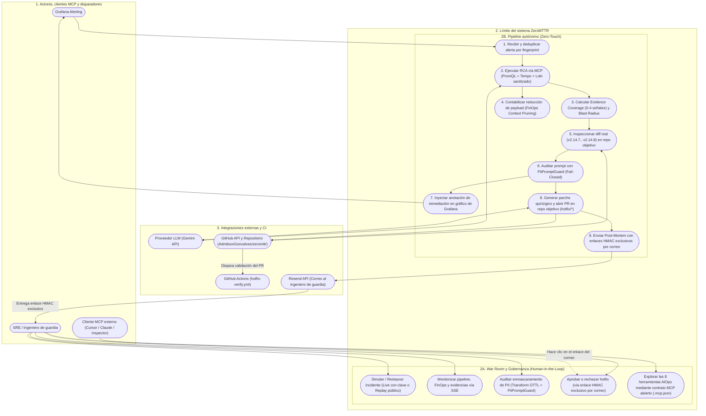
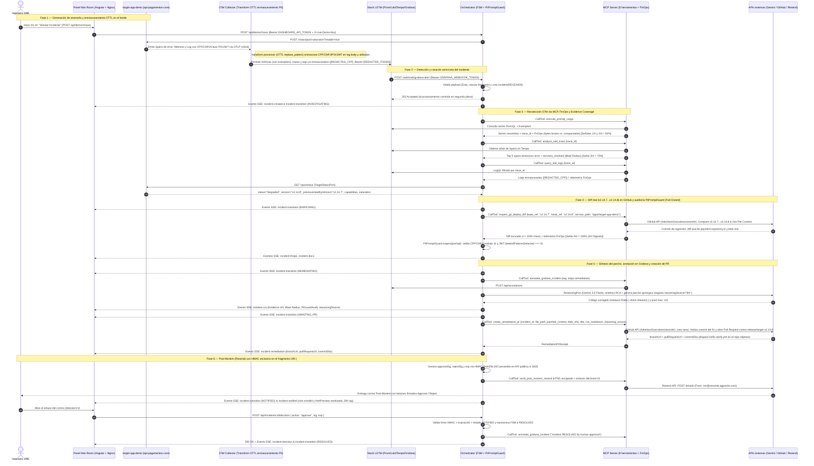
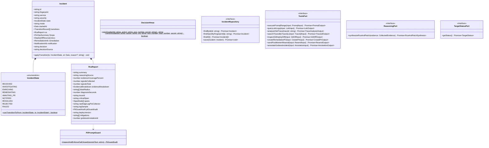
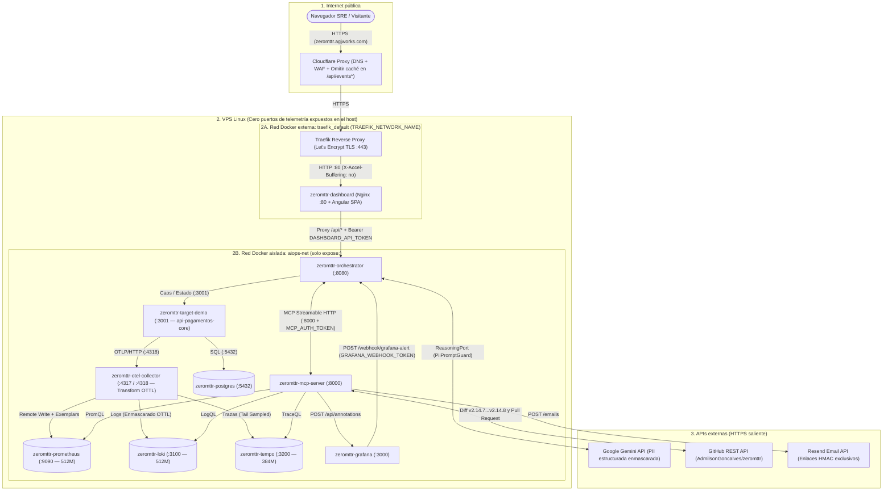

# 📐 ZeroMTTR — Diagramas de comportamiento y estáticos del sistema

| Campo | Valor |
| :--- | :--- |
| **Proyecto** | ZeroMTTR — AIOps autónomo y remediación de incidentes |
| **Línea** | Logística y Automatización (automatización de flujos de trabajo operativos e integraciones entre sistemas) |
| **Documento maestro** | [`00_architecture_master.md`](./00_architecture_master.md) |
| **Alcance** | Modelado de comportamiento (Casos de uso y Secuencia) y modelado estructural/estático (Clases hexagonales y Topología de red) |

---

## 1. Diagrama de casos de uso

Define visualmente los **Actores** (incluidos clientes MCP externos como Cursor / Claude Desktop / MCP Inspector), la **Operación interactiva / Gobernanza humana (Human-in-the-Loop)**, el **Pipeline autónomo (Zero-Touch)** y las **Integraciones externas**.

---

## 2. Diagrama de secuencia de extremo a extremo (Flujo de comportamiento)

Representa la interacción cronológica completa entre contenedores y APIs externas, destacando:
1. El enmascaramiento de PII en el cuerpo del log (`transform` OTTL en el Collector) **antes** del almacenamiento en Loki;
2. La validación determinista mediante **`PiiPromptGuard`** **antes** de enviar el prompt a Gemini;
3. La inspección de los tags reales `v2.14.7...v2.14.8` (`apps/target-app-demo`) y la apertura del PR contra la rama `release/target-v2.14.8` en el repositorio `AdmilsonGoncalves/zeromttr`;
4. La segregación entre `GRAFANA_WEBHOOK_TOKEN` y `DASHBOARD_API_TOKEN`, manteniendo el **HMAC `decisionToken` restringido exclusivamente al correo enviado por Resend** (nunca expuesto en SSE ni en `GET /api/incidents/:id`).

---

## 3. Diagramas de clases — Arquitectura hexagonal

Dado que `apps/orchestrator` y `apps/mcp-server` siguen una **Arquitectura Hexagonal (Ports & Adapters)** con **TDD obligatorio**, los diagramas siguientes presentan las entidades de dominio (incluidas `PiiPromptGuard` y `EvidenceCoverage`), casos de uso, puertos (interfaces) y adaptadores.

### 3.1 `apps/orchestrator` — Dominio y puertos

### 3.2 `apps/orchestrator` — Casos de uso y adaptadores

```mermaid
classDiagram
    direction TB

    class HandleAlert {
        +execute(payload: GrafanaWebhookPayload) Promise~Incident~
    }
    class InvestigateIncident {
        +execute(incidentId: string) Promise~RcaReport~
    }
    class EnrichWithDeployDiff {
        +execute(incidentId: string) Promise~DeployDiffSource[]~
    }
    class DispatchRemediation {
        +execute(incidentId: string) Promise~RemediationInfo~
    }
    class NotifyOnCall {
        +execute(incidentId: string) Promise~NotificationInfo~
    }
    class RecordDecision {
        +execute(incidentId: string, action: string, sig: string, exp: number) Promise~Incident~
        +executeSimulated(incidentId: string, action: string) Promise~Incident~
    }

    class IncidentRepository {
        <<interface>>
    }
    class ToolsPort {
        <<interface>>
    }
    class ReasoningPort {
        <<interface>>
    }
    class TargetStatusPort {
        <<interface>>
    }

    class FileIncidentRepository
    class McpClientAdapter
    class GeminiReasoningAdapter
    class DeterministicFallbackReasoningAdapter
    class HttpTargetStatusAdapter
    class PrometheusTargetStatusAdapter

    HandleAlert --> IncidentRepository
    InvestigateIncident --> ToolsPort
    InvestigateIncident --> TargetStatusPort
    InvestigateIncident --> IncidentRepository
    EnrichWithDeployDiff --> ToolsPort
    EnrichWithDeployDiff --> IncidentRepository
    DispatchRemediation --> ReasoningPort
    DispatchRemediation --> ToolsPort
    DispatchRemediation --> IncidentRepository
    NotifyOnCall --> ToolsPort
    NotifyOnCall --> IncidentRepository
    RecordDecision --> IncidentRepository
    RecordDecision --> ToolsPort

    FileIncidentRepository ..|> IncidentRepository
    McpClientAdapter ..|> ToolsPort
    GeminiReasoningAdapter ..|> ReasoningPort
    DeterministicFallbackReasoningAdapter ..|> ReasoningPort
    HttpTargetStatusAdapter ..|> TargetStatusPort
    PrometheusTargetStatusAdapter ..|> TargetStatusPort
    PrometheusTargetStatusAdapter --> ToolsPort
```

---

### 3.3 `apps/mcp-server` — Dominio puro, 8 herramientas, puertos y adaptadores HTTP

```mermaid
classDiagram
    direction TB

    class SeriesSummarizer {
        +summarize(series: RawPromSeries[], maxSeries: number)$ SeriesSummary[]
    }
    class LogTruncator {
        +truncateLines(lines: string[], maxLines: number, maxChars: number)$ string[]
    }
    class SpanAnalyzer {
        +analyze(spans: RawSpan[])$ TraceSummary
    }
    class FinOpsCalculator {
        +calculate(rawBytes: number, compactedBytes: number)$ FinOpsMetrics
    }

    class ExecutePromqlRange {
        +execute(input: PromqlToolInput) Promise~PromqlToolOutput~
    }
    class QueryLokiLogs {
        +execute(input: LokiToolInput) Promise~LokiToolOutput~
    }
    class AnalyzeOtelTrace {
        +execute(input: TraceToolInput) Promise~TraceToolOutput~
    }
    class SearchTracesByTraceQL {
        +execute(input: TraceQlToolInput) Promise~TraceQlToolOutput~
    }
    class InspectGitDeployDiff {
        +execute(input: GitDiffToolInput) Promise~GitDiffToolOutput~
    }
    class CreateRemediationPr {
        +execute(input: CreatePrToolInput) Promise~CreatePrToolOutput~
    }
    class SendPostMortemResend {
        +execute(input: ResendToolInput) Promise~ResendToolOutput~
    }
    class AnnotateGrafanaIncident {
        +execute(input: AnnotationToolInput) Promise~AnnotationToolOutput~
    }

    class MetricsPort {
        <<interface>>
    }
    class LogsPort {
        <<interface>>
    }
    class TracesPort {
        <<interface>>
    }
    class RepoInspectorPort {
        <<interface>>
    }
    class RemediationPort {
        <<interface>>
    }
    class NotifierPort {
        <<interface>>
    }
    class AnnotationPort {
        <<interface>>
    }

    class PrometheusHttpAdapter
    class LokiHttpAdapter
    class TempoHttpAdapter
    class GithubInspectorHttpAdapter
    class GithubRemediationHttpAdapter
    class ResendHttpAdapter
    class GrafanaAnnotationsHttpAdapter

    ExecutePromqlRange --> SeriesSummarizer
    ExecutePromqlRange --> FinOpsCalculator
    ExecutePromqlRange --> MetricsPort

    QueryLokiLogs --> LogTruncator
    QueryLokiLogs --> FinOpsCalculator
    QueryLokiLogs --> LogsPort

    AnalyzeOtelTrace --> SpanAnalyzer
    AnalyzeOtelTrace --> TracesPort

    SearchTracesByTraceQL --> TracesPort

    InspectGitDeployDiff --> FinOpsCalculator
    InspectGitDeployDiff --> RepoInspectorPort

    CreateRemediationPr --> RemediationPort
    SendPostMortemResend --> NotifierPort
    AnnotateGrafanaIncident --> AnnotationPort

    PrometheusHttpAdapter ..|> MetricsPort
    LokiHttpAdapter ..|> LogsPort
    TempoHttpAdapter ..|> TracesPort
    GithubInspectorHttpAdapter ..|> RepoInspectorPort
    GithubRemediationHttpAdapter ..|> RemediationPort
    ResendHttpAdapter ..|> NotifierPort
    GrafanaAnnotationsHttpAdapter ..|> AnnotationPort
```

---

## 4. Diagrama estático de despliegue y aislamiento de red

Ilustra la defensa en profundidad en el VPS Linux:
- **Ningún contenedor publica puertos en el host (`ports:` omitido)**;
- Solo el contenedor `dashboard` (Nginx) participa simultáneamente en la red externa de Traefik (`traefik_default` / `${TRAEFIK_NETWORK_NAME}`) y en la red interna aislada (`aiops-net`);
- **Segregación estricta de credenciales:** Nginx inyecta `Authorization: Bearer ${DASHBOARD_API_TOKEN}` en las rutas `/api/*` del Dashboard, mientras que Grafana Alerting utiliza un token exclusivo (`GRAFANA_WEBHOOK_TOKEN`) para invocar `POST /webhook/grafana-alert` internamente dentro de la red `aiops-net`.

