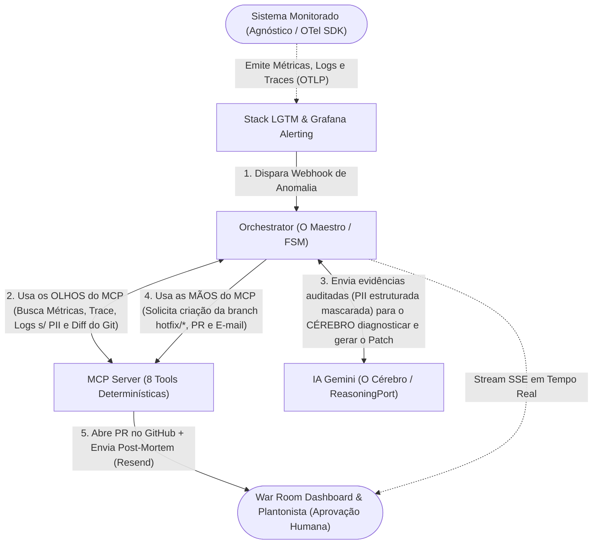
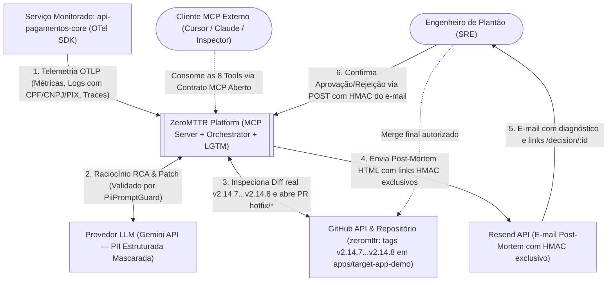
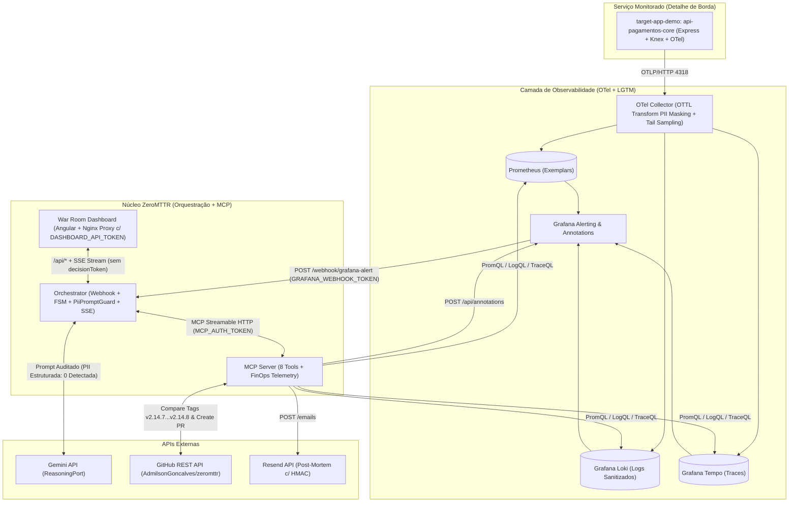
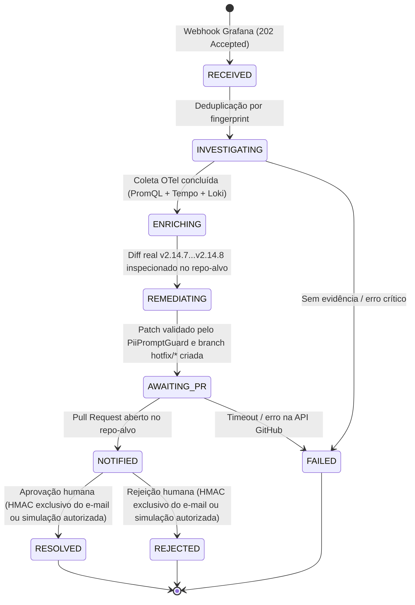
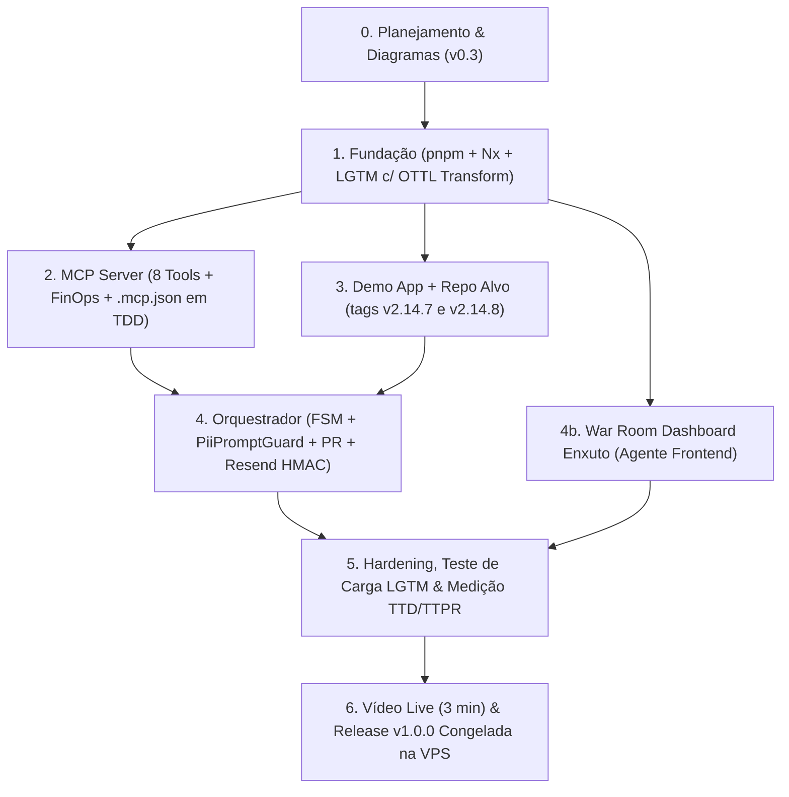

# ⚡ ZeroMTTR — Documento Mestre de Arquitetura e Plano de Projeto

| Campo | Valor |
| :--- | :--- |
| **Projeto** | ZeroMTTR — Autonomous AIOps & Incident Remediation |
| **Trilha Principal** | **Logística & Automação** (Automação de fluxos de trabalho operacionais e integrações autônomas entre sistemas críticos) |
| **Arquitetura Agnóstica de Domínio** | Desacoplada do serviço monitorado (*Clean Architecture* — o workload é um detalhe de borda conectado via OTLP e Git). Demonstração com **`api-pagamentos-core`** (aplicável a liquidação PIX, expedição logística, e-commerce, etc.) |
| **Organização** | **AGJ Works** (`https://agjworks.com`) |
| **Ambiente de Produção (Demo)** | `https://zeromttr.agjworks.com` (VPS Linux + Traefik + Cloudflare) |
| **Repositório (Monorepo Único)** | `https://github.com/AdmilsonGoncalves/zeromttr` (branch `master` saudável na tag `v2.14.7`; branch `release/target-v2.14.8` na tag `v2.14.8` contendo a regressão em `apps/target-app-demo` alvo dos PRs de hotfix) |
| **Status** | Planejamento (v0.3 — OTel/LGTM + MCP Aberto + GitHub Remediation + Resend HMAC Isolado). Implementação 100% escrita do zero após 04/11/2026 21h00 BRT |
| **Diagramas do Sistema (UML / Rede)** | [`docs/pt-BR/01_system_diagrams.md`](./01_system_diagrams.md) (Casos de Uso, Sequência E2E, Classes Hexagonais e Topologia de Rede) |
| **Documentos Técnicos** | Fatias de implementação em [`docs/pt-BR/tech/`](./tech/) (ver §12) |

---

## 1. Introdução e Posicionamento

### 1.1 Automação de Fluxos Operacionais e Arquitetura Aberta (Clean Architecture)
Em arquiteturas de microsserviços que sustentam operações críticas no Brasil — como processamento de transações instantâneas (PIX), sistemas de expedição logística, faturamento ou checkout — o tempo entre um alerta de degradação e a correção em produção ainda é dominado por trabalho manual fragmentado. Seguindo o princípio de **Robert C. Martin (*Clean Architecture*)** de **manter a arquitetura aberta e adiar detalhes**, o **ZeroMTTR** foi desenhado como um motor **100% agnóstico ao domínio do serviço monitorado**: qualquer aplicação que emita telemetria OpenTelemetry (OTLP) e possua um repositório Git pode ser conectada sem alterar uma única linha do orquestrador ou do servidor MCP.

Na operação real, a resposta a incidentes enfrenta três gargalos:
1. **Fragmentação manual entre sistemas:** ferramentas de observabilidade param no alerta textual, exigindo que o engenheiro de plantão cruze manualmente métricas (Prometheus), traces distribuídos (Tempo), logs (Loki) e histórico de deploys (GitHub).
2. **Risco de vazamento de PII brasileira ao usar IA:** logs de erro em produção frequentemente contêm **CPF, CNPJ, chaves PIX/e-mails e tokens JWT/Bearer**. Enviar esses logs brutos para LLMs externos viola regras de privacidade e governança de dados.
3. **Custo imprevisível de tokens:** enviar despejos brutos de séries temporais, árvores de spans e *git diffs* extensos estoura a janela de contexto e encarece o uso de LLMs.

O **ZeroMTTR** integra esses sistemas e automatiza o fluxo de trabalho de ponta a ponta em segundos:

> **Alerta (Grafana) → Mascaramento de PII na Borda (OTel Collector `transform`) → Coleta Determinística via MCP (OTel/LGTM + GitHub Diff `v2.14.7...v2.14.8`) → Auditoria Fail-Closed (`PiiPromptGuard`) & Síntese de Patch via LLM (`ReasoningPort`) → Pull Request validado por CI → Post-mortem com aprovação humana assinada exclusivamente por e-mail (Resend HMAC em `#fragment`).**

### 1.2 Posicionamento e Diferenciação (Estado da Arte em AI SRE)
A categoria de agentes para operações de TI conta com ferramentas relevantes de mercado e código aberto. O **ZeroMTTR** não propõe reinventar o conceito genérico de "alerta para PR", mas entregar de forma integrada, *out-of-the-box*, três capacidades que — até onde verificamos na documentação pública das ferramentas em nov/2026 — costumam exigir customização externa ou licenciamento SaaS proprietário:

| Critério | HolmesGPT (CNCF) / OpenSRE (Configuração Padrão) | Datadog Bits AI / Sentry Seer | **ZeroMTTR (Este Projeto)** |
| :--- | :--- | :--- | :--- |
| **Modelo de Implantação** | Self-hosted (foco principal em investigação / integração ChatOps) | SaaS proprietário (acoplado à nuvem do fornecedor) | **100% Self-Hosted & Open Source**, com contrato **MCP aberto** consumível por clientes externos (Claude Desktop, Cursor, MCP Inspector) e pelo orquestrador |
| **Proteção Verificável de PII antes do LLM** | Não identificamos guard-rail algorítmico nativo de CPF/CNPJ pré-prompt na documentação pública (nov/2026) | Processado na infraestrutura do provedor SaaS | **Dupla barreira independente:** (1) Mascaramento OTTL (`transform`) na borda do OTel Collector e (2) **`PiiPromptGuard` (fail-closed)** com validação de dígitos verificadores (módulo 11) de CPF/CNPJ e detecção estrutural de JWT antes do envio ao LLM |
| **Medição de Redução de Payload (FinOps) por Incidente** | Foco em limites de janela de contexto | Cobrança gerenciada na licença SaaS | **Métrica de poda de contexto por tool call MCP:** calcula `raw_bytes_fetched` vs. `compacted_bytes_sent_to_llm` (sumarização estatística + truncamento por política) e exibe a estimativa de tokens poupados (`bytes / 4`) |
| **Governança de Remediação** | Abertura de PR via integrações configuráveis | Abre PR direto na plataforma SaaS | Abre **Pull Request contra a branch de release (`release/target-v2.14.8`)**, aciona CI de verificação (`hotfix-verify.yml`) e exige **aprovação humana via link HMAC exclusivo no `#fragment` do e-mail (Resend)** |

---

## 2. Objetivos e Métricas

### 2.1 Objetivo Geral
Entregar uma plataforma funcional, demonstrável ao vivo e de código aberto que automatize a investigação de causa raiz (RCA) e a preparação de Pull Requests de correção para incidentes em microsserviços, utilizando **Model Context Protocol (MCP)**, **OpenTelemetry**, **mascaramento verificável de PII na borda** e **governança com humano no circuito**.

### 2.2 A Essência do Sistema em 30 Segundos (O Maestro, o Cérebro e os Olhos/Mãos)
Para compreender imediatamente o papel de cada bloco da arquitetura, o **ZeroMTTR** separa estritamente **quem executa ferramentas (MCP)**, **quem sintetiza o diagnóstico e o código (IA)** e **quem coordena o workflow (Orchestrator)**:

1. **O `mcp-server` (MCP) = Os "Olhos e as Mãos" (100% Determinístico, sem IA embutida):**
   - O **Model Context Protocol (MCP)** funciona como uma interface universal que expõe **8 ferramentas (tools)** padronizadas divididas em dois grupos:
     - **Olhos (Leitura e Poda de Contexto FinOps):** `execute_promql_range` (Prometheus), `analyze_otel_trace` (Tempo), `search_traces_by_traceql` (busca TraceQL ad-hoc e fallback quando não há exemplar), `query_loki_logs` (Loki) e `inspect_git_deploy_diff` (compara a versão saudável anterior com a versão atual no GitHub).
     - **Mãos (Ação e Governança):** `create_remediation_pr` (cria branch `hotfix/zeromttr-*`, aplica o commit de correção — sempre no nível de `PATCH` semântico — e abre o Pull Request no GitHub), `annotate_grafana_incident` (marca o gráfico do Grafana) e `send_post_mortem_resend` (envia o relatório por e-mail).
2. **A IA (`Gemini API` via `ReasoningPort`) = O "Cérebro":**
   - A IA **não** acessa bancos de dados, observabilidade nem o GitHub diretamente. Ela recebe apenas o resumo podado pelo MCP e validado em modo *fail-closed* pelo `PiiPromptGuard`, sintetiza a causa raiz (RCA) e escreve o código corrigido (o patch cirúrgico), registrando explicitamente `reasoningSource: 'llm' | 'fallback'`.
3. **O `orchestrator` = O "Maestro" (Workflow Determinístico + FSM):**
   - Recebe o alerta do Grafana → executa de forma previsível a sequência de coleta nos **Olhos do MCP** → valida a ausência de PII (`PiiPromptGuard`) e envia ao **Cérebro (IA)** para sintetizar o RCA e gerar o patch → aciona as **Mãos do MCP** para abrir o Pull Request no GitHub (disparando o CI da branch) e enviar o e-mail de aprovação humana ao plantonista, enquanto transmite tudo ao vivo via SSE para o **War Room Dashboard**.



### 2.3 Indicadores Operacionais Mensuráveis (KPIs)
Para evitar comparações distorcidas com processos que incluem deploy completo em produção, o ZeroMTTR mede especificamente o tempo até o diagnóstico determinístico (**TTD**) e o tempo até um Pull Request testado e pronto para revisão humana (**TTPR**), comparados contra um **baseline manual cronometrado** (os mesmos 7 passos executados manualmente por um engenheiro):

| KPI | Meta ZeroMTTR | Baseline Manual Cronometrado (7 passos) |
| :--- | :--- | :--- |
| **TTD (Time to Deterministic RCA + Deploy Diff)** | **≤ 15 s** | ~12 a 18 min (cruzar PromQL, exemplar, trace no Tempo, logs no Loki e `git diff`) |
| **TTPR (Time to Reviewable Hotfix PR no GitHub)** | **≤ 30 s** | ~25 a 40 min (isolar linha defeituosa, criar branch, codificar fix, rodar testes e abrir PR) |
| **Tempo até entrega do Post-Mortem assinado (Resend)** | **≤ 45 s** | ~45 a 60 min (redigir resumo executivo com evidências e links) |
| **Cobertura de testes automatizados (`domain/` + `application/`)** | **≥ 80 %** | — |

### 2.4 Cinco Diferenciais Técnicos Verificáveis
1. **Dupla Barreira Independente de Proteção de PII (OTTL `transform` + `PiiPromptGuard` Fail-Closed cobrindo padrões estruturados dos 5 Tipos Oficiais de Chave PIX do BACEN):** na 1ª barreira, o OTel Collector aplica transformação OTTL (`replace_pattern` sobre `log.body` e atributos) mascarando CPF, CNPJ, E-mail, Telefone (padrão ANATEL), Chave PIX Aleatória (EVP / UUID v4 condicionado a rótulo PIX) e Bearer/JWT na ingestão; na 2ª barreira (independente), o `PiiPromptGuard` inspeciona todos os campos de texto livre (logs, mensagens de erro de spans, commits e diff do Git — excluindo séries numéricas brutas do Prometheus) validando dígitos verificadores (módulo 11 da Receita Federal) de CPF/CNPJ (com ou sem pontuação), regras da ANATEL para celulares (`9xxxx-xxxx`) e fixos (`[2-5]xxx-xxxx`), e-mails, chaves aleatórias EVP (`UUID v4` `4xxx-[89ab]xxx` condicionadas a rótulo PIX) e estrutura de JWT (`eyJ...` mesmo sem `Bearer`). Se detectar qualquer vazamento residual (`leakedPatternsDetected > 0`), **aborta o envio ao LLM externo (fail-closed)** e aciona o fallback local.
2. **Telemetria FinOps de Redução de Payload (Context Pruning) no MCP:** cada tool calcula `raw_bytes_fetched` vs. `compacted_bytes_sent_to_llm` (obtidos por sumarização estatística de séries e truncamento por política de limites), exibindo dinamicamente no topo do dashboard a redução percentual de bytes e a estimativa de tokens poupados (`Math.round((raw - compacted) / 4)`).
3. **Contrato MCP Aberto (Interoperável com Clientes Externos):** as 8 tools MCP não ficam presas ao workflow do orquestrador; o repositório inclui configuração `.mcp.json` permitindo que qualquer Host MCP externo (**MCP Inspector / Cursor / Claude Desktop**) escolha e invoque livremente as ferramentas sobre a stack LGTM e o GitHub.
4. **Evidence Coverage Score (`0–100%` / `4 de 4 sinais`) & Blast Radius:** mede de forma linear e transparente quantos sinais independentes convergiram para o diagnóstico (+25% anomalia PromQL, +25% `trace_id` via Exemplar, +25% Span com erro no Tempo, +25% Log correlacionado no Loki + commit isolado no diff `v2.14.7...v2.14.8` = `4/4 Signals — 100%`), degradando proporcionalmente (`3/4 — 75%`, `2/4 — 50%`) caso algum sinal esteja ausente, além de listar os serviços afetados (`services_involved`).
5. **Execução Live Real (< 25s) com `reasoningSource` Explícito + Modo Replay Transparente:** o vídeo de demonstração e as avaliações com chave (`LIVE_DEMO_KEY`) ou via Docker local executam o **fluxo `Live` 100% real** (exibindo `reasoningSource: 'llm'` no SSE e no corpo do PR para comprovar que a síntese veio do Gemini ao vivo, e não do fallback). Na VPS pública aberta à internet, visitantes anônimos sem chave assistem por padrão ao modo `Replay` (claramente identificado na UI e no README) para proteger as cotas de API.

### 2.5 Fora de Escopo e Limites Declarados (MVP)
- **Sem merge ou redeploy automático em produção:** por decisão de governança (*human-in-the-loop*), o ciclo autônomo encerra na abertura do Pull Request validado pelo CI na branch de release (`release/target-v2.14.8`) e no registro da decisão humana assinada. Na demonstração, a simulação de falha no contêiner `target-app-demo` é controlada por estado em memória e restaurada pelo script/botão de reset.
- **Escopo da detecção de PII:** o mascaramento OTTL e o `PiiPromptGuard` cobrem os **padrões estruturados dos 5 tipos oficiais de Chave PIX do Banco Central** (CPF e CNPJ com Módulo-11 da Receita Federal, Telefone Celular/Fixo com regras da ANATEL, E-mail RFC 5322 e Chave Aleatória EVP/UUID v4 RFC 4122 condicionada a contexto `pix`/`pixKey`/`chave_pix`/`evp`), além de tokens JWT/Bearer (telefone sem máscara e UUID v4 requerem marcador contextual para evitar falsos positivos com correlation IDs/timestamps Unix; nomes próprios em texto livre não fazem parte do escopo determinístico).
- Multi-tenant, alta disponibilidade multi-nó e retenção de longo prazo para métricas/logs/traces.

---

## 3. Escopo e Stakeholders

| Stakeholder | Interesse |
| :--- | :--- |
| Engenheiro de Plantão (SRE) / Operação Logística | Receber RCA correlacionado ao commit causador e Pull Request testado em segundos; aprovar ou rejeitar via link assinado no seu e-mail |
| Equipe de Plataforma / FinOps | Garantir que nenhum dado pessoal (CPF/CNPJ/PIX/JWT) seja enviado a LLMs externos e manter o consumo de tokens previsível |
| Desenvolvedores / Comunidade Open Source | Conectar qualquer cliente compatível com MCP (`.mcp.json`) às 8 tools de observabilidade e remediação |

---

## 4. Tecnologias Envolvidas

| Camada | Tecnologia | Papel |
| :--- | :--- | :--- |
| Runtime & Monorepo | **Node.js 24 LTS**, **pnpm** (`pnpm-workspace.yaml`), **Nx** (`nx.json`), TypeScript (`strict`, `ES2024`, `NodeNext`) | Orquestração de tarefas, cache de build/testes e pacotes em `apps/*` |
| Instrumentação | OpenTelemetry SDK (Node) | Emissão de traces, métricas (com exemplars) e logs estruturados |
| Ingestão & Sanitização | OTel Collector Contrib 0.114+ | `memory_limiter`, **`transform` (OTTL regex masking no `log.body` e atributos)**, `redaction` (spans), `tail_sampling` |
| Armazenamento | Prometheus (exemplars), Loki, Tempo | Stack LGTM |
| Visualização / Gatilho | Grafana 11.2+ (Alerting) | Webhook de incidente e API de anotações (`POST /api/annotations`) |
| Protocolo de Agente | **MCP** (`@modelcontextprotocol/sdk`) | Interface aberta padronizada de 8 tools de AIOps |
| LLM do Agente | Google Gemini API (`ReasoningPort`, modelo configurável via `LLM_MODEL`, padrão `gemini-3.5-flash`) | Síntese de RCA e geração de patch cirúrgico (com `reasoningSource: 'llm' \| 'fallback'` explícito) |
| **Inspeção de Deploy & Auto-Remediação** | **GitHub REST API (Octokit)** sobre `apps/target-app-demo` no repositório `zeromttr` | Comparação real entre as tags `v2.14.7...v2.14.8`, leitura de código, criação de branch `hotfix/zeromttr-*` e abertura de Pull Request mirando `release/target-v2.14.8` |
| **Notificação e Governança** | **Resend** | Entrega do Post-Mortem em HTML (`sre@send.zeromttr.agjworks.com`) contendo com exclusividade os links de decisão assinados via HMAC |
| Testes | Vitest, Supertest, `nock`/MSW + **Test Helpers (`test/helpers/`)** | **Testing Trophy (Integração & E2E como prioridade)** exercitando rotas HTTP, MCP e `PiiPromptGuard` de ponta a ponta (Happy & Unhappy Paths); testes unitários restritos às funções puras de apoio |
| Qualidade | ESLint, Prettier, Husky + lint-staged, Commitlint | Padrões de código e imposição de fronteiras hexagonais |
| Infraestrutura | Docker, Docker Compose | Execução local (`docker-compose.yml`) e em produção na VPS (`docker-compose.prod.yml`) |
| CI/CD | GitHub Actions | `ci.yml`, `hotfix-verify.yml` (verifica PRs `hotfix/zeromttr-*`) e `cd-release.yml` (deploy na VPS congelado apenas para tags `v*` ou disparo manual) |
| Workload Demo | Express + Knex + PostgreSQL | Serviço `api-pagamentos-core` com falha reproduzível de saturação do pool de conexões |
| Frontend | **Angular (última versão estável)**, **PrimeNG (preset Aura Dark)**, Tailwind CSS v4 + `tailwindcss-primeui` | War Room Dashboard enxuto (Single-Pane, 4 quadrantes) + rota `/decision/:id` |

---

## 5. Arquitetura do Sistema

### 5.1 Estilo Arquitetural
| Aspecto | Decisão |
| :--- | :--- |
| Estilo macro | **Event-driven + Agentic** (webhook dispara o agente; fallback determinístico garante conclusão caso o LLM falhe) |
| Estilo interno | **Hexagonal (Ports & Adapters) / Clean Architecture** em `apps/orchestrator` e `apps/mcp-server` |
| Comportamento | **Máquina de Estados Finitos (FSM)** pura controlando o ciclo de vida do incidente |
| Integração | **MCP sobre HTTP** (Streamable HTTP; compatível com clientes externos via `.mcp.json`) |
| Segurança de Decisão | **HMAC exclusivo por e-mail:** assinaturas de aprovação/rejeição trafegam apenas no e-mail enviado pelo Resend, nunca no SSE ou em endpoints públicos de leitura |
| Implantação | Local via `docker-compose.yml` · Produção em **VPS Linux** via `docker-compose.prod.yml` + **Traefik + Cloudflare**, lendo segredos de arquivo externo ao repositório (ex.: `/path/to/secrets/.env`) |

### 5.2 Padrões por Componente
| Componente | Padrão | Organização |
| :--- | :--- | :--- |
| `apps/orchestrator/` e `apps/mcp-server/` | **Hexagonal (Ports & Adapters)** | `domain` → `application` → `ports` → `adapters`, com composition root em `main.ts` |
| `apps/target-app-demo/` | **MVC em camadas** | `routes` → `controllers` → `services` → `repositories` (`PaymentRepository`) |
| `apps/dashboard/` | **Single-Pane War Room com Signals** (Angular + PrimeNG Aura Dark) | Standalone Components (`WarRoomComponent` + `DecisionComponent`) focado no fluxo principal de 3 minutos |

### 5.3 Visão de Contexto (C4 Nível 1)


### 5.4 Visão de Contêineres (C4 Nível 2)


### 5.5 Máquina de Estados do Incidente (FSM)


> [!NOTE]
> Para a modelagem detalhada **comportamental** (Diagrama de Casos de Uso e Diagrama de Sequência Ponta a Ponta) e **estática** (Diagramas de Classes Hexagonais de `apps/orchestrator` e `apps/mcp-server` e Topologia de Isolamento de Rede na VPS), consulte [`01_system_diagrams.md`](./01_system_diagrams.md).

### 5.6 Decisões Arquiteturais (ADRs Resumidos)
| ID | Decisão | Motivo | Alternativa Descartada |
| :--- | :--- | :--- | :--- |
| ADR-001 | Monorepo único **pnpm + Nx** (`apps/*`) com branch `master` saudável (`v2.14.7`) e branch dedicada `release/target-v2.14.8` (`v2.14.8`) para a regressão de `apps/target-app-demo` | Tudo permanece em um único repositório (`AdmilsonGoncalves/zeromttr`), mantendo a `master` 100% verde no CI enquanto permite comparar tags reais `v2.14.7...v2.14.8` e abrir PRs contra `release/target-v2.14.8` | Deixar código quebrado na `master` ou manter múltiplos repositórios |
| ADR-002 | Arquitetura Hexagonal no orquestrador e no MCP | Domínio isolado de HTTP e SDKs externos; testabilidade em TDD com fakes | Camadas acopladas |
| ADR-003 | MCP como contrato aberto de ferramentas (`.mcp.json` incluso) | Permite que tanto o `orchestrator` quanto clientes externos (Cursor/Claude/Inspector) consumam as mesmas 8 tools | Chamadas REST internas ad hoc |
| ADR-004 | LLM isolado atrás de `ReasoningPort` + `PiiPromptGuard` + Fallback Determinístico | Garante auditoria zero-PII antes da chamada externa e continuidade operacional mesmo se o provedor de LLM falhar | Chamada direta ao SDK sem guard-rail |
| ADR-005 | Truncamento defensivo e FinOps no MCP | Controle estrito de tokens e medição exata de bytes economizados por tool call | Envio de payloads brutos |
| ADR-006 | Segregação de tokens e **HMAC exclusivo no e-mail** para aprovação humana | Impede que visitantes da demo pública leiam o `decisionToken` via SSE/REST e aprovem incidentes sem acesso ao e-mail do plantonista | Expor `decisionToken` na API do dashboard ou usar o mesmo token para webhook e UI |
| ADR-007 | Persistência de incidentes em memória + arquivo JSON (MVP) | Simplicidade operacional e suporte nativo a gravação de artefatos para o modo Replay | Banco relacional dedicado para o orquestrador |
| ADR-008 | As 8 tools e seus adapters HTTP vivem em `apps/mcp-server`; `apps/orchestrator` consome via `ToolsPort` | Zero duplicação de adapters; servidor MCP 100% autônomo | Adapters duplicados nos dois serviços |
| ADR-009 | Mascaramento de PII em logs via processor **`transform` (OTTL `replace_pattern`)** no OTel Collector | Garante sanitização determinística diretamente no `log.body` e atributos em qualquer versão do Collector 0.114+ | Depender apenas do processor `redaction` (restrito a atributos de span em algumas versões) |

---

## 6. Princípios e Regras de Desenvolvimento

### 6.1 TDD & Testing Trophy (Prioridade em Integração & E2E)
Ciclo **Red → Green → Refactor** com foco na filosofia *Testing Trophy*:
- Todo caso de uso e fluxo integrado nasce de testes de integração (*Happy* e *Unhappy Paths*) que falham, escritos antes da implementação usando helpers reutilizáveis em `test/helpers/`.
- Adapters externos (GitHub API, Resend, Prometheus, Loki, Tempo, Grafana) são exercitados em testes de integração com interceptação HTTP na borda de saída (`nock`/MSW). **Nunca chamam APIs reais em CI.**
- *Testing Trophy*: testes de integração e E2E exercitam rotas HTTP, MCP, `PiiPromptGuard` e FSM de ponta a ponta; testes unitários são reservados para funções puras de apoio (Módulo-11, regexes ANATEL/BACEN, FinOps, escape HTML).
- Meta de cobertura: ≥ 80 % em `domain/` e `application/`.

### 6.2 SOLID Aplicado
| Princípio | Aplicação Concreta |
| :--- | :--- |
| **S** | Um arquivo por tool; um caso de uso por classe |
| **O** | Novos adapters (outro LLM, outro provedor Git, outro canal de notificação) sem alterar o domínio |
| **L** | Qualquer implementação de port é substituível por fake |
| **I** | Ports coesos: `MetricsPort`, `LogsPort`, `TracesPort`, `RepoInspectorPort`, `RemediationPort`, `NotifierPort`, `AnnotationPort` |
| **D** | Casos de uso dependem exclusivamente de ports; composição em `main.ts` |

### 6.3 Outras Regras
- **Clean Code / DRY / YAGNI / KISS**; funções pequenas, sem `any` fora de fronteiras (usar `zod` para validar entradas externas).
- **Idioma:** código, tools, logs e commits em en-US; documentação principal e README em en-US e pt-BR.
- **Segurança por padrão:** três tokens distintos (`MCP_AUTH_TOKEN`, `GRAFANA_WEBHOOK_TOKEN`, `DASHBOARD_API_TOKEN`), `decisionToken` restrito ao e-mail, escape de HTML nos templates, redaction OTTL na borda + `PiiPromptGuard` pré-LLM.

---

## 7. Estrutura de Pastas (Monorepo pnpm + Nx)

```text
zeromttr/
├── package.json                  # Scripts raiz delegando ao Nx (check:workspace, lint:workspace, test:workspace, build:workspace)
├── pnpm-workspace.yaml           # packages: ['apps/*']
├── nx.json                       # Task pipeline, cache e affected (Nx package-based)
├── tsconfig.base.json            # Strict TS config compartilhado
├── .mcp.json                     # Configuração pronta para conectar clientes MCP externos (Inspector / Cursor / Claude)
├── .nvmrc                        # Node 24
├── .dockerignore                 # Mantém contexto de build Docker < 2 MB
├── README.md                     # en-US (inclui trilha, posicionamento e distinção Live vs Replay)
├── README.pt-BR.md
├── AGENTS.md                     # Contexto e regras para agentes de codificação
├── GEMINI.md                     # Ponteiro: instrui o Gemini a ler o AGENTS.md
├── LICENSE                       # MIT
├── docker-compose.yml            # Ambiente local de desenvolvimento
├── docker-compose.prod.yml       # VPS Linux (Traefik + limites seguros de RAM + env_file externo, zero ports no host)
├── .github/workflows/
│   ├── ci.yml                    # Lint, typecheck, Gitleaks, Vitest (≥80%), Compose smoke (via pnpm + Nx)
│   ├── hotfix-verify.yml         # Gate automático nos PRs hotfix/zeromttr-* abertos contra release/target-v2.14.8
│   └── cd-release.yml            # Push GHCR em main/tags; deploy na VPS congelado APENAS para tags v* ou workflow_dispatch
├── .env.example                  # Template local (dev)
├── .env.prod.template            # Template de produção na VPS (ex.: /path/to/secrets/.env)
├── infra/
│   ├── otel-collector-config.yaml
│   ├── otel-collector-config.prod.yaml
│   ├── prometheus.yml
│   ├── tempo-config.yaml
│   ├── loki-config.yaml
│   └── grafana/provisioning/
│       ├── datasources/datasources.yaml
│       └── alerting/{rules.yaml,contact-points.yaml,policies.yaml}
├── apps/
│   ├── mcp-server/               # Hexagonal (8 tools + FinOps telemetry + adapters LGTM/GitHub/Resend)
│   │   ├── src/
│   │   │   ├── domain/           # summarize-series, truncate, span-analysis, finops
│   │   │   ├── application/      # casos de uso (uma tool = um caso de uso)
│   │   │   ├── ports/            # MetricsPort, LogsPort, TracesPort, RepoInspectorPort, RemediationPort, NotifierPort, AnnotationPort
│   │   │   ├── adapters/         # prometheus, loki, tempo, github-inspector, github-remediation, resend, grafana-annotations (HTTP)
│   │   │   ├── transport/        # servidor MCP Streamable HTTP + auth
│   │   │   ├── config/
│   │   │   └── main.ts           # composition root
│   │   └── test/{helpers,integration,unit}/
│   ├── orchestrator/             # Hexagonal + FSM + PiiPromptGuard
│   │   ├── src/
│   │   │   ├── domain/           # Incident, IncidentState (FSM), RcaReport, EvidenceCoverage, DecisionHmac, PiiPromptGuard
│   │   │   ├── application/      # HandleAlert, InvestigateIncident, EnrichWithDeployDiff, DispatchRemediation, NotifyOnCall, RecordDecision
│   │   │   ├── ports/            # ReasoningPort, ToolsPort (MCP client), IncidentRepository, TargetStatusPort, Clock
│   │   │   ├── adapters/         # llm.gemini (com PiiPromptGuard), mcp.client, repo.file, target-status.http
│   │   │   ├── http/             # webhook Grafana (GRAFANA_WEBHOOK_TOKEN), API REST (DASHBOARD_API_TOKEN), decisões HMAC, SSE
│   │   │   └── main.ts
│   │   └── test/
│   ├── target-app-demo/          # MVC em camadas (api-pagamentos-core — emissor OTel local)
│   │   ├── src/{routes,controllers,services,repositories,models,telemetry,chaos}/
│   │   └── test/
│   └── dashboard/                # Angular + PrimeNG (Aura Dark) War Room enxuto, Fase 4b
├── scripts/                      # demo.sh, chaos.sh, reset.sh, measure-mttr.sh, smoke-integrations.sh
└── docs/
    ├── pt-BR/
    │   ├── 00_architecture_master.md
    │   ├── 01_system_diagrams.md # Casos de Uso, Sequência E2E, Classes Hexagonais e Topologia de Rede
    │   ├── tech/                 # documentos de implementação por fatia (01 a 08)
    │   └── adr/
    └── en-US/
```

---

## 8. Fases do Projeto e Entregas

| Fase | Objetivo | Entregáveis | Critério de Aceite (DoD da Fase) |
| :--- | :--- | :--- | :--- |
| **0 — Planejamento** | Arquitetura v0.3, diagramas UML, especificações técnicas e credenciais | Este documento, `01_system_diagrams.md`, `tech/01..08.md` | Especificações revisadas e sem pontas soltas |
| **1 — Fundação** | Monorepo (`pnpm` + `Nx`), CI, stack LGTM com `transform` OTTL para PII | `pnpm-workspace.yaml`, `nx.json`, `docker-compose`, `infra/`, CI verde | `docker compose up` saudável; Collector mascara CPF/CNPJ/PIX/JWT em `log.body` |
| **2 — MCP Server (TDD)** | 8 tools com ports/adapters, FinOps e `.mcp.json` | `apps/mcp-server/` com testes, auth e suporte a MCP Inspector externo | Cobertura ≥ 80 %; 8 tools respondem ao Orchestrator e ao MCP Inspector |
| **3 — Demo App + Tags Git** | Workload `api-pagamentos-core` + branch `release/target-v2.14.8` (`v2.14.7` e `v2.14.8` criadas **após** workflows, `pnpm-lock.yaml` e testes existirem) | `apps/target-app-demo/`, tags reais `v2.14.7`/`v2.14.8` protegidas e `hotfix-verify.yml` | Falha dispara alerta no Grafana; `compare/v2.14.7...v2.14.8` retorna diff real e PR aciona `hotfix-verify.yml` |
| **4 — Orquestrador (TDD)** | Webhook segregado, FSM, `PiiPromptGuard`, GitHub PR, Resend HMAC exclusivo | `apps/orchestrator/` com testes de segurança e auditoria de prompt | E2E: alerta → diff → PR → e-mail em < 30 s; zero `decisionToken` no SSE |
| **4b — Dashboard Enxuto** | War Room Dashboard focado no roteiro de 3 min | `apps/dashboard/` (`WarRoomComponent` + `DecisionComponent`), mock server e Nginx | Golden path completo na tela com mock e com orquestrador real |
| **5 — Hardening & Baseline** | Medição cronometrada de TTD/TTPR e testes sob carga nos limites de RAM | `measure-mttr.sh`, baseline documentado, testes E2E | TTD/TTPR medidos contra baseline manual; LGTM estável sob carga |
| **6 — Release & Submissão** | Documentação final, vídeo de 3 min em modo `Live` e deploy congelado na VPS | README en/pt-BR, release `v1.0.0` implantada na VPS | Checklist de entrega 100 % cumprido (ver `tech/07`) |



---

## 9. Requisitos Não Funcionais

| Atributo | Requisito |
| :--- | :--- |
| Desempenho | TTD (RCA + Diff) ≤ 15 s; TTPR (abertura de PR) ≤ 30 s; respostas de tool ≤ 5 s (p95) |
| Economia de Tokens (FinOps) | ≤ 500 chars/linha de log, ≤ 100 linhas, ≤ 1500 chars/diff do GitHub, ≤ 5 séries PromQL |
| Segurança e Governança | Três tokens segregados (`MCP_AUTH_TOKEN`, `GRAFANA_WEBHOOK_TOKEN`, `DASHBOARD_API_TOKEN`); `decisionToken` enviado **apenas** no e-mail; PII mascarada na borda (OTTL `transform`) e auditada pré-LLM (`PiiPromptGuard`) |
| Confiabilidade | Timeouts; retry com backoff; idempotência por `incident_id`; deduplicação de alertas por fingerprint; fallback determinístico se o LLM falhar |
| Estabilidade de Produção | Deploy na VPS acionado apenas em tags de release da plataforma `v1.*.*` ou `workflow_dispatch` (nunca em pushes comuns na branch principal nem nas tags `v2.14.*` do workload de demo), mantendo o ambiente estável durante avaliações |
| Licenciamento | MIT |

---

## 10. Estratégia de Qualidade e CI/CD (GitHub Actions)

- **Estratégia de Testes (*Testing Trophy* — Prioridade em Integração e E2E):** priorizar testes de integração HTTP (`Supertest` + `nock` com helpers reutilizáveis em `test/helpers/`) e testes E2E cobrindo tanto os **Happy Paths** quanto os **Unhappy Paths** antes da implementação, reservando testes unitários isolados apenas para funções puras de apoio (Módulo-11 de CPF/CNPJ, regras da ANATEL, cálculo FinOps, `EvidenceCoverage` e transições puras da FSM).
- **Pre-commit e Pre-push local:** ESLint (com `no-restricted-imports` garantindo fronteira hexagonal e `no-floating-promises`), Prettier, typecheck e testes (`pnpm run check:workspace`).
- **Pipeline de CI/CD em 3 Workflows no GitHub Actions (`.github/workflows/`):**
  1. **`ci.yml` (Integração Contínua em Push e PRs na `master`):**
     - **Quality & Security Gate:** ESLint, Prettier, `tsc --noEmit`, varredura de segredos (`gitleaks-action`) e `pnpm audit --prod --audit-level=critical`.
     - **Integration, Security & Support Unit Tests + Coverage Gate:** Vitest com cobertura ≥ 80 % em `domain/` + `application/` (incluindo a suíte de integração Happy/Unhappy Paths do `PiiPromptGuard` e do pipeline HTTP/MCP).
     - **Docker & Compose Smoke Test:** valida `docker compose config` e build das imagens.
  2. **`hotfix-verify.yml` (Validação Automática dos PRs Autônomos):**
     - Dispara nos Pull Requests `hotfix/zeromttr-*` (abertos pelo ZeroMTTR contra a branch `release/target-v2.14.8`), executa a suíte de regressão do `apps/target-app-demo` (`PaymentRepository`) e publica o comentário de certificação (`✅ ZeroMTTR Autonomous CI Gate: PASSED`).
  3. **`cd-release.yml` (Publicação GHCR & Deploy Controlado na VPS):**
     - Publica imagens no **GitHub Container Registry (`ghcr.io/admilsongoncalves/zeromttr/*`)**.
     - O job `deploy-vps` executa **somente quando uma tag de release da plataforma `v1.*.*` é criada (ignorando tags de demo `v2.14.*`) ou via `workflow_dispatch` manual**, evitando que commits intermediários derrubem ou reiniciem a VPS durante o período de avaliação.

---

## 11. Riscos Técnicos e Mitigações

| # | Risco | Prob. | Impacto | Mitigação |
| :--- | :--- | :--- | :--- | :--- |
| R1 | Indisponibilidade, timeout ou mudança de versão de modelo na API do LLM | Baixa | Alto | Modelo configurável via env (`LLM_MODEL=gemini-3.5-flash`, validado no smoke test da Fase 1); fallback determinístico em caso de falha de rede, exibindo `reasoningSource: 'llm' \| 'fallback'` no SSE e no PR |
| R2 | Visitante anônimo tentar aprovar incidente ou esgotar cotas na VPS pública | Média | Alto | `decisionToken` removido do SSE/REST (enviado só por e-mail); modo `replay` como padrão para visitantes sem `LIVE_DEMO_KEY`; cooldown global de 2 min |
| R3 | Processor `redaction` não cobrir corpo de logs (`log.body`) no Collector | Média | Alto | Uso explícito do processor **`transform` (OTTL `replace_pattern` sobre `log.body`)** combinado com auditoria determinística no **`PiiPromptGuard`** antes do `ReasoningPort` |
| R4 | Regressão de demo quebrar o CI da `master`, PR não disparar o `hotfix-verify.yml` ou PAT alterar a `master` | Média | Médio | Criar `v2.14.7` e `release/target-v2.14.8` **somente após** `.github/workflows/hotfix-verify.yml` e testes do `target-app-demo` estarem prontos (Fim da Fase 3); ativar **Branch Protection na `master`** e **Tag Protection em `v2.14.*`**; limpeza via `scripts/reset.sh` |
| R5 | OOMKill em serviços da stack LGTM na VPS durante consultas concorrentes | Baixa | Médio | Limites dimensionados com margem segura (`prometheus: 512M`, `loki: 512M`, `tempo: 384M`, Collector `256M` com `limit_mib: 200`) validados sob carga na Fase 5 |

---

## 12. Mapa dos Documentos Técnicos (Fatias para Agentes de IA)

Cada documento é **autocontido** e termina com tarefas e critérios de aceite verificáveis. Ordem de execução recomendada:

| # | Documento | Fase | Depende de |
| :--- | :--- | :--- | :--- |
| 01 | [tech/01_foundation_and_infrastructure.md](./tech/01_foundation_and_infrastructure.md) | 1 | — |
| 02 | [tech/02_mcp_server.md](./tech/02_mcp_server.md) | 2 | 01 |
| 03 | [tech/03_target_app_demo.md](./tech/03_target_app_demo.md) | 3 | 01 |
| 04 | [tech/04_partner_integrations.md](./tech/04_partner_integrations.md) | 2 e 4 | 02 |
| 05 | [tech/05_orchestrator.md](./tech/05_orchestrator.md) | 4 | 02, 03, 04 |
| 06 | [tech/06_testing_and_quality.md](./tech/06_testing_and_quality.md) | todas | — |
| 07 | [tech/07_demo_and_delivery.md](./tech/07_demo_and_delivery.md) | 5–6 | 05, 08 |
| 08 | [tech/08_dashboard_frontend.md](./tech/08_dashboard_frontend.md) | 4b | contrato da §4 (mock) ; integra com 05 |
| 09 | [tech/09_contracts_and_llm_synthesis.md](./tech/09_contracts_and_llm_synthesis.md) | 2, 4, 4b | 01, 02, 05 |

> [!TIP]
> Prompt padrão para agentes: *"Leia `AGENTS.md`, `docs/pt-BR/00_architecture_master.md` e `docs/pt-BR/tech/NN_*.md`. Implemente somente esse documento, do zero e em TDD, e pare quando todos os critérios de aceite estiverem verdes."*

---

## 13. Glossário
- **ADR:** *Architecture Decision Record* (registro de decisão arquitetural)
- **AIOps:** *Artificial Intelligence for IT Operations* (inteligência artificial para operações de TI)
- **CI/CD:** *Continuous Integration / Continuous Delivery* (integração contínua e entrega contínua)
- **CNPJ:** *Cadastro Nacional da Pessoa Jurídica* (*Brazilian Corporate Taxpayer Registry* — identificador fiscal de empresas no Brasil)
- **CPF:** *Cadastro de Pessoas Físicas* (*Brazilian Individual Taxpayer Registry* — identificador fiscal pessoal no Brasil)
- **CVE:** *Common Vulnerabilities and Exposures* (catálogo de vulnerabilidades e exposições de segurança conhecidas)
- **DoD:** *Definition of Done* (definição de pronto)
- **DRY:** *Don't Repeat Yourself* (princípio de não duplicação de conhecimento/código)
- **E2E:** *End-to-End* (teste ou fluxo de ponta a ponta)
- **FinOps:** *Financial Operations* (gestão financeira operacional de nuvem, infraestrutura e consumo de tokens de IA)
- **FSM:** *Finite State Machine* (máquina de estados finitos)
- **GHCR:** *GitHub Container Registry* (registro de imagens de contêineres do GitHub)
- **HMAC:** *Hash-based Message Authentication Code* (código de autenticação de mensagem baseado em hash criptográfico)
- **JWT:** *JSON Web Token* (padrão de token de autenticação assinado em JSON)
- **KISS:** *Keep It Simple, Stupid* (princípio de manter o design o mais simples possível)
- **KPI:** *Key Performance Indicator* (indicador-chave de desempenho)
- **LGPD:** *Lei Geral de Proteção de Dados* (*Brazilian General Data Protection Law* — legislação brasileira de privacidade de dados)
- **LGTM:** *Loki, Grafana, Tempo, Metrics / Mimir* (pilha de observabilidade de logs, visualização, traces e métricas)
- **LLM:** *Large Language Model* (grande modelo de linguagem)
- **LogQL:** *Log Query Language* (linguagem de consulta de logs do Grafana Loki)
- **MCP:** *Model Context Protocol* (protocolo aberto de contexto de modelo para integração de ferramentas com agentes de IA)
- **MTTD:** *Mean Time to Detect* (tempo médio de detecção de um incidente)
- **MTTR:** *Mean Time to Resolve / Recovery* (tempo médio de resolução ou recuperação de um incidente)
- **MVC:** *Model-View-Controller* (padrão arquitetural em camadas de modelo, visualização e controlador)
- **MVP:** *Minimum Viable Product* (produto mínimo viável)
- **OTel:** *OpenTelemetry* (framework e padrão aberto de instrumentação e telemetria)
- **OTLP:** *OpenTelemetry Protocol* (protocolo nativo de transporte de dados do OpenTelemetry)
- **OTTL:** *OpenTelemetry Transformation Language* (linguagem de transformação de telemetria usada pelo processor `transform` do OTel Collector)
- **PAT:** *Personal Access Token* (token de acesso pessoal para autenticação na API do GitHub)
- **PII:** *Personally Identifiable Information* (informação pessoalmente identificável / dados pessoais sensíveis)
- **PIX:** *Pagamento Instantâneo Brasileiro* (sistema de pagamentos instantâneos do Banco Central do Brasil)
- **PR:** *Pull Request* (solicitação de revisão e mesclagem de alterações de código)
- **PromQL:** *Prometheus Query Language* (linguagem de consulta de séries temporais do Prometheus)
- **RCA:** *Root Cause Analysis* (análise de causa raiz de um incidente)
- **SOLID:** *Single Responsibility, Open-Closed, Liskov Substitution, Interface Segregation, Dependency Inversion* (cinco princípios de design de código limpo e desacoplado)
- **SPA:** *Single-Page Application* (aplicação web de página única)
- **SRE:** *Site Reliability Engineering / Engineer* (engenharia ou engenheiro de confiabilidade de sistemas)
- **SRP:** *Single Responsibility Principle* (princípio da responsabilidade única)
- **SSE:** *Server-Sent Events* (eventos enviados pelo servidor ao navegador em tempo real via HTTP)
- **TDD:** *Test-Driven Development* (desenvolvimento orientado a testes)
- **TraceQL:** *Trace Query Language* (linguagem de consulta de traces distribuídos do Grafana Tempo)
- **TTD:** *Time to Deterministic Diagnosis* (tempo decorrido do alerta até o isolamento determinístico da causa raiz e do diff de deploy)
- **TTL:** *Time to Live* (tempo de vida útil de um registro em cache ou token)
- **TTPR:** *Time to Reviewable Pull Request* (tempo decorrido do alerta até a abertura de um Pull Request de hotfix validado por CI)
- **VPS:** *Virtual Private Server* (servidor virtual privado)
- **YAGNI:** *You Aren't Gonna Need It* (princípio de não implementar funcionalidades não requisitadas no momento)
