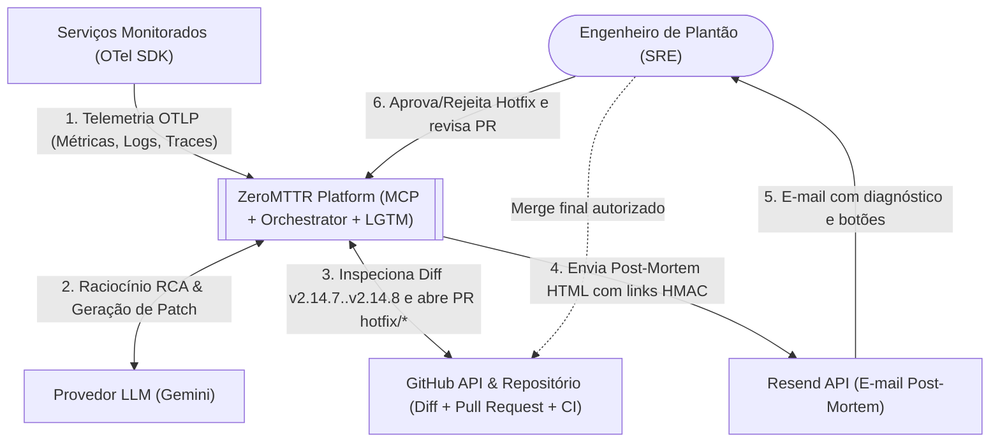
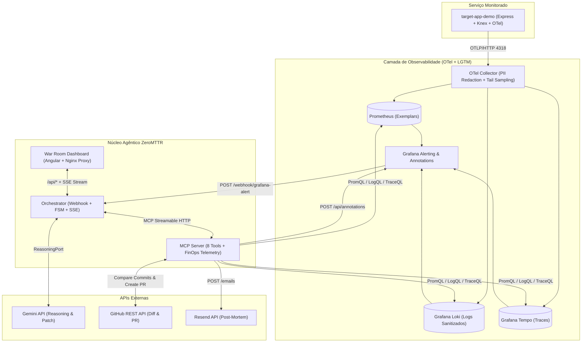
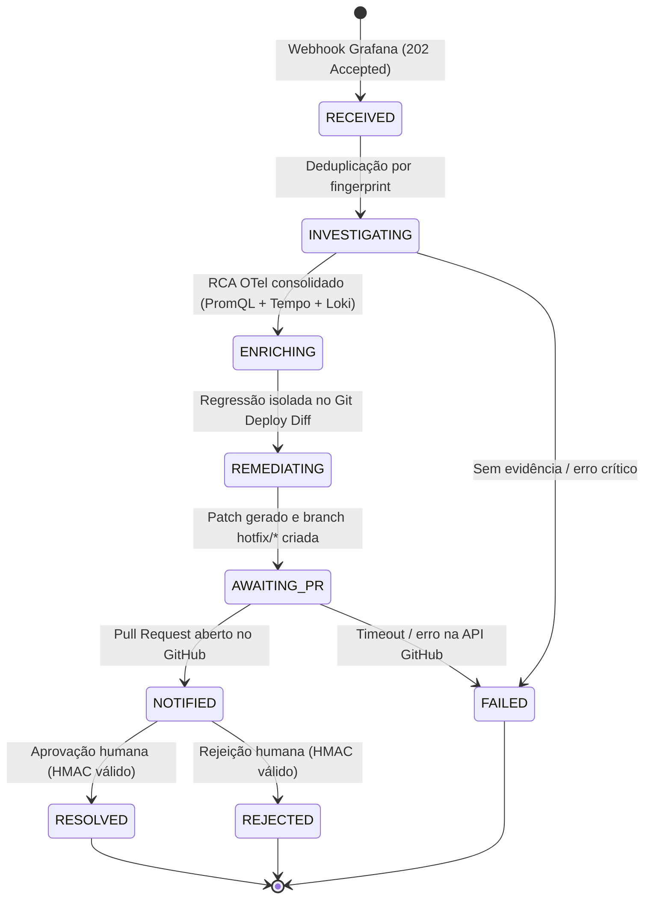
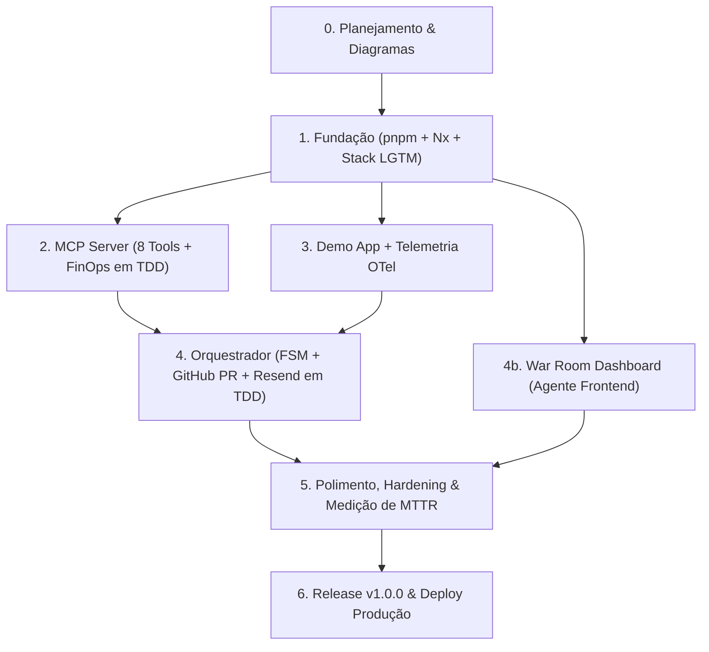

# ⚡ ZeroMTTR — Documento Mestre de Arquitetura e Plano de Projeto

| Campo | Valor |
| :--- | :--- |
| **Projeto** | ZeroMTTR — Autonomous AIOps & Incident Remediation |
| **Organização** | **AGJ Works** (`https://agjworks.com`) |
| **Ambiente de Produção (Demo)** | `https://zeromttr.agjworks.com` (VPS Linux + Traefik + Cloudflare) |
| **Repositório** | `https://github.com/AdmilsonGoncalves/zeromttr` |
| **Status** | Planejamento (v0.2 — Arquitetura Autônoma OTel/LGTM + MCP + GitHub Remediation + Resend). Os critérios de aceite dos documentos `tech/` são atualizados conforme as fases avançam |
| **Diagramas do Sistema (UML / Rede)** | [`docs/pt-BR/01_system_diagrams.md`](./01_system_diagrams.md) (Casos de Uso, Sequência E2E, Classes Hexagonais e Topologia de Rede) |
| **Documentos técnicos** | Fatias de implementação em [`docs/pt-BR/tech/`](./tech/) (ver §12) |

---

## 1. Introdução

Em ambientes de microsserviços, o tempo entre o sintoma (alerta) e a correção em produção é dominado por trabalho manual e fragmentado: ferramentas de observabilidade param no alerta textual, enquanto assistentes de código não enxergam a telemetria de produção. O **ZeroMTTR** conecta esses dois mundos e automatiza o ciclo de ponta a ponta em segundos:

> **Alerta (Grafana) → RCA determinístico (OTel/LGTM via MCP) → Correlação de Regressão no Deploy (GitHub Diff API via MCP) → Patch cirúrgico e Pull Request validado por CI (GitHub API + LLM) → Post-mortem e aprovação humana (Resend + War Room).**

## 2. Objetivo

### 2.1 Objetivo geral
Entregar uma plataforma funcional, demonstrável ao vivo e de código aberto, que reduza drasticamente o MTTD e o MTTR de incidentes em microsserviços via agente autônomo fundamentado no **Model Context Protocol (MCP)**, **OpenTelemetry** e governança com humano no circuito.

### 2.2 Objetivos mensuráveis (KPIs operacionais)
| KPI | Meta |
| :--- | :--- |
| Tempo do alerta até RCA determinístico + correlação de deploy | ≤ 15 s |
| Tempo do alerta até Pull Request de hotfix aberto no GitHub | ≤ 30 s |
| Tempo do alerta até e-mail de post-mortem entregue | ≤ 45 s |
| Comparativo MTTR manual vs. ZeroMTTR | Referência para triagem manual: MTTD de 15 a 20 min e MTTR de 45 a 60 min (redução > 95%) |
| Cobertura de testes (módulos de domínio e aplicação) | ≥ 80 % |

### 2.3 Diferenciais de Engenharia (Resiliência, FinOps e Governança)
O projeto incorpora **5 pilares de Engenharia de Resiliência, FinOps e Governança**:
1. **Modo Live Ultrarrápido (< 25s) & Modo Replay Determinístico (`⚡ Live API Mode | 🎬 Accelerated Replay 25s`):** executa o ciclo real completo em ~20 segundos (sem depender de sessões externas lentas) e grava o stream de eventos em cache JSON, permitindo também reproduzir a execução gravada sob demanda sem consumir cota de APIs.
2. **Prova Visual "Antes vs. Depois" de Redação de PII (LGPD Edge Compliance):** exibe lado a lado no War Room o payload bruto emitido na borda (`CPF 123.456.789-00` + JWT) e o log pós-OTel Collector entregue ao MCP (`CPF ****`), comprovando zero vazamento de PII para LLMs externos.
3. **Telemetria FinOps / Token Economy no MCP:** cada tool calcula `raw_bytes_fetched` vs. `compacted_bytes_sent_to_llm`, exibindo no topo do dashboard a compressão de contexto em tempo real (ex.: `💰 Context Compression: 94.2% — Saved ~48k tokens`).
4. **Auto-Injeção de Anotação no Grafana (`POST /api/annotations`):** registra automaticamente uma linha vertical tracejada (`aiops-remediation`) sobre o gráfico de latência no segundo exato em que o agente isola o RCA e abre o PR de remediação.
5. **RCA Confidence Score Determinístico (`p-knob` 95%) & Blast Radius:** calcula a confiança por convergência de evidências (+25% PromQL, +25% Exemplar `trace_id`, +25% Span com erro no Tempo, +20% Log no Loki + regressão isolada no diff do deploy `v2.14.7...v2.14.8` no GitHub) e lista os serviços impactados em cascata (`services_involved`).

### 2.4 Fora de escopo (MVP)
Multi-tenant, alta disponibilidade multi-nó, autenticação de usuários finais, armazenamento durável de longo prazo (Tempo/Loki/Prometheus em disco local), dashboard com múltiplos perfis de usuário (o dashboard operacional faz parte do MVP, ver Fase 4b).

## 3. Escopo e Stakeholders

| Stakeholder | Interesse |
| :--- | :--- |
| Engenheiro de plantão (SRE) | Receber RCA correlacionado ao commit causador e PR pronto; aprovar ou rejeitar com 1 clique |
| Equipe de Engenharia / Plataforma | Manter arquitetura desacoplada, testável e com custo previsível de LLM |
| Gestores técnicos / Auditoria | Acompanhar redução de MTTD/MTTR, governança humana e conformidade LGPD |

## 4. Tecnologias Envolvidas

| Camada | Tecnologia | Papel |
| :--- | :--- | :--- |
| Runtime & Monorepo | **Node.js 24 LTS**, **pnpm** (`pnpm-workspace.yaml`), **Nx** (`nx.json`), TypeScript (`strict`, `ES2024`, `NodeNext`) | Orquestração de tarefas, cache de build/testes e workspaces em `apps/*` |
| Instrumentação | OpenTelemetry SDK (Node) | Emissão de traces, métricas (com exemplars) e logs |
| Ingestão | OTel Collector Contrib 0.114+ | `memory_limiter`, `redaction` (LGPD PII), `tail_sampling` |
| Armazenamento | Prometheus (exemplars), Loki, Tempo | Stack LGTM |
| Visualização/Gatilho | Grafana 11.2+ (Alerting) | Webhook de incidente e API de anotações |
| Protocolo de agente | **MCP** (`@modelcontextprotocol/sdk`) | Interface padronizada de 8 tools de AIOps |
| LLM do agente | Gemini via API (`ReasoningPort`) | Síntese de RCA e geração de patch cirúrgico |
| **Inspeção de Deploy & Auto-Remediação** | **GitHub REST API (Octokit)** | Inspeção de diff entre releases (`v2.14.7...v2.14.8`), leitura do arquivo afetado, criação de branch `hotfix/zeromttr-*` e abertura automática de Pull Request |
| **Notificação e governança** | **Resend** | Post-mortem em HTML (`sre@zeromttr.agjworks.com`) e aprovação humana via HMAC |
| Testes | Vitest, Supertest, Testcontainers (opcional), `nock`/MSW | TDD |
| Qualidade | ESLint, Prettier, Husky + lint-staged, Commitlint | Padrões e fronteiras arquiteturais |
| Infra | Docker, Docker Compose | Execução local e em produção reprodutível |
| CI | GitHub Actions | Lint, testes, build, scan e verificação automática de PRs de hotfix |
| Demo app | Express + Knex + PostgreSQL | Serviço-alvo (`api-pagamentos-core`) com falha reproduzível |
| Frontend | **Angular (última versão estável)**, **PrimeNG (preset Aura Dark)**, Tailwind CSS v4 + `tailwindcss-primeui` | War Room Dashboard (Single-Pane, 4 quadrantes): simular falha, `p-timeline` ao vivo, evidências OTel/Git Diff e PR/Resend |

## 5. Tipo de Arquitetura

### 5.1 Estilo escolhido
| Aspecto | Decisão |
| :--- | :--- |
| Estilo macro | **Event-driven + agentic** (webhook dispara o fluxo) |
| Estilo interno | **Hexagonal (Ports & Adapters) / Clean Architecture** no orquestrador e no MCP |
| Comportamento | **Máquina de estados finitos (FSM)** do incidente |
| Integração | **MCP sobre HTTP** (Streamable HTTP; SSE como fallback) |
| Implantação | Local via `docker-compose.yml` · Produção em **VPS Linux** via `docker-compose.prod.yml` + **Traefik + Cloudflare**, puxando imagens do GHCR e lendo chaves de arquivo `.env` externo ao repositório (ex.: `/path/to/secrets/.env`) |

### 5.2 Padrões por componente
| Componente | Padrão | Organização |
| :--- | :--- | :--- |
| `apps/orchestrator/` e `apps/mcp-server/` | **Hexagonal (Ports & Adapters)** | `domain` → `application` → `ports` → `adapters`, com composition root em `main.ts` |
| `apps/target-app-demo/` | **MVC em camadas** | `routes` → `controllers` → `services` → `repositories` |
| `apps/dashboard/` | **Single-Pane War Room com Signals** (Angular + PrimeNG Aura Dark) | Standalone Components (`WarRoomComponent` em 4 quadrantes + `DecisionComponent`), desenvolvido por agente dedicado contra contrato e mock server |

### 5.3 Visão de contexto (C4 nível 1)


### 5.4 Visão de contêineres (C4 nível 2)


### 5.5 FSM do incidente


> [!NOTE]
> Para a modelagem detalhada **comportamental** (Diagrama de Casos de Uso e Diagrama de Sequência Ponta a Ponta com MCP, GitHub API, SSE e HMAC) e **estática** (Diagramas de Classes Hexagonais de `apps/orchestrator` e `apps/mcp-server` e Topologia de Isolamento de Rede na VPS), consulte [`01_system_diagrams.md`](./01_system_diagrams.md).

### 5.6 Decisões arquiteturais (ADRs resumidos)
| ID | Decisão | Motivo | Alternativa |
| :--- | :--- | :--- | :--- |
| ADR-001 | Monorepo **pnpm + Nx** (package-based) em `apps/*` | Um repo público, cache de tarefas com Nx, `pnpm --filter` enxuto e um `docker compose up` | Multi-repo ou npm puro |
| ADR-002 | Hexagonal no orquestrador/MCP | Domínio isolado de HTTP e APIs externas; adapters reais ou falsos conforme o contexto | Camadas tradicionais |
| ADR-003 | MCP como contrato de ferramentas | Padrão aberto, reutilizável por qualquer cliente MCP | REST ad hoc |
| ADR-004 | LLM por porta (`ReasoningPort`) | Evitar acoplamento; permitir fake determinístico em testes | SDK direto |
| ADR-005 | Truncamento defensivo e FinOps no MCP | Controle estrito de tokens e medição de economia em tempo real | Sem limites |
| ADR-006 | Humano no circuito antes do merge (HMAC) | Governança e segurança operacional | Merge automático |
| ADR-007 | Persistência de incidentes em memória + arquivo JSON (MVP) | Simplicidade operacional no MVP | Postgres |
| ADR-008 | As 8 tools e seus adapters HTTP vivem no `apps/mcp-server`; `apps/orchestrator` consome via `ToolsPort` | Zero duplicação de adapters; servidor MCP 100% autônomo | Pacote extra ou adapters duplicados |
| ADR-009 | Inspeção de regressão e abertura de PR via **GitHub REST API (Octokit) + Gemini** sobre o próprio monorepo (`apps/target-app-demo/`) | Execução determinística em < 10 s, custo zero e disparo imediato do workflow `hotfix-verify.yml` | Agentes SaaS externos de longa duração |

## 6. Princípios e Regras de Desenvolvimento

### 6.1 TDD (obrigatório no domínio)
Ciclo **Red → Green → Refactor** para domínio, casos de uso e adapters.
- Todo caso de uso nasce de um teste que falha, versionado antes da implementação.
- Adapters externos (GitHub API, Resend, Prometheus, Loki, Tempo, Grafana) são testados com *contract tests* e mocks HTTP (`nock`/MSW). **Nunca chamam a API real em CI.**
- Pirâmide: ~70 % unitários, ~20 % integração (Compose efêmero), ~10 % E2E (cenário de simulação).
- Meta de cobertura: ≥ 80 % em `domain/` e `application/`.

### 6.2 SOLID aplicado
| Princípio | Aplicação concreta |
| :--- | :--- |
| **S** | Um arquivo por tool; um caso de uso por classe |
| **O** | Novos adapters (outro LLM, outro provedor Git, outro canal de notificação) sem alterar o domínio |
| **L** | Qualquer implementação de port é substituível por fake |
| **I** | Ports pequenos: `MetricsPort`, `LogsPort`, `TracesPort`, `RepoInspectorPort`, `RemediationPort`, `NotifierPort`, `AnnotationPort` |
| **D** | Casos de uso dependem de ports; composição em `main.ts` (composition root) |

### 6.3 Outras regras
- **Clean Code / DRY / YAGNI / KISS**; funções pequenas, sem `any` fora de fronteiras (usar `zod` para validar entradas externas).
- **Idioma:** código, tools, logs e commits em en-US; README em en-US e pt-BR.
- **Commits:** Conventional Commits; branches `feat/*`, `fix/*`, `docs/*`; PRs pequenos com checklist de DoD.
- **Segurança por padrão:** segredos só em `.env` (nunca commitados), bearer token no MCP, escape de HTML nos e-mails, redaction de PII na borda, menor privilégio nos tokens.
- **Observabilidade do próprio ZeroMTTR:** logs estruturados (`pino`) com `incident_id` e `trace_id`.
- **Resiliência:** timeouts, retry com backoff e idempotência em chamadas à API do GitHub e ao Resend.

## 7. Estrutura de Pastas (Monorepo pnpm + Nx)

```text
zeromttr/
├── package.json                  # Scripts raiz delegando ao Nx (check:workspace, lint:workspace, test:workspace, build:workspace)
├── pnpm-workspace.yaml           # packages: ['apps/*']
├── nx.json                       # Task pipeline, cache e affected (Nx package-based)
├── tsconfig.base.json            # Strict TS config compartilhado
├── .nvmrc                        # Node 24
├── .dockerignore                 # Mantém contexto de build Docker < 2 MB
├── README.md                     # en-US
├── README.pt-BR.md
├── AGENTS.md                     # contexto para agentes de IA
├── LICENSE                       # MIT
├── docker-compose.yml            # Ambiente local de desenvolvimento
├── docker-compose.prod.yml       # VPS Linux (Traefik + limites de RAM + env_file externo, zero ports abertas)
├── .github/workflows/
│   ├── ci.yml                    # Lint, typecheck, Gitleaks, Vitest (≥80%), Compose smoke (via pnpm + Nx)
│   ├── hotfix-verify.yml         # Gate automático nos PRs abertos pelo ZeroMTTR (hotfix/zeromttr-*)
│   └── cd-release.yml            # Push de imagens para GHCR (ghcr.io) + GitHub Release em tags v*
├── .env.example                  # Template local (dev)
├── .env.prod.template            # Template de produção na VPS (ex.: /path/to/secrets/.env)
├── infra/
│   ├── otel-collector-config.yaml
│   ├── otel-collector-config.prod.yaml
│   ├── prometheus.yml
│   ├── tempo-config.yaml
│   ├── loki-config.yaml
│   └── grafana/provisioning/
│       ├── datasources/datasources.yaml
│       └── alerting/{rules.yaml,contact-points.yaml,policies.yaml}
├── apps/
│   ├── mcp-server/               # Hexagonal (8 tools + FinOps telemetry + adapters LGTM/GitHub/Resend)
│   │   ├── src/
│   │   │   ├── domain/           # tipos, regras de sumarização/truncamento, FinOps
│   │   │   ├── application/      # casos de uso (uma tool = um caso de uso)
│   │   │   ├── ports/            # MetricsPort, LogsPort, TracesPort, RepoInspectorPort, RemediationPort, NotifierPort, AnnotationPort
│   │   │   ├── adapters/         # prometheus, loki, tempo, github-inspector, github-remediation, resend, grafana-annotations (HTTP)
│   │   │   ├── transport/        # servidor MCP + auth
│   │   │   ├── config/
│   │   │   └── main.ts           # composition root
│   │   └── test/{unit,integration,contract}/
│   ├── orchestrator/             # Hexagonal + FSM
│   │   ├── src/
│   │   │   ├── domain/           # Incident, IncidentState (FSM), RcaReport, ConfidenceScore, DecisionHmac
│   │   │   ├── application/      # HandleAlert, Investigate, EnrichWithDeployDiff, DispatchRemediation, Notify, RecordDecision
│   │   │   ├── ports/            # ReasoningPort, ToolsPort (MCP client), IncidentRepo, TargetStatusPort, Clock
│   │   │   ├── adapters/         # llm.gemini, mcp.client, repo.file, target-status.http
│   │   │   ├── http/             # webhook Grafana, API REST (/api/*), decisões HMAC, SSE (/api/events)
│   │   │   └── main.ts
│   │   └── test/
│   ├── target-app-demo/          # MVC em camadas (api-pagamentos-core)
│   │   ├── src/{routes,controllers,services,repositories,models,telemetry,chaos}/
│   │   └── test/
│   └── dashboard/                # Angular + PrimeNG (Aura Dark) War Room, Fase 4b
├── scripts/                      # demo.sh, chaos.sh, reset.sh, measure-mttr.sh, smoke-integrations.sh
└── docs/
    ├── pt-BR/
    │   ├── 00_architecture_master.md
    │   ├── 01_system_diagrams.md # Casos de Uso, Sequência E2E, Classes Hexagonais e Topologia de Rede
    │   ├── tech/                 # documentos de implementação por fatia
    │   └── adr/
    └── en-US/                    # tradução, após consolidar a versão pt-BR
```

> [!IMPORTANT]
> Este plano separa responsabilidades em `apps/mcp-server/` e `apps/orchestrator/` dentro de um workspace **pnpm + Nx** para cumprir SRP e manter a raiz do monorepo limpa. A estrutura acima é a referência para todos os documentos `tech/`.

## 8. Fases do Projeto e Entregas

| Fase | Objetivo | Entregáveis | Critério de aceite (DoD da fase) |
| :--- | :--- | :--- | :--- |
| **0 — Planejamento** | Arquitetura, especificações técnicas, ADRs e credenciais de API | Este documento, `01_system_diagrams.md`, `tech/*`, chaves configuradas | Especificações revisadas; chaves validadas |
| **1 — Fundação** | Monorepo (`pnpm` + `Nx`), CI, stack LGTM | `pnpm-workspace.yaml`, `nx.json`, `docker-compose`, `infra/`, CI verde, README inicial | `docker compose up` saudável; CI roda `check:workspace` |
| **2 — MCP Server (TDD)** | 8 tools com ports/adapters e FinOps | `apps/mcp-server/` com testes e auth | Cobertura ≥ 80 %; 8 tools respondem via cliente MCP |
| **3 — Demo app + telemetria** | Serviço-alvo com falha induzida | `apps/target-app-demo/`, `chaos.sh`, alerta provisionado | Falha dispara alerta no Grafana com `trace_id` correlacionado |
| **4 — Orquestrador (TDD)** | Webhook, FSM, agente, GitHub PR, Resend | `apps/orchestrator/`, callbacks de aprovação | E2E: alerta → diff → PR → e-mail em < 30 s |
| **4b — Dashboard (agente de frontend, em paralelo à Fase 4)** | War Room Dashboard em tela única (4 quadrantes) | `apps/dashboard/` com `WarRoomComponent` (`p-timeline`, `p-tabs`, `p-tree`, GitHub PR/Resend cards) + `DecisionComponent`; mock server; contêiner nginx | Golden path completo na tela com o mock e, depois, com o orquestrador real |
| **5 — Polimento e Hardening** | Hardening, métricas de MTTR, integração final dashboard + orquestrador | `measure-mttr.sh`, testes E2E | MTTR medido e documentado |
| **6 — Release e Documentação** | Documentação final, deploy em produção e release | README en/pt-BR, demonstração gravada, LICENSE, release `v1.0.0` | Checklist de entrega 100 % (ver `tech/07`) |



## 9. Requisitos Não Funcionais

| Atributo | Requisito |
| :--- | :--- |
| Desempenho | RCA ≤ 15 s; abertura de PR ≤ 30 s; respostas de tool ≤ 5 s (p95) |
| Custo de tokens | ≤ 500 chars/linha de log, ≤ 100 linhas, ≤ 1500 chars/diff do GitHub, ≤ 5 séries PromQL |
| Segurança | Auth no MCP e callbacks; PII redigida na borda; segredos fora do Git; HTML escapado; HMAC nas decisões |
| Confiabilidade | Timeouts; retry com backoff; idempotência por `incident_id`; dedup de alertas por fingerprint |
| Portabilidade | `docker compose up` em Linux/macOS |
| Manutenibilidade | Ports/adapters; lint com fronteira hexagonal e formatação automáticos |
| Observabilidade | Logs JSON com `incident_id`/`trace_id`; `/health` |
| Licenciamento | MIT |

## 10. Estratégia de Qualidade e CI/CD (GitHub Actions)

- **Pre-commit e Pre-push local:** ESLint (com `no-restricted-imports` garantindo fronteira hexagonal e `no-floating-promises`), Prettier, typecheck e testes (Husky + `lint-staged` no `pre-commit` e `pnpm run check:workspace` no `pre-push`).
- **Pipeline de CI/CD em 3 Workflows no GitHub Actions (`.github/workflows/`):**
  1. **`ci.yml` (Integração Contínua em Push e PRs):**
     - **Quality & Security Gate:** ESLint, Prettier, `tsc --noEmit` (`pnpm nx run-many --targets=lint,typecheck --all`), varredura de segredos (`gitleaks-action`) e `pnpm audit --prod`.
     - **Unit & Contract Tests + Coverage Gate:** Vitest com cobertura ≥ 80 % em `domain/` + `application/` (`apps/mcp-server`, `apps/orchestrator`, `apps/target-app-demo`) e testes do `apps/dashboard` (Angular).
     - **Docker & Compose Smoke Test:** valida `docker compose config`, executa build das imagens com cache (`type=gha`) e verifica `/health` dos serviços.
  2. **`hotfix-verify.yml` (Validação Automática dos PRs Autônomos):**
     - Dispara automaticamente em Pull Requests com branch `hotfix/zeromttr-*` abertos pelo **ZeroMTTR**.
     - Executa a suíte de testes unitários e de regressão do `apps/target-app-demo` e publica um comentário automático de certificação no PR (`✅ ZeroMTTR Autonomous CI Gate: PASSED`), fechando o ciclo entre o agente de código e a governança humana.
  3. **`cd-release.yml` (Entrega Contínua — GHCR & Releases):**
     - Em push na `main`/`master` ou tags `v*`, publica automaticamente as imagens Docker (`mcp-server`, `orchestrator`, `target-app-demo`, `dashboard`) no **GitHub Container Registry (`ghcr.io/admilsongoncalves/zeromttr/*`)** usando o próprio `GITHUB_TOKEN`.
     - Em tags `v*`, cria a GitHub Release oficial com notas geradas automaticamente.
- **Definition of Done (por PR):** testes escritos primeiro; workflows de CI verdes; sem segredos; docs atualizadas; auto-revisão pelo checklist.

## 11. Riscos Técnicos e Mitigações

| # | Risco | Prob. | Impacto | Mitigação |
| :--- | :--- | :--- | :--- | :--- |
| R1 | Falha ou rate-limit na API do LLM ou GitHub durante o fluxo | Baixa | Alto | Fallback determinístico para RCA e patch; timeout configurável; estado `FAILED` explícito com notificação ao plantonista |
| R2 | Conflito de branch caso o mesmo incidente tente abrir PR duas vezes | Baixa | Médio | Chave de idempotência derivada de `incident_id` (`hotfix/zeromttr-<incident_id>`); reutiliza PR existente se já aberto |
| R3 | Dashboard consumir tempo do caminho crítico | Baixa | Médio | Projeto limpo (`ng new`) com PrimeNG Aura Dark, tela única de 4 quadrantes e agente dedicado com mock server |
| R4 | Redaction não cobre logs | Média | Alto | Teste de integração com PII sintética; fallback com `transform` ou no app |
| R5 | Consumo excessivo de cota de API na VPS pública | Média | Médio | Modo `replay` como padrão para visitantes anônimos; `LIVE_DEMO_KEY` + cooldown global de 2 min; deduplicação de alertas |
| R6 | MCP exposto sem autenticação | Baixa | Alto | Bearer token obrigatório desde a Fase 2 e isolamento na rede interna `aiops-net` |

## 12. Mapa dos Documentos Técnicos (fatias para agentes de IA)

Cada documento é **autocontido**, indica a fonte de código de apoio e termina com tarefas e critérios de aceite verificáveis. Ordem de execução recomendada:

| # | Documento | Fase | Depende de |
| :--- | :--- | :--- | :--- |
| 01 | [tech/01_foundation_and_infrastructure.md](./tech/01_foundation_and_infrastructure.md) | 1 | — |
| 02 | [tech/02_mcp_server.md](./tech/02_mcp_server.md) | 2 | 01 |
| 03 | [tech/03_target_app_demo.md](./tech/03_target_app_demo.md) | 3 | 01 |
| 04 | [tech/04_partner_integrations.md](./tech/04_partner_integrations.md) | 2 e 4 | 02 |
| 05 | [tech/05_orchestrator.md](./tech/05_orchestrator.md) | 4 | 02, 03, 04 |
| 06 | [tech/06_testing_and_quality.md](./tech/06_testing_and_quality.md) | todas | — |
| 07 | [tech/07_demo_and_delivery.md](./tech/07_demo_and_delivery.md) | 5–6 | 05, 08 |
| 08 | [tech/08_dashboard_frontend.md](./tech/08_dashboard_frontend.md) | 4b | contrato da §4 (mock) ; integra com 05 |

> [!TIP]
> Prompt padrão para agentes: *"Leia `AGENTS.md`, `docs/pt-BR/00_architecture_master.md` e `docs/pt-BR/tech/NN_*.md`. Implemente somente esse documento, em TDD, e pare quando todos os critérios de aceite estiverem verdes."*

## 13. Glossário
- **ADR:** *Architecture Decision Record* (registro de decisão arquitetural)
- **AIOps:** *Artificial Intelligence for IT Operations* (inteligência artificial para operações de TI)
- **CI/CD:** *Continuous Integration / Continuous Delivery* (integração contínua e entrega contínua)
- **CPF:** *Cadastro de Pessoas Físicas* (*Brazilian Individual Taxpayer Registry* — identificador fiscal pessoal no Brasil)
- **CVE:** *Common Vulnerabilities and Exposures* (catálogo de vulnerabilidades e exposições de segurança conhecidas)
- **DoD:** *Definition of Done* (definição de pronto)
- **DRY:** *Don't Repeat Yourself* (princípio de não duplicação de conhecimento/código)
- **E2E:** *End-to-End* (teste ou fluxo de ponta a ponta)
- **FinOps:** *Financial Operations* (gestão financeira operacional de nuvem, infraestrutura e consumo de tokens de IA)
- **FSM:** *Finite State Machine* (máquina de estados finitos)
- **GHCR:** *GitHub Container Registry* (registro de imagens de contêineres do GitHub)
- **HMAC:** *Hash-based Message Authentication Code* (código de autenticação de mensagem baseado em hash criptográfico)
- **JWT:** *JSON Web Token* (padrão de token de autenticação assinado em JSON)
- **KISS:** *Keep It Simple, Stupid* (princípio de manter o design o mais simples possível)
- **KPI:** *Key Performance Indicator* (indicador-chave de desempenho)
- **LGPD:** *Lei Geral de Proteção de Dados* (*Brazilian General Data Protection Law* — legislação brasileira de privacidade de dados)
- **LGTM:** *Loki, Grafana, Tempo, Metrics / Mimir* (pilha de observabilidade de logs, visualização, traces e métricas)
- **LLM:** *Large Language Model* (grande modelo de linguagem)
- **LogQL:** *Log Query Language* (linguagem de consulta de logs do Grafana Loki)
- **MCP:** *Model Context Protocol* (protocolo aberto de contexto de modelo para integração de ferramentas com agentes de IA)
- **MTTD:** *Mean Time to Detect* (tempo médio de detecção de um incidente)
- **MTTR:** *Mean Time to Resolve / Recovery* (tempo médio de resolução ou recuperação de um incidente)
- **MVC:** *Model-View-Controller* (padrão arquitetural em camadas de modelo, visualização e controlador)
- **MVP:** *Minimum Viable Product* (produto mínimo viável)
- **OTel:** *OpenTelemetry* (framework e padrão aberto de instrumentação e telemetria)
- **OTLP:** *OpenTelemetry Protocol* (protocolo nativo de transporte de dados do OpenTelemetry)
- **PAT:** *Personal Access Token* (token de acesso pessoal para autenticação na API do GitHub)
- **PII:** *Personally Identifiable Information* (informação pessoalmente identificável / dados pessoais sensíveis)
- **PR:** *Pull Request* (solicitação de revisão e mesclagem de alterações de código)
- **PromQL:** *Prometheus Query Language* (linguagem de consulta de séries temporais do Prometheus)
- **RCA:** *Root Cause Analysis* (análise de causa raiz de um incidente)
- **SOLID:** *Single Responsibility, Open-Closed, Liskov Substitution, Interface Segregation, Dependency Inversion* (cinco princípios de design de código limpo e desacoplado)
- **SPA:** *Single-Page Application* (aplicação web de página única)
- **SRE:** *Site Reliability Engineering / Engineer* (engenharia ou engenheiro de confiabilidade de sistemas)
- **SRP:** *Single Responsibility Principle* (princípio da responsabilidade única)
- **SSE:** *Server-Sent Events* (eventos enviados pelo servidor ao navegador em tempo real via HTTP)
- **TDD:** *Test-Driven Development* (desenvolvimento orientado a testes)
- **TraceQL:** *Trace Query Language* (linguagem de consulta de traces distribuídos do Grafana Tempo)
- **TTL:** *Time to Live* (tempo de vida útil de um registro em cache ou token)
- **VPS:** *Virtual Private Server* (servidor virtual privado)
- **YAGNI:** *You Aren't Gonna Need It* (princípio de não implementar funcionalidades não requisitadas no momento)
