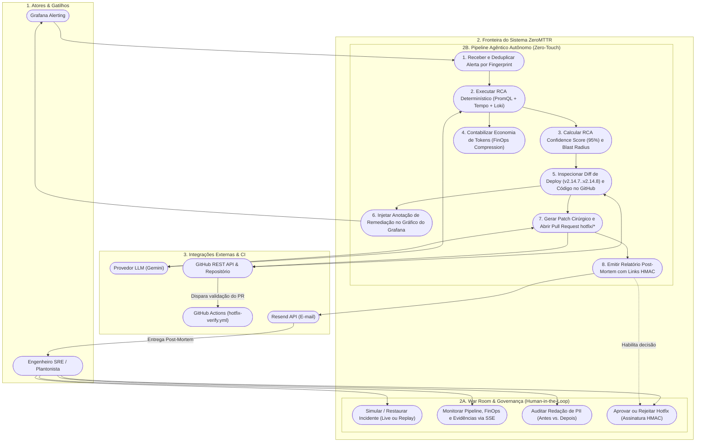
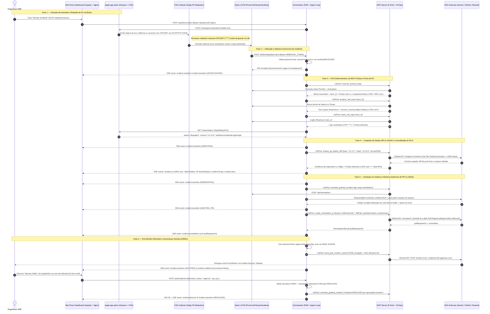
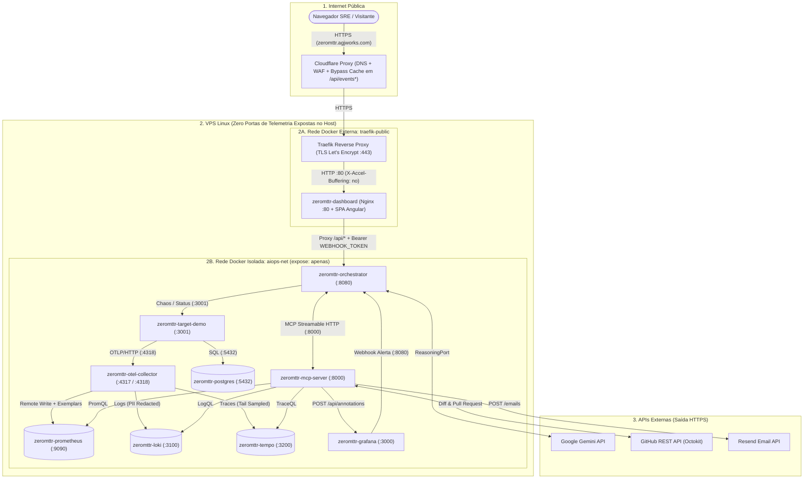

# 📐 ZeroMTTR — Diagramas Comportamentais e Estáticos do Sistema

| Campo | Valor |
| :--- | :--- |
| **Projeto** | ZeroMTTR — Autonomous AIOps & Incident Remediation |
| **Documento Mestre** | [`00_architecture_master.md`](./00_architecture_master.md) |
| **Escopo** | Modelagem comportamental (Casos de Uso e Sequência) e estrutural/estática (Classes Hexagonais e Topologia de Rede) |

---

## 1. Diagrama de Casos de Uso

Delimita visualmente os **Atores**, a **Operação Interativa / Governança Humana (Human-in-the-Loop)**, o **Pipeline Agêntico Autônomo (Zero-Touch)** e as **Integrações Externas**.

---

## 2. Diagrama de Sequência Ponta a Ponta (Fluxo Comportamental)

Representa a interação cronológica completa entre os contêineres e APIs externas, incluindo o processamento assíncrono (`202 Accepted`), a correlação dos 3 pilares OTel, a inspeção do diff do deploy via GitHub API, a abertura do PR autônomo em segundos, o streaming **SSE** e a validação **HMAC** na decisão humana.

---

## 3. Diagramas de Classes — Arquitetura Hexagonal

Como `apps/orchestrator` e `apps/mcp-server` seguem **Arquitetura Hexagonal (Ports & Adapters)** com **TDD obrigatório**, os diagramas abaixo apresentam as entidades de domínio, casos de uso, portas (interfaces) e adaptadores.

### 3.1 `apps/orchestrator` — Domínio e Ports

```mermaid
classDiagram
    direction TB

    class Incident {
        +string id
        +string fingerprint
        +string service
        +string severity
        +IncidentState state
        +string mode
        +Date startedAt
        +TransitionRecord[] transitions
        +RcaReport rca
        +FinOpsSummary finops
        +DeployDiffSource[] docs
        +RemediationInfo remediation
        +NotificationInfo notification
        +DecisionToken decisionToken
        +applyTransition(to: IncidentState, at: Date, reason?: string) void
    }

    class IncidentState {
        <<enumeration>>
        RECEIVED
        INVESTIGATING
        ENRICHING
        REMEDIATING
        AWAITING_PR
        NOTIFIED
        RESOLVED
        REJECTED
        FAILED
        +canTransitionTo(from: IncidentState, to: IncidentState)$ boolean
    }

    class RcaReport {
        +string summary
        +number confidence
        +ConfidenceBreakdown confidenceBreakdown
        +string[] blastRadius
        +number diagnosisSeconds
        +string traceId
        +string criticalSpan
        +SpanNode[] spans
        +string rawUnredactedLogSample
        +string logSample
        +string deployVersion
        +string[] mitigations
        +number grafanaAnnotationId
    }

    class DecisionHmac {
        +sign(incidentId: string, action: string, exp: number, secret: string)$ string
        +verify(incidentId: string, action: string, sig: string, exp: number, now: number, secret: string)$ boolean
    }

    class IncidentRepository {
        <<interface>>
        +findById(id: string) Promise~Incident~
        +findOpenByFingerprint(fp: string) Promise~Incident~
        +findAll() Promise~Incident[]~
        +save(incident: Incident) Promise~void~
    }

    class ToolsPort {
        <<interface>>
        +executePromqlRange(input: PromqlInput) Promise~PromqlOutput~
        +queryLokiLogs(input: LokiInput) Promise~LokiOutput~
        +analyzeOtelTrace(traceId: string) Promise~TraceAnalysisOutput~
        +searchTracesByTraceQL(input: TraceQlInput) Promise~TraceQlOutput~
        +inspectGitDeployDiff(input: GitDiffInput) Promise~GitDiffOutput~
        +createRemediationPr(input: CreatePrInput) Promise~CreatePrOutput~
        +sendPostMortemResend(input: ResendInput) Promise~ResendOutput~
        +annotateGrafanaIncident(input: AnnotationInput) Promise~AnnotationOutput~
    }

    class ReasoningPort {
        <<interface>>
        +synthesizeRcaAndPatch(evidence: CollectedEvidence) Promise~RcaAndPatchSynthesis~
    }

    class TargetStatusPort {
        <<interface>>
        +getStatus() Promise~TargetStatus~
        +triggerChaos(enable: boolean) Promise~void~
    }

    Incident *-- IncidentState
    Incident *-- RcaReport
```

### 3.2 `apps/orchestrator` — Casos de Uso e Adapters

```mermaid
classDiagram
    direction TB

    class HandleAlert {
        +execute(payload: GrafanaWebhookPayload) Promise~Incident~
    }
    class InvestigateIncident {
        +execute(incidentId: string) Promise~RcaReport~
    }
    class EnrichWithDeployDiff {
        +execute(incidentId: string) Promise~DeployDiffSource[]~
    }
    class DispatchRemediation {
        +execute(incidentId: string) Promise~RemediationInfo~
    }
    class NotifyOnCall {
        +execute(incidentId: string) Promise~NotificationInfo~
    }
    class RecordDecision {
        +execute(incidentId: string, action: string, sig: string, exp: number) Promise~Incident~
    }

    class IncidentRepository {
        <<interface>>
    }
    class ToolsPort {
        <<interface>>
    }
    class ReasoningPort {
        <<interface>>
    }
    class TargetStatusPort {
        <<interface>>
    }

    class FileIncidentRepository
    class McpClientAdapter
    class GeminiReasoningAdapter
    class HttpTargetStatusAdapter

    HandleAlert --> IncidentRepository
    InvestigateIncident --> ToolsPort
    InvestigateIncident --> TargetStatusPort
    InvestigateIncident --> IncidentRepository
    EnrichWithDeployDiff --> ToolsPort
    EnrichWithDeployDiff --> IncidentRepository
    DispatchRemediation --> ReasoningPort
    DispatchRemediation --> ToolsPort
    DispatchRemediation --> IncidentRepository
    NotifyOnCall --> ToolsPort
    NotifyOnCall --> IncidentRepository
    RecordDecision --> IncidentRepository
    RecordDecision --> ToolsPort

    FileIncidentRepository ..|> IncidentRepository
    McpClientAdapter ..|> ToolsPort
    GeminiReasoningAdapter ..|> ReasoningPort
    HttpTargetStatusAdapter ..|> TargetStatusPort
```

---

### 3.3 `apps/mcp-server` — Domínio Puro, 8 Tools, Ports e Adapters HTTP

---

## 4. Diagrama Estático de Implantação e Isolamento de Rede

Ilustra a defesa em profundidade na VPS Linux: **nenhum contêiner publica portas no host (`ports:` ausente)**; apenas o contêiner `dashboard` (Nginx) participa simultaneamente da rede externa do Traefik (`traefik-public`) e da rede interna isolada (`aiops-net`), injetando internamente o cabeçalho `Authorization: Bearer ${WEBHOOK_TOKEN}` ao fazer proxy de `/api/*` para o `orchestrator`.

